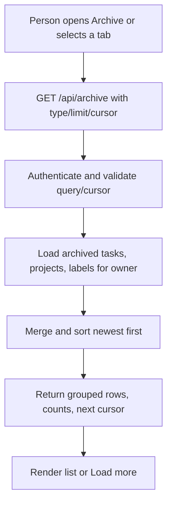

# 01. Browse the Archive

**Version:** 1.0.0  
**Created:** 2026-09-24  
**Last Updated:** 2026-11-25

## In simple terms

The Archive page brings archived tasks, projects, and labels together in one place. The person can view all item types or choose a tab, load more older entries, and see counts. Results are ordered newest first and paged with a cursor.

## Flowchart



## Data flow walkthrough

Each numbered item describes one file. Comments explain the shared list and cursor paging.

### 1. `frontend/src/app/features/archive/components/archive-page/archive-page.ts`

```ts
// Read the selected item type from the URL and load that Archive tab.
protected load(tab: ArchiveTab): void {
  this.loading.set(true);
  this.items.set([]);
  this.request = this.archive.list(tab).subscribe({
    next: (page) => {
      this.items.set(page.items);
      this.nextCursor.set(page.nextCursor);
      this.mergeCounts(tab, page.counts);
      this.loading.set(false);
    },
  });
}
```

### 2. `frontend/src/app/features/archive/services/archive.service.ts`

```ts
list(tab: ArchiveTab, cursor?: string | null, limit = ARCHIVE_PAGE_SIZE): Observable<ArchivePage> {
  // Send the requested type, page size, and optional cursor.
  let params = new HttpParams().set('type', tab).set('limit', String(limit));
  if (cursor) params = params.set('cursor', cursor);
  return this.http.get<ApiArchiveResponse>(`${this.api}/archive`, { params }).pipe(map((body) => this.toPage(body)));
}
```

### 3. `backend/src/features/archive/archive.routes.ts`

```ts
router.get(
  '/',
  requireAuth(sessionService),
  validateRequest(archiveQueryValidator, 'query', 'Invalid archive query'),
  controller.list
);
```

### 4. `backend/src/features/archive/validators/archive-query.validator.ts`

```ts
// Allow all or one item type; bound page size and decode only valid cursors.
export const archiveQueryValidator = z
  .object({
    type: z.enum(['all', 'tasks', 'projects', 'labels']).default('all'),
    limit: z.coerce.number().int().min(1).max(50).default(20),
    cursor: cursorValue.optional(),
  })
  .strict();
```

### 5. `backend/src/features/archive/archive.service.ts`

```ts
// Query only the selected kinds, concurrently; merge their rows into one newest-first page.
const [tasks, projects, labels] = await Promise.all([
  includes('tasks')
    ? this.dependencies.listArchivedTasks(userId, query.limit, query.cursor)
    : Promise.resolve(emptyTasks),
  includes('projects')
    ? this.dependencies.listArchivedProjects(userId, query.limit, query.cursor)
    : Promise.resolve(emptyProjects),
  includes('labels')
    ? this.dependencies.listArchivedLabels(userId, query.limit, query.cursor)
    : Promise.resolve(emptyLabels),
]);
```

### 6. `backend/src/features/archive/archive.controller.ts`

```ts
// Use the authenticated owner and validated paging parameters for the archive response.
const archive = await service.list(
  req.auth!.userId,
  res.locals.validated as ArchiveQuery
);
res.status(200).json(archive);
```

See [tests.md](tests.md) for cursor, group, counts, and tab coverage.
