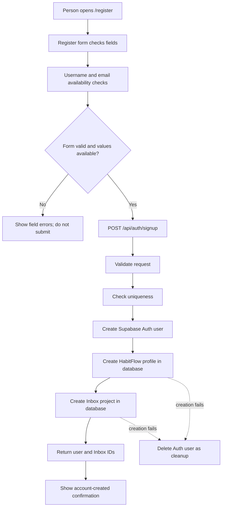

# 01. User Signup

**Version:** 1.0.0  
**Created:** 2026-09-24  
**Last Updated:** 2026-11-25

## In simple terms

A person enters a username, email, password, timezone, and password confirmation. HabitFlow checks the username and email while they type, then creates the account when the form is submitted. A successful signup also creates the user's profile and a starter Inbox project. Signup does not sign the person in; the UI offers a link to the login page.

## Flowchart



## Data flow walkthrough

Each numbered item below describes exactly one source file. The comments inside each excerpt explain that file's contribution to signup.

### 1. `frontend/src/app/app.routes.ts`

```ts
{
    path: 'register',
    // Only signed-out visitors should see the signup page.
    canActivate: [guestGuard],
    // Load the Register screen when the browser visits /register.
    loadComponent: () => import('./features/auth/register/register').then((m) => m.Register),
}
```

### 2. `frontend/src/app/features/auth/register/register.html`

```html
<!-- Bind the visible fields to the form in register.ts and call submit on submit. -->
<form [formGroup]="form" (ngSubmit)="submit()" novalidate>
  <input id="username" type="text" formControlName="username" />
  <input id="email" type="email" formControlName="email" />
  <input id="password" type="password" formControlName="password" />
  <input
    id="confirmPassword"
    type="password"
    formControlName="confirmPassword"
  />
  <select id="timezone" formControlName="timezone"></select>

  <!-- Prevent duplicate submissions while the request is in flight. -->
  <button type="submit" [disabled]="submitting()">Create account</button>
</form>
```

### 3. `frontend/src/app/features/auth/register/register.ts`

```ts
// Reject mismatched passwords before sending anything to the backend.
const passwordsMatch: ValidatorFn = (group) => {
    const password = group.get('password')?.value;
    const confirmation = group.get('confirmPassword')?.value;
    return confirmation && password !== confirmation ? { passwordMismatch: true } : null;
};

protected submit(): void {
    // Stop if another submission is running or the form is invalid.
    if (this.submitting()) return;
    if (this.form.invalid) {
        this.form.markAllAsTouched();
        return;
    }

    // Send trimmed username/email and the selected timezone to AuthService.
    const { username, email, password, confirmPassword, timezone } = this.form.getRawValue();
    this.submitting.set(true);
    this.auth.signup({
        username: username.trim(),
        email: email.trim(),
        password,
        confirmPassword,
        timezone: timezone || DEFAULT_TIMEZONE,
    }).subscribe({
        // A successful response switches the template to its account-created message.
        next: () => this.registered.set(true),
        error: (error: unknown) => this.handleSubmitError(error),
    });
}
```

### 4. `frontend/src/app/features/auth/auth.service.ts`

```ts
signup(payload: SignupRequest): Observable<SignupResponse> {
    // Send the signup form as JSON to the backend's signup endpoint.
    return this.http.post<SignupResponse>(`${this.baseUrl}/signup`, payload);
}
```

### 5. `backend/src/app.ts`

```ts
// Give auth requests the /api/auth prefix and create the auth routes.
app.use('/api/auth', createAuthRouter({ sessionService: sessions }));
```

### 6. `backend/src/features/auth/auth.routes.ts`

```ts
const registration = new RegisterService({
  // Check stored usernames/emails before creating the account.
  isUsernameAvailable,
  isEmailAvailable,
  // Supabase Auth owns the login credentials and can remove a partial account.
  createAuthUser: (input) => supabaseAdmin.createUser(input),
  deleteAuthUser: (id) => supabaseAdmin.deleteUser(id),
  // Prisma-backed functions create HabitFlow data after the Auth account exists.
  createUserProfile,
  createInboxProject,
});
```

### 7. `backend/src/features/auth/register/register.routes.ts`

```ts
router.post(
  '/signup',
  // Validate the request body before the controller receives it.
  validateRequest(signupValidator, 'body', 'Invalid signup details'),
  controller.register
);
```

### 8. `backend/src/features/auth/register/validators/signup.validator.ts`

```ts
export const signupValidator = z
  .object({
    // Reuse shared rules for username, email, password, and timezone.
    username: usernameValidator,
    email: emailValidator,
    password: passwordValidator,
    confirmPassword: z.string(),
    timezone: timezoneValidator,
  })
  // Also check the password confirmation on the server, not only in the browser.
  .refine((data) => data.password === data.confirmPassword, {
    path: ['confirmPassword'],
    message: 'Passwords do not match',
  });
```

### 9. `backend/src/shared/middleware/validate-request.middleware.ts`

```ts
const result = schema.safeParse(input);
if (!result.success) {
  // Stop here with HTTP 400 when the request does not match the signup rules.
  res.status(400).json({
    error: message,
    details: result.error.issues.map(({ path, message: detail }) => ({
      field: path.join('.'),
      message: detail,
    })),
  });
  return;
}

// Make the validated and parsed body available to the controller.
res.locals.validated = result.data;
next();
```

### 10. `backend/src/features/auth/register/register.controller.ts`

```ts
register: async (_req, res, next) => {
    try {
        // Pass only the body approved by validateRequest to the signup service.
        const result = await service.register(res.locals.validated as SignupInput);
        // Tell the frontend the account was created and return its IDs.
        res.status(201).json(result);
    } catch (error) {
        // Report uniqueness conflicts as HTTP 409; send other errors onward.
        if (error instanceof AuthConflictError) {
            res.status(409).json({ error: error.message });
            return;
        }
        next(error);
    }
},
```

### 11. `backend/src/features/auth/register/register.service.ts`

```ts
async register(input: SignupInput): Promise<SignupResult> {
    const email = normalizeEmail(input.email);

    // Check uniqueness again at submit time; the earlier browser check can go stale.
    if (!(await this.dependencies.isUsernameAvailable(input.username))) {
        throw new AuthConflictError('Username is already in use');
    }
    if (!(await this.dependencies.isEmailAvailable(email))) {
        throw new AuthConflictError('Email is already in use');
    }

    // Create the credential account before creating HabitFlow's profile and Inbox.
    const user = await this.dependencies.createAuthUser({
        email,
        password: input.password,
        username: input.username,
    });
    try {
        await this.dependencies.createUserProfile({
            userId: user.id,
            username: input.username,
            email,
            timezone: input.timezone,
        });
        const inboxProjectId = await this.dependencies.createInboxProject(user.id);
        return { userId: user.id, inboxProjectId };
    } catch (error) {
        // If profile or Inbox creation fails, remove the Auth account to avoid a partial signup.
        await this.dependencies.deleteAuthUser(user.id);
        throw error;
    }
}
```

### 12. `backend/src/features/auth/register/db/queries/create-user-profile.query.ts`

```ts
await prisma.user.create({
  // Use the Supabase Auth ID to connect HabitFlow's profile to the account.
  data: {
    id: input.userId,
    username: input.username,
    email: input.email,
    timezone: input.timezone,
  },
});
```

### 13. `backend/src/features/auth/register/db/queries/create-inbox-project.query.ts`

```ts
const project = await prisma.project.create({
  // Give every new user a default Inbox project in HabitFlow's database.
  data: { userId, name: 'Inbox', isInbox: true },
  // Return only the new project's ID to the signup service.
  select: { id: true },
});
return project.id;
```

After the controller returns `201`, step 3's success handler marks the form as registered. The signup response contains `userId` and `inboxProjectId`; it does not create or save a login session.

See [tests.md](tests.md) for signup-specific and signup-fixture test coverage.
