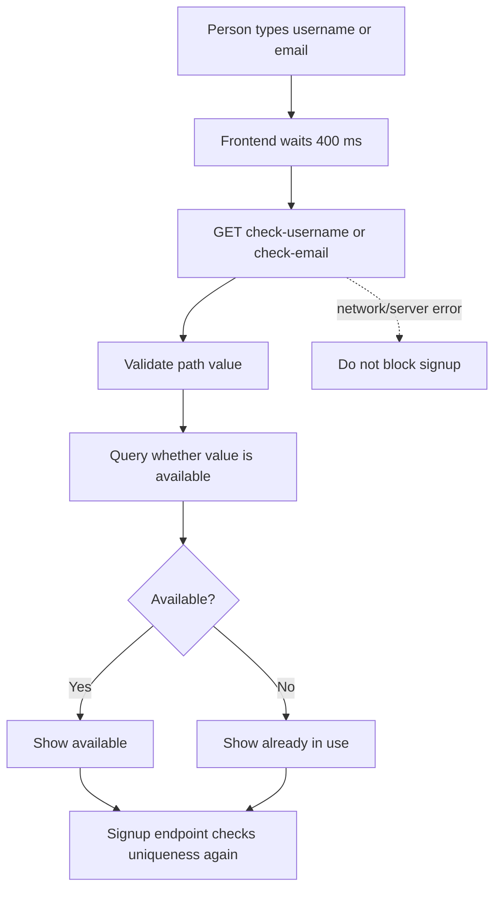

# 02. Check Signup Availability

## In simple terms

While someone is filling out signup, HabitFlow waits briefly after they stop typing and asks whether the username or email is already in use. This gives early feedback, but it is only a convenience: the final signup request checks uniqueness again because another person could claim the value in the meantime.

## Flowchart



## Data flow walkthrough

Each numbered item describes one file. Comments in the excerpts explain its part in the check.

### 1. `frontend/src/app/features/auth/register/register.ts`

```ts
// Wait briefly so a request is made after typing settles, not for every keystroke.
export const AVAILABILITY_DEBOUNCE_MS = 400;

// Reuse this async validator for username or email availability.
return timer(AVAILABILITY_DEBOUNCE_MS).pipe(
  switchMap(() => check(value)),
  map(({ available }) => {
    // Keep availability state for the form message and block a value marked taken.
    state.set(available ? 'available' : 'taken');
    return available ? null : { taken: true };
  }),
  catchError(() => {
    // A check outage is not proof the value is taken; final signup checks again.
    state.set('unknown');
    return of(null);
  })
);
```

### 2. `frontend/src/app/features/auth/auth.service.ts`

```ts
checkUsername(username: string): Observable<AvailabilityResponse> {
  // Encode the value so punctuation in a username remains one URL path value.
  return this.http.get<AvailabilityResponse>(
    `${this.baseUrl}/check-username/${encodeURIComponent(username)}`,
  );
}

checkEmail(email: string): Observable<AvailabilityResponse> {
  // The registration component lowercases email before calling this method.
  return this.http.get<AvailabilityResponse>(
    `${this.baseUrl}/check-email/${encodeURIComponent(email)}`,
  );
}
```

### 3. `backend/src/features/auth/register/register.routes.ts`

```ts
router.get(
  '/check-username/:username',
  // Reject malformed path values before querying storage.
  validateRequest(
    checkUsernameValidator,
    'params',
    'Username must be between 1 and 50 characters'
  ),
  controller.checkUsername
);
router.get(
  '/check-email/:email',
  // Validate email syntax and maximum length on the server too.
  validateRequest(
    checkEmailValidator,
    'params',
    'Email must be valid and no longer than 255 characters'
  ),
  controller.checkEmail
);
```

### 4. `backend/src/features/auth/register/validators/check-username.validator.ts`

```ts
// Apply the shared username rules to the username path parameter.
export const checkUsernameValidator = usernameValidator;
```

### 5. `backend/src/features/auth/register/validators/check-email.validator.ts`

```ts
// Apply the shared email rules to the email path parameter.
export const checkEmailValidator = emailValidator;
```

### 6. `backend/src/features/auth/register/register.controller.ts`

```ts
checkUsername: async (_req, res, next) => {
  try {
    // `res.locals.validated` was set by the route's request-validation middleware.
    const username = res.locals.validated as z.infer<typeof checkUsernameValidator>;
    // Return a simple boolean for the frontend's availability indicator.
    res.json({ available: await service.checkUsername(username) });
  } catch (error) {
    next(error);
  }
},
```

### 7. `backend/src/features/auth/register/register.service.ts`

```ts
async checkUsername(username: string): Promise<boolean> {
  // Delegate the lookup to the database query wired into this service.
  return this.dependencies.isUsernameAvailable(username);
}

async checkEmail(email: string): Promise<boolean> {
  // Normalize email before checking so letter case does not change the result.
  return this.dependencies.isEmailAvailable(normalizeEmail(email));
}
```

### 8. `backend/src/features/auth/shared/db/queries/is-username-available.query.ts`

```ts
// Ask Prisma whether the username is already present in a user profile.
export async function isUsernameAvailable(username: string): Promise<boolean> {
  // Count non-deleted matching profiles; zero means this name is available.
  return (
    (await prisma.user.count({ where: { username, deletedAt: null } })) === 0
  );
}
```

### 9. `backend/src/features/auth/shared/db/queries/is-email-available.query.ts`

```ts
// Ask Prisma whether a profile already uses the normalized email.
export async function isEmailAvailable(email: string): Promise<boolean> {
  // Count non-deleted profiles with the case-normalized email.
  return (
    (await prisma.user.count({
      where: { email: email.toLowerCase(), deletedAt: null },
    })) === 0
  );
}
```

Availability is only a preview. The final signup service repeats the uniqueness check and the database constraint handles a value claimed between the preview and submission. See [tests.md](tests.md) for coverage.
