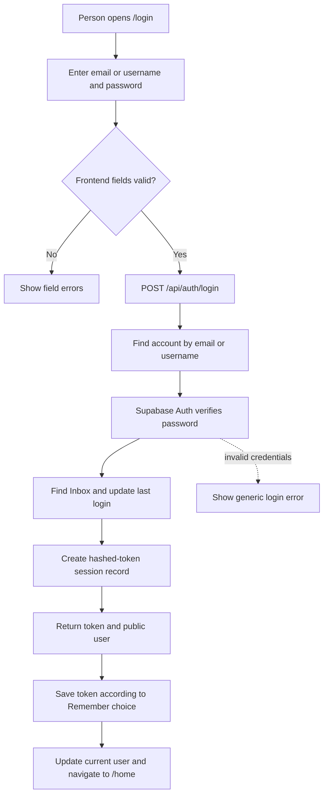

# 03. User Login

**Version:** 1.0.0  
**Created:** 2026-09-24  
**Last Updated:** 2026-11-25

## In simple terms

The person enters an email address or username and their password. If the credentials are correct, HabitFlow creates a server-side session and saves the returned session token in the browser. The “remember” choice controls whether the token lasts only for the current browser session or is kept in local storage. The person is then sent to the home page.

## Flowchart



## Data flow walkthrough

Each numbered item describes one file. Comments in the excerpts explain how it moves login forward.

### 1. `frontend/src/app/app.routes.ts`

```ts
{
  path: 'login',
  // Keep signed-in users out of the login screen.
  canActivate: [guestGuard],
  // Load the login component for /login.
  loadComponent: () => import('./features/auth/login/login').then((m) => m.Login),
}
```

### 2. `frontend/src/app/features/auth/login/login.ts`

```ts
protected submit(): void {
  // Do not submit while another request is running or when required values are missing.
  if (this.submitting()) return;
  if (this.form.invalid) {
    this.form.markAllAsTouched();
    return;
  }

  const { identifier, password, remember } = this.form.getRawValue();
  // Send email-or-username, password, and the browser's remember choice to session handling.
  this.session.login({ identifier: identifier.trim(), password }, remember).subscribe({
    // A successful login goes to the configured signed-in landing page.
    next: () => void this.router.navigateByUrl(POST_LOGIN_REDIRECT),
    // Present a generic message for credential failures.
    error: (error: unknown) => this.formError.set(mapLoginError(error).message),
  });
}
```

### 3. `frontend/src/app/features/auth/session/session.service.ts`

```ts
login(request: LoginRequest, remember: boolean): Observable<LoginResponse> {
  // Store the returned user in app state after LoginService succeeds.
  return this.loginService.login(request, remember).pipe(tap(({ user }) => this.user.set(user)));
}
```

### 4. `frontend/src/app/features/auth/login/services/login.service.ts`

```ts
login(request: LoginRequest, remember: boolean): Observable<LoginResponse> {
  return this.http
    // 401 here means wrong credentials, so the session-expiry interceptor must not redirect.
    .post<LoginResponse>(`${this.baseUrl}/login`, request, {
      context: new HttpContext().set(SKIP_SESSION_EXPIRY, true),
    })
    // Save only the returned session token, choosing local or tab storage from Remember.
    .pipe(tap(({ token }) => this.tokens.save(token, remember)));
}
```

### 5. `frontend/src/app/features/auth/session/token-storage.service.ts`

```ts
save(token: string, remember: boolean): void {
  // Remove an old token so this login has only one active browser copy.
  this.clear();
  try {
    // Remember uses localStorage; otherwise the token ends with this browser session.
    (remember ? localStorage : sessionStorage).setItem(TOKEN_STORAGE_KEY, token);
  } catch {
    // Login can still succeed, but the session cannot survive a reload.
  }
}
```

### 6. `backend/src/features/auth/login/login.routes.ts`

```ts
router.post(
  '/login',
  // Check that the identifier and password have the required shape.
  validateRequest(loginValidator, 'body', 'Invalid login details'),
  createLoginController(service)
);
```

### 7. `backend/src/features/auth/login/login.service.ts`

```ts
async login(input: LoginInput) {
  // Find the local profile from either the supplied email or username.
  const user = await this.dependencies.findUserByIdentifier(input.identifier);
  const mapped = user && toUser(user);
  if (!user || user.deletedAt || !mapped) throw new InvalidCredentialsError();

  // Supabase Auth checks the password; credential failures become one generic login error.
  try {
    await this.dependencies.verifyCredentials(mapped.email, input.password);
  } catch (error) {
    if (
      error instanceof SupabaseAuthRequestError &&
      (error.status === 400 || error.status === 401 || error.status === 422)
    ) {
      throw new InvalidCredentialsError();
    }
    throw error;
  }
  const inboxProjectId = await this.dependencies.getInboxProjectId(user.id);
  // The account needs an Inbox before login can complete.
  if (inboxProjectId === null) throw new AuthUnauthorizedError('Account is unavailable');
  await this.dependencies.updateLastLogin(user.id);
  // Issue a HabitFlow session and return the public user to the browser.
  const token = await this.dependencies.issueSession(user.id);
  return { token, user: toPublicUser(mapped, inboxProjectId) };
}
```

### 8. `backend/src/features/auth/session/session.service.ts`

```ts
async issue(userId: string): Promise<string> {
  const token = generateToken();
  // Store a hash and expiry in the database; return the raw token only to the frontend.
  await this.dependencies.createSession({
    userId,
    tokenHash: hashToken(token),
    expiresAt: new Date(this.now().getTime() + SESSION_LIFETIME_MS),
  });
  return token;
}
```

The frontend now has a token and public user, but signup remains separate from login. See [tests.md](tests.md) for login and session coverage.
