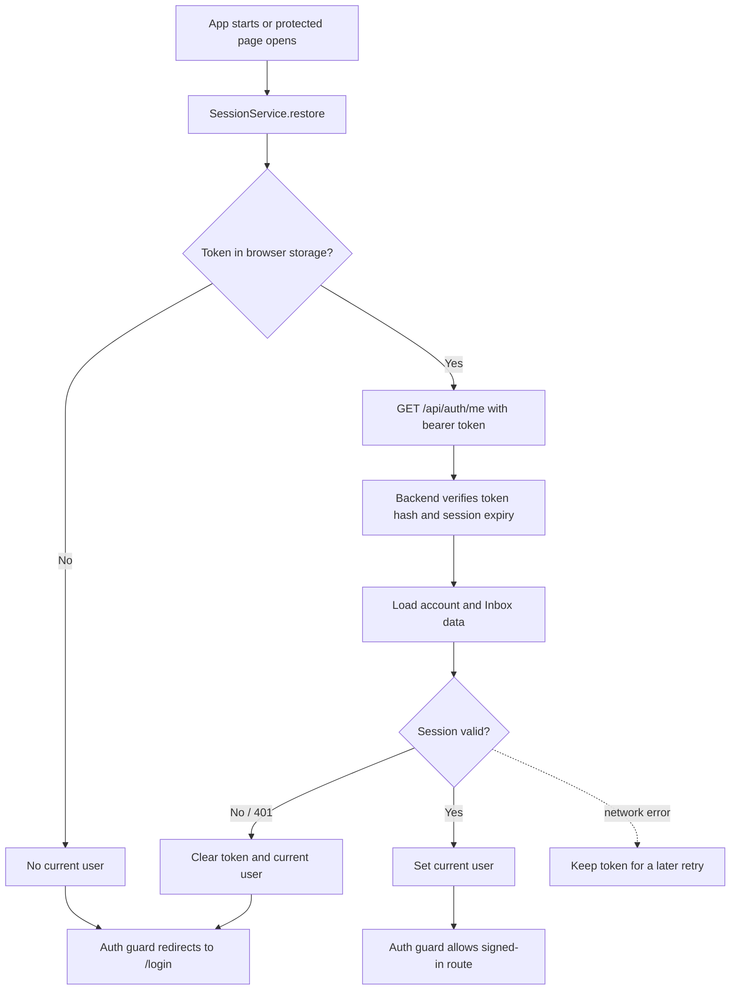

# 04. Restore a Session and Protect Pages

**Version:** 1.0.0  
**Created:** 2026-09-24  
**Last Updated:** 2026-11-25

## In simple terms

When HabitFlow starts, it looks for a saved session token. If it finds one, it asks the backend who the token belongs to before deciding which page to show. A valid session lets the person open signed-in pages; a rejected token is removed and the person is sent to login. A temporary network error does not automatically erase the saved token.

## Flowchart



## Data flow walkthrough

Each numbered item describes one file. Comments in the excerpts explain how restoration and route access work together.

### 1. `frontend/src/app/features/auth/session/auth.guards.ts`

```ts
export const authGuard: CanActivateFn = async () => {
  const session = inject(SessionService);
  const router = inject(Router);
  // Wait for the saved token check before deciding whether this page is private.
  await session.restore();
  return session.isAuthenticated() || router.createUrlTree(['/login']);
};
```

### 2. `frontend/src/app/features/auth/session/session.service.ts`

```ts
restore(): Promise<void> {
  // Reuse one restore request if multiple guards run during the same app start.
  this.restoring ??= this.loadCurrentUser();
  return this.restoring;
}

private async loadCurrentUser(): Promise<void> {
  // There is nothing to restore if this browser has no token.
  if (!this.tokens.get()) return;
  try {
    // Ask the backend for the user represented by the saved token.
    this.user.set(await firstValueFrom(this.http.get<SessionUser>(`${this.baseUrl}/me`, OWN_401_HANDLING)));
  } catch (error) {
    // A rejected token is stale; a network failure alone does not erase it.
    if (error instanceof HttpErrorResponse && error.status === 401) this.clear();
  }
}
```

### 3. `frontend/src/app/features/auth/session/token-storage.service.ts`

```ts
get(): string | null {
  try {
    // Find the token in tab storage first, then in persistent Remember storage.
    return sessionStorage.getItem(TOKEN_STORAGE_KEY) ?? localStorage.getItem(TOKEN_STORAGE_KEY);
  } catch {
    // Storage can be blocked by the browser; treat that as no readable token.
    return null;
  }
}
```

### 4. `frontend/src/app/features/auth/session/auth.interceptor.ts`

```ts
// For this app's API calls, read the saved token and attach it as a Bearer credential.
const token = inject(TokenStorageService).get();
const request = token
  ? req.clone({ setHeaders: { Authorization: `Bearer ${token}` } })
  : req;

return next(request).pipe(
  catchError((error: unknown) => {
    // Expired/revoked sessions are cleared unless this request handles its own 401.
    if (
      error instanceof HttpErrorResponse &&
      error.status === 401 &&
      !req.context.get(SKIP_SESSION_EXPIRY)
    ) {
      inject(SessionService).clear();
      void inject(Router).navigateByUrl('/login');
    }
    return throwError(() => error);
  })
);
```

### 5. `backend/src/features/auth/session/session.routes.ts`

```ts
// Require a verified session before returning the current account at /me.
router.get('/me', requireAuth(service), controller.me);
```

### 6. `backend/src/features/auth/session/middleware/require-auth.middleware.ts`

```ts
// Read the Bearer token and reject requests that do not provide one.
const token = parseBearerToken(req.header('Authorization'));
if (!token) {
  res.status(401).json({ error: 'Token invalid or expired' });
  return;
}
try {
  // Verify the session before attaching the signed-in user identity to the request.
  req.auth = await sessionService.verify(token);
  next();
} catch (error) {
  if (error instanceof AuthUnauthorizedError) {
    res.status(401).json({ error: 'Token invalid or expired' });
    return;
  }
  next(error);
}
```

### 7. `backend/src/features/auth/session/session.service.ts`

```ts
async verify(token: string): Promise<{ userId: string; expiresAt: Date }> {
  // Find the session using its hash and reject missing, expired, or revoked records.
  const session = await this.dependencies.findSessionByTokenHash(hashToken(token));
  if (!isSessionUsable(session, this.now())) throw new AuthUnauthorizedError('Token invalid or expired');

  // A valid session is not enough if its account has since been deleted.
  const user = await this.dependencies.findUserById(session.userId);
  if (!user || user.deletedAt) throw new AuthUnauthorizedError('Token invalid or expired');
  return { userId: session.userId, expiresAt: session.expiresAt };
}
```

### 8. `backend/src/features/auth/session/session.controller.ts`

```ts
me: async (req, res, next) => {
  try {
    // req.auth is populated by requireAuth after the session is verified.
    res.status(200).json(await service.getMe(req.auth!.userId));
  } catch (error) {
    // Tell the frontend the saved credential can no longer be used.
    if (error instanceof AuthUnauthorizedError) {
      res.status(401).json({ error: 'Token invalid or expired' });
      return;
    }
    next(error);
  }
},
```

The frontend stores the returned user in its session signal, which lets the guard allow private routes. See [tests.md](tests.md) for restore, guard, and interceptor coverage.
