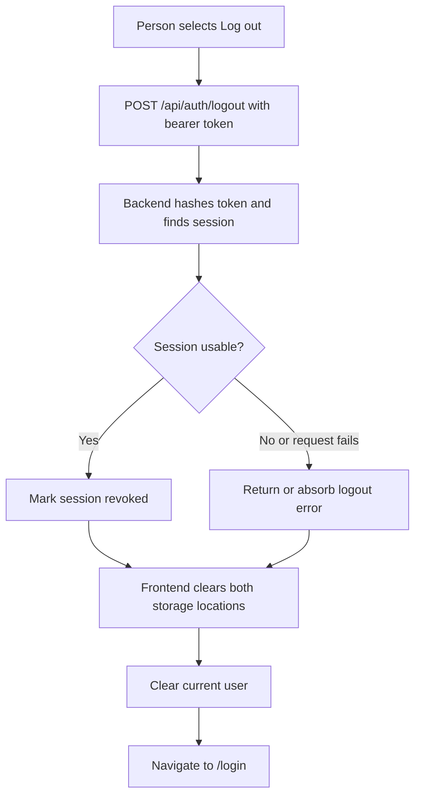

# 05. User Logout

**Version:** 1.0.0  
**Created:** 2026-09-24  
**Last Updated:** 2026-11-25

## In simple terms

When the person chooses Log out, HabitFlow asks the backend to disable the current session, then removes the token and signed-in user from the browser even if the request fails. The person is sent to the login page. That token can no longer be used to call protected APIs once the server has revoked it.

## Flowchart



## Data flow walkthrough

Each numbered item describes one file. Comments in the excerpts explain how logout ends the browser and server sessions.

### 1. `frontend/src/app/shared/components/top-bar/top-bar.ts`

```ts
protected logout(): void {
  // Ignore a second click while logout is already running.
  if (this.loggingOut()) return;
  this.loggingOut.set(true);
  this.session.logout().pipe(finalize(() => this.loggingOut.set(false))).subscribe(() => {
    // Return the signed-out person to the login page.
    void this.router.navigateByUrl('/login');
  });
}
```

### 2. `frontend/src/app/features/auth/session/session.service.ts`

```ts
logout(): Observable<void> {
  return this.http.post(`${this.baseUrl}/logout`, null, OWN_401_HANDLING).pipe(
    // Even if the network is down, finish local sign-out.
    catchError(() => of(null)),
    // Remove the token and clear the current user after the request settles.
    map(() => this.clear()),
  );
}
```

### 3. `frontend/src/app/features/auth/session/token-storage.service.ts`

```ts
clear(): void {
  try {
    // Remove both possible copies because the token may have been remembered or tab-only.
    localStorage.removeItem(TOKEN_STORAGE_KEY);
    sessionStorage.removeItem(TOKEN_STORAGE_KEY);
  } catch {
    // Storage may be blocked; the in-memory session can still be cleared.
  }
}
```

### 4. `backend/src/features/auth/session/session.routes.ts`

```ts
// Logout reads the token in its controller so it can revoke this one session.
router.post('/logout', controller.logout);
```

### 5. `backend/src/features/auth/session/session.controller.ts`

```ts
logout: async (req, res, next) => {
  // Find the session token in the request's Authorization header.
  const token = parseBearerToken(req.header('Authorization'));
  if (!token) {
    res.status(401).json({ error: 'Unauthorized' });
    return;
  }
  try {
    // Mark the current server-side session unusable.
    await service.expire(token);
    res.status(200).json({ message: 'Logged out successfully' });
  } catch (error) {
    if (error instanceof AuthUnauthorizedError) {
      res.status(401).json({ error: error.message });
      return;
    }
    next(error);
  }
},
```

### 6. `backend/src/features/auth/session/session.service.ts`

```ts
async revoke(token: string): Promise<void> {
  // Look up by token hash so raw credentials are not used as database keys.
  const session = await this.dependencies.findSessionByTokenHash(hashToken(token));
  if (!isSessionUsable(session, this.now())) throw new AuthUnauthorizedError('Unauthorized');
  // Persist the revocation for this single session.
  await this.dependencies.revokeSession(hashToken(token));
}
```

### 7. `backend/src/features/auth/session/db/queries/revoke-session.query.ts`

```ts
export async function revokeSession(tokenHash: string): Promise<void> {
  // Store the time this session was revoked; later verification will reject it.
  await prisma.session.updateMany({
    where: { tokenHash, revokedAt: null },
    data: { revokedAt: new Date() },
  });
}
```

After the request completes or fails, the frontend also clears local state, so logout does not leave the current page appearing signed in. See [tests.md](tests.md) for all logout coverage.
