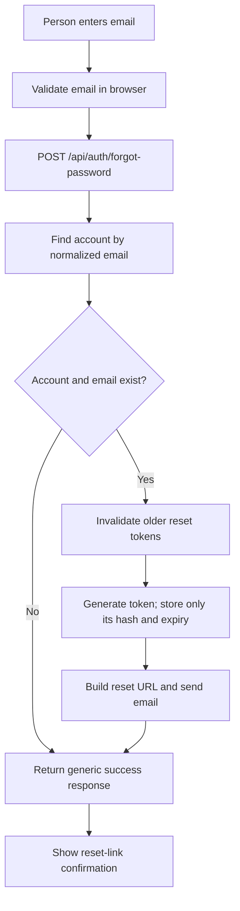

# 06. Request a Password Reset

**Version:** 1.0.0  
**Created:** 2026-09-24  
**Last Updated:** 2026-11-25

## In simple terms

The person enters an email address on the Forgot password page. If an account exists, HabitFlow creates a short-lived reset link and sends it by email. The response is intentionally the same when no account exists, so someone cannot use this screen to discover which email addresses have accounts.

## Flowchart



## Data flow walkthrough

Each numbered item describes one file. Comments in the excerpts explain how a request becomes a reset email without disclosing whether an account exists.

### 1. `frontend/src/app/features/auth/forgot-password/forgot-password.ts`

```ts
protected submit(): void {
  // Reject invalid email input and prevent duplicate requests.
  if (this.form.invalid || this.submitting()) {
    this.form.markAllAsTouched();
    return;
  }
  this.submitting.set(true);
  // Normalize email before asking the API to send a reset link.
  this.auth.requestPasswordReset(this.form.controls.email.value.trim().toLowerCase()).subscribe({
    // The response is generic for both known and unknown addresses.
    next: () => this.sent.set(true),
    error: (error: unknown) => {
      // Show a validation message for HTTP 400, but don't reveal account existence.
      this.error.set(
        error instanceof HttpErrorResponse && error.status === 400
          ? ((error.error as { error?: string } | null)?.error ?? 'Enter a valid email address.')
          : error instanceof HttpErrorResponse
            ? 'We could not send the reset email. Please try again shortly.'
            : 'Something went wrong. Please try again shortly.',
      );
    },
  });
}
```

### 2. `frontend/src/app/features/auth/auth.service.ts`

```ts
requestPasswordReset(email: string): Observable<MessageResponse> {
  // Send only the address to the forgot-password API endpoint.
  return this.http.post<MessageResponse>(`${this.baseUrl}/forgot-password`, { email });
}
```

### 3. `backend/src/features/auth/forgot-password/forgot-password.routes.ts`

```ts
router.post(
  '/forgot-password',
  // Validate the request body before it reaches the recovery service.
  validateRequest(forgotPasswordValidator, 'body', 'Invalid email address'),
  createForgotPasswordController(service)
);
```

### 4. `backend/src/features/auth/forgot-password/validators/forgot-password.validator.ts`

```ts
// Reuse the shared email format/normalization rule for this request body.
export const forgotPasswordValidator = z.object({ email: emailValidator });
```

### 5. `backend/src/features/auth/forgot-password/forgot-password.controller.ts`

```ts
await service.request((res.locals.validated as ForgotPasswordInput).email);
// Return the same wording whether the address belongs to an account or not.
res.status(200).json({
  message: 'If an account exists for that email, a reset link has been sent.',
});
```

### 6. `backend/src/features/auth/forgot-password/forgot-password.service.ts`

```ts
async request(email: string): Promise<void> {
  // An unknown address exits quietly; the controller still returns generic success.
  const user = await this.dependencies.findUserByEmail(email.toLowerCase());
  if (!user?.email) return;

  // Retire old links, then create a new random token with a one-hour expiry.
  await this.dependencies.invalidateResetTokens(user.id);
  const token = generateToken();
  await this.dependencies.createResetToken({
    userId: user.id,
    tokenHash: hashToken(token),
    expiresAt: new Date(this.now().getTime() + 60 * 60 * 1000),
  });
  // Put the raw token only in the emailed URL; persist only its hash.
  const emailContent = resetLinkEmail(buildResetLink(this.dependencies.webBaseUrl, token));
  await this.dependencies.mailer.send({ to: user.email, ...emailContent });
}
```

### 7. `backend/src/features/auth/forgot-password/db/queries/invalidate-reset-tokens.query.ts`

```ts
// Mark existing unused links as used so only the newest request remains valid.
await prisma.passwordResetToken.updateMany({
  where: { userId, usedAt: null },
  data: { usedAt: new Date() },
});
```

### 8. `backend/src/features/auth/forgot-password/db/queries/create-reset-token.query.ts`

```ts
// Persist the account ID, token hash, and expiry (never the raw token).
await prisma.passwordResetToken.create({ data: input });
```

The service sends mail through the configured mailer; local development can print the reset URL to the backend console. See [tests.md](tests.md) for recovery-request coverage.
