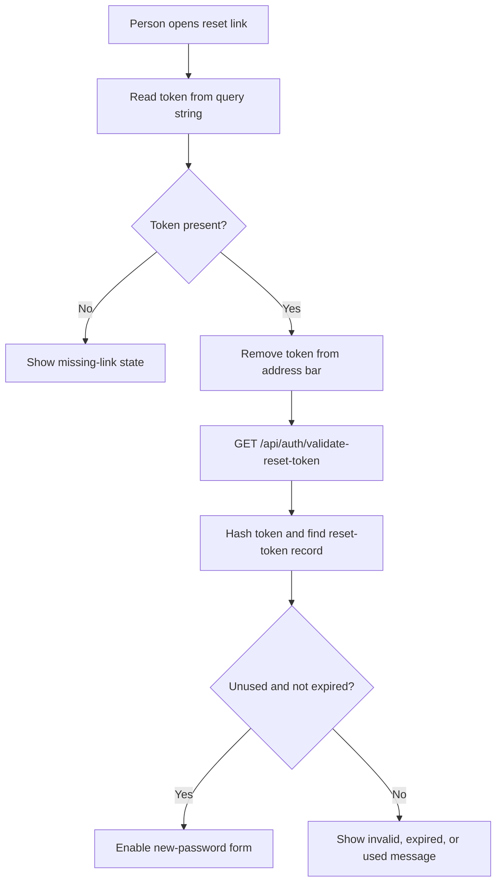

# 07. Validate a Password Reset Link

## In simple terms

Before showing the new-password form, HabitFlow checks whether the link is real, unused, and still within its time limit. A missing, expired, or already-used link gets an explanatory page instead of an active form. The token is removed from the browser's address bar after it is read.

## Flowchart



## Data flow walkthrough

Each numbered item describes one file. Comments in the excerpts explain how a link is checked and how the page responds.

### 1. `frontend/src/app/features/auth/reset-password/reset-password.ts`

```ts
this.token = inject(ActivatedRoute).snapshot.queryParamMap.get('token');
if (!this.token) {
  // No token means no reset form can be opened.
  this.status.set('missing');
  return;
}

// Remove the secret from the address bar and replace the history entry.
void this.router.navigate([], {
  queryParams: { token: null },
  queryParamsHandling: 'merge',
  replaceUrl: true,
});
// Ask the backend whether this token can still be used.
this.auth.validateResetToken(this.token).subscribe({
  next: ({ valid }) => this.status.set(valid ? 'ready' : 'invalid'),
  error: (error: unknown) => this.status.set(readTokenStatus(error)),
});
```

### 2. `frontend/src/app/features/auth/auth.service.ts`

```ts
validateResetToken(token: string): Observable<ResetTokenResponse> {
  // Send the token as a query parameter; HttpClient handles URL encoding.
  return this.http.get<ResetTokenResponse>(`${this.baseUrl}/validate-reset-token`, {
    params: { token },
  });
}
```

### 3. `backend/src/features/auth/reset-password/reset-password.routes.ts`

```ts
router.get(
  '/validate-reset-token',
  // Validate that a token query parameter was supplied before checking it.
  validateRequest(
    validateTokenQueryValidator,
    'query',
    'A valid reset token is required'
  ),
  controller.validate
);
```

### 4. `backend/src/features/auth/reset-password/validators/validate-token-query.validator.ts`

```ts
// Require a non-empty, trimmed token string in the query string.
export const validateTokenQueryValidator = z.object({
  token: z.string().trim().min(1),
});
```

### 5. `backend/src/features/auth/reset-password/reset-password.controller.ts`

```ts
await validator.validate((res.locals.validated as ValidateTokenQuery).token);
// A successful lookup means the token is currently usable.
res.status(200).json({ valid: true });
```

### 6. `backend/src/features/auth/reset-password/services/validate-reset-token.service.ts`

```ts
async validate(token: string) {
  // Search using a hash, not the raw secret from the link.
  const record = await this.dependencies.findResetTokenByHash(hashToken(token));
  if (!record) throw new ResetTokenError('invalid');
  // A reset link can only be used once and only before its expiry time.
  if (record.usedAt) throw new ResetTokenError('used');
  if (record.expiresAt.getTime() <= this.now().getTime()) {
    throw new ResetTokenError('expired');
  }
  return record;
}
```

### 7. `backend/src/features/auth/reset-password/db/queries/find-reset-token-by-hash.query.ts`

```ts
// Find only the reset record fields the service needs, using the token hash.
return prisma.passwordResetToken.findUnique({
  where: { tokenHash },
  select: { userId: true, expiresAt: true, usedAt: true },
});
```

### 8. `frontend/src/app/features/auth/reset-password/token-status-message.util.ts`

```ts
export function readTokenStatus(error: unknown): ResetTokenStatus {
  // Network errors and server errors do not reveal token details to the page.
  if (!(error instanceof HttpErrorResponse) || error.status !== 400)
    return 'invalid';
  const reason = (error.error as Partial<ResetTokenErrorResponse> | null)
    ?.reason;
  // Only the recognized expired/used reasons get their dedicated page message.
  return reason === 'expired' || reason === 'used' ? reason : 'invalid';
}
```

Only the `ready` state enables the new-password form. Reset submission checks the token again because its state could change after this initial check. See [tests.md](tests.md) for validation coverage.
