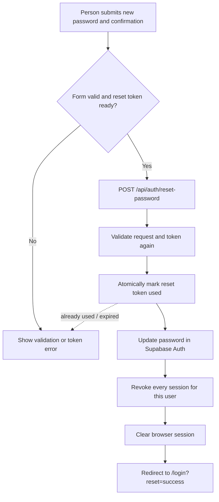

# 08. Reset Password

## In simple terms

After the reset link passes validation, the person enters and confirms a new password. HabitFlow checks the link again, marks it as used, updates the password with the identity provider, and signs out all sessions for that account. The browser clears its own session and sends the person to login.

## Flowchart



## Data flow walkthrough

Each numbered item describes one file. Comments in the excerpts explain how a valid one-time link changes the password and ends the old sessions.

### 1. `frontend/src/app/features/auth/reset-password/reset-password.ts`

```ts
protected submit(): void {
  const token = this.token;
  // Only a validated link and a valid form can submit a new password.
  if (!token || this.status() !== 'ready' || this.submitting()) return;
  if (this.form.invalid) {
    this.form.markAllAsTouched();
    return;
  }
  this.auth.resetPassword(token, this.form.controls.password.value).subscribe({
    next: () => {
      // The backend revokes every session, so clear this browser too.
      this.session.clear();
      void this.router.navigateByUrl(RESET_SUCCESS_REDIRECT);
    },
  });
}
```

### 2. `frontend/src/app/features/auth/auth.service.ts`

```ts
resetPassword(token: string, password: string): Observable<MessageResponse> {
  // Send the link token and both password fields to the reset endpoint.
  return this.http.post<MessageResponse>(`${this.baseUrl}/reset-password`, {
    token,
    newPassword: password,
    confirmPassword: password,
  });
}
```

### 3. `backend/src/features/auth/reset-password/reset-password.routes.ts`

```ts
router.post(
  '/reset-password',
  // Validate and normalize the password payload before calling the controller.
  validateRequest(resetPasswordValidator, 'body', 'Invalid reset details'),
  controller.reset
);
```

### 4. `backend/src/features/auth/reset-password/validators/reset-password.validator.ts`

```ts
.transform((input) => {
  // Accept the request's newPassword field and normalize it for the service.
  const password = input.newPassword ?? input.password ?? '';
  return {
    token: input.token,
    password,
    confirmPassword: input.confirmPassword ?? password,
  };
})
// Reject a confirmation that differs from the new password.
.refine((input) => input.password === input.confirmPassword, {
  path: ['confirmPassword'],
  message: 'Passwords do not match',
})
// Reject passwords shorter than eight characters.
.refine((input) => input.password.length >= 8, {
  path: ['newPassword'],
  message: 'Password must be at least 8 characters',
});
```

### 5. `backend/src/features/auth/reset-password/reset-password.controller.ts`

```ts
const input = res.locals.validated as ResetPasswordInput;
try {
  // Hand the validated token and password to the reset service.
  await resetter.reset(input.token, input.password);
  res.status(200).json({ message: 'Password updated successfully.' });
} catch (error) {
  if (error instanceof ResetTokenError) {
    // Do not reveal whether the token was used, expired, or otherwise invalid here.
    sendTokenError(error, res, false);
    return;
  }
  next(error);
}
```

### 6. `backend/src/features/auth/reset-password/services/reset-password.service.ts`

```ts
async reset(token: string, password: string): Promise<void> {
  // Recheck the token because its state could have changed since the page loaded.
  const record = await this.tokens.validate(token);
  // Consume it only if it is still unused and unexpired; concurrent replay then fails.
  const marked = await this.dependencies.markResetTokenUsed(hashToken(token), this.now());
  if (!marked) throw new ResetTokenError('used');
  // Change the provider password, then invalidate every server-side session for this user.
  await this.dependencies.updatePassword(record.userId, password);
  await this.dependencies.revokeUserSessions(record.userId);
}
```

### 7. `backend/src/features/auth/reset-password/db/queries/mark-reset-token-used.query.ts`

```ts
// Only one request can change a still-valid token from unused to used.
const result = await prisma.passwordResetToken.updateMany({
  where: { tokenHash, usedAt: null, expiresAt: { gt: now } },
  data: { usedAt: now },
});
return result.count === 1;
```

### 8. `backend/src/features/auth/auth.routes.ts`

```ts
const resetPassword = new ResetPasswordService(resetTokenValidator, {
  // Supabase Auth owns the account password; Prisma handles token/session records.
  updatePassword: (userId, password) =>
    supabaseAdmin.updatePassword(userId, password),
  markResetTokenUsed,
  revokeUserSessions,
});
```

### 9. `backend/src/features/auth/reset-password/db/queries/revoke-user-sessions.query.ts`

```ts
// A reset is a sign-out-all-devices event, so revoke every active session for the user.
await prisma.session.updateMany({
  where: { userId, revokedAt: null },
  data: { revokedAt: new Date() },
});
```

The person must log in again with the new password. See [tests.md](tests.md) for reset coverage.
