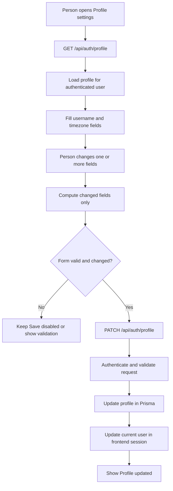

# 09. View and Update Profile

**Version:** 1.0.0  
**Created:** 2026-09-24  
**Last Updated:** 2026-11-25

## In simple terms

In Profile settings, a signed-in person can see their username and timezone, change either value, and save only when something has changed. HabitFlow checks the submitted values, saves them for that account, and updates the current user's information in the app so the new username appears without requiring a reload.

## Flowchart



## Data flow walkthrough

Each numbered item describes one file. Comments in the excerpts explain how profile data moves between the page, API, and database.

### 1. `frontend/src/app/features/auth/profile/profile-settings/profile-settings.ts`

```ts
protected load(): void {
  // Ask the profile service for the signed-in user's saved values.
  this.profiles.get().subscribe({
    next: (profile) => {
      this.showSaved(profile);
      this.loadState.set('ready');
    },
    error: () => this.loadState.set('error'),
  });
}

protected submit(): void {
  // Only send changed fields, and don't submit invalid or unchanged values.
  const changes = this.changes();
  if (this.form.invalid || Object.keys(changes).length === 0) return;
  this.profiles.update(changes).subscribe({
    next: (profile) => {
      this.showSaved(profile);
      this.saved.set('Profile updated.');
    },
  });
}
```

### 2. `frontend/src/app/features/auth/profile/utils/diff-profile.util.ts`

```ts
export function diffProfile(
  saved: Profile,
  values: ProfileFormValues
): UpdateProfileRequest {
  const changes: UpdateProfileRequest = {};
  // Trim username and include it only if it differs from the saved value.
  const username = values.username.trim();
  if (username !== saved.username) changes.username = username;
  // Include timezone only when the person selected a different non-empty value.
  if (values.timezone && values.timezone !== saved.timezone)
    changes.timezone = values.timezone;
  return changes;
}
```

### 3. `frontend/src/app/features/auth/profile/services/profile.service.ts`

```ts
/** PATCH with only the changed fields. */
update(changes: UpdateProfileRequest): Observable<Profile> {
  return this.http.patch<Profile>(this.url, changes).pipe(
    // Update the shared signed-in user so the new username appears immediately.
    tap(({ username, timezone }) =>
      this.session.updateUser(timezone ? { username, timezone } : { username }),
    ),
  );
}
```

### 4. `backend/src/features/auth/profile/profile.routes.ts`

```ts
router.patch(
  '/profile',
  // Require a signed-in session and validate the update body before the controller.
  requireAuth(sessionService),
  validateRequest(profileUpdateValidator, 'body', 'Invalid profile details'),
  controller.updateProfile
);
```

### 5. `backend/src/features/auth/profile/profile.controller.ts`

```ts
const profile = await service.updateProfile(
  // The target account comes from verified session data, not a user ID in the body.
  req.auth!.userId,
  res.locals.validated as ProfileUpdateInput
);
res.status(200).json(profile);
```

### 6. `backend/src/features/auth/profile/profile.service.ts`

```ts
if (input.username !== undefined) {
  // Trim the username before it reaches the database.
  update.username = input.username.trim();
}
if (input.timezone !== undefined) update.timezone = input.timezone;
try {
  return await this.dependencies.updateProfile(userId, update);
} catch (error) {
  // Convert the database unique-username constraint into an API conflict.
  if (
    typeof error === 'object' &&
    error !== null &&
    'code' in error &&
    error.code === 'P2002'
  ) {
    throw new AuthConflictError('Username is already in use');
  }
  throw error;
}
```

### 7. `backend/src/features/auth/profile/db/queries/find-profile.query.ts`

```ts
// Read the active profile using the authenticated account ID.
return prisma.user.findFirst({
  where: { id: userId, deletedAt: null },
  select: { id: true, username: true, timezone: true },
});
```

### 8. `backend/src/features/auth/profile/db/queries/update-profile.query.ts`

```ts
return prisma.user.update({
  // Update only fields supplied by the person and refresh the modified timestamp.
  where: { id: userId },
  data: {
    ...(data.username !== undefined ? { username: data.username } : {}),
    ...(data.timezone !== undefined ? { timezone: data.timezone } : {}),
    updatedAt: new Date(),
  },
  select: { id: true, username: true, timezone: true },
});
```

See [tests.md](tests.md) for profile read/update and persistence coverage.
