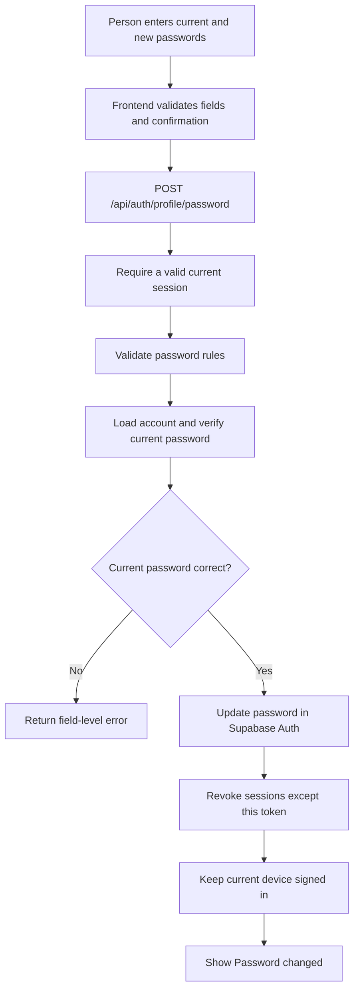

# 10. Change Password

## In simple terms

From Profile settings, a signed-in person enters their current password and a new password twice. HabitFlow verifies the current password before changing it. The current device stays signed in, while sessions on other devices are revoked so they must log in again with the new password.

## Flowchart



## Data flow walkthrough

Each numbered item describes one file. Comments in the excerpts explain how the current password is checked and other sessions are ended.

### 1. `frontend/src/app/features/auth/profile/change-password/change-password-form.ts`

```ts
// Keep the new password and its confirmation consistent, and require a real change.
const passwordRules: ValidatorFn = (group) => {
  const { currentPassword, newPassword, confirmPassword } = group.value;
  const errors: Record<string, true> = {};
  if (confirmPassword && newPassword !== confirmPassword) errors['passwordMismatch'] = true;
  if (newPassword && newPassword === currentPassword) errors['sameAsCurrent'] = true;
  return Object.keys(errors).length ? errors : null;
};

protected submit(): void {
  // Reject invalid input before sending the request.
  if (this.form.invalid) {
    this.form.markAllAsTouched();
    return;
  }
  this.profiles.changePassword(this.form.getRawValue()).subscribe({
    next: () => {
      // Clear password values after success and show confirmation.
      this.form.reset();
      this.saved.set("Password changed. You've been signed out on other devices.");
    },
  });
}
```

### 2. `frontend/src/app/features/auth/profile/services/profile.service.ts`

```ts
changePassword(request: ChangePasswordRequest): Observable<{ message: string }> {
  // Post current and new passwords to the protected profile password endpoint.
  return this.http.post<{ message: string }>(`${this.url}/password`, request);
}
```

### 3. `backend/src/features/auth/profile/profile.routes.ts`

```ts
router.post(
  '/profile/password',
  // Require a valid current session before accepting a password change.
  requireAuth(sessionService),
  // Check password length, confirmation, and that the new password differs.
  validateRequest(changePasswordValidator, 'body', 'Invalid password details'),
  controller.changePassword
);
```

### 4. `backend/src/features/auth/profile/validators/change-password.validator.ts`

```ts
export const changePasswordValidator = z
  .object({
    currentPassword: z.string().min(1),
    newPassword: passwordValidator,
    confirmPassword: z.string(),
  })
  // The new password must be confirmed and must differ from the current password.
  .refine((input) => input.newPassword === input.confirmPassword, {
    path: ['confirmPassword'],
    message: 'Passwords do not match',
  })
  .refine((input) => input.newPassword !== input.currentPassword, {
    path: ['newPassword'],
    message: 'New password must be different from the current password',
  });
```

### 5. `backend/src/features/auth/profile/profile.controller.ts`

```ts
const input = res.locals.validated as ChangePasswordInput;
// Keep the current session by passing its hash to the service.
const token = parseBearerToken(req.header('Authorization'))!;
await passwords.change(
  req.auth!.userId,
  hashToken(token),
  input.currentPassword,
  input.newPassword
);
res.status(200).json({ message: 'Password changed successfully' });
```

### 6. `backend/src/features/auth/profile/change-password.service.ts`

```ts
// Verify the current password with Supabase Auth before changing anything.
await this.dependencies.verifyCredentials(
  user.email.toLowerCase(),
  currentPassword
);
// Supabase Auth updates the credential; then revoke other sessions but keep this one.
await this.dependencies.updatePassword(userId, newPassword);
await this.dependencies.revokeOtherSessions(userId, currentTokenHash);
```

### 7. `backend/src/features/auth/auth.routes.ts`

```ts
const changePassword = new ChangePasswordService({
  findUserById,
  // Credential verification and password updates are owned by Supabase Auth.
  verifyCredentials: (email, password) =>
    supabaseAdmin.verifyCredentials(email, password),
  updatePassword: (userId, password) =>
    supabaseAdmin.updatePassword(userId, password),
  // Prisma revokes the user's other sessions after the credential changes.
  revokeOtherSessions,
});
```

### 8. `backend/src/features/auth/profile/db/queries/revoke-other-sessions.query.ts`

```ts
await prisma.session.updateMany({
  // Revoke active sessions except the token used for this password change.
  where: { userId, revokedAt: null, NOT: { tokenHash: keepTokenHash } },
  data: { revokedAt: new Date() },
});
```

The current device remains signed in; other devices must authenticate again using the new password. See [tests.md](tests.md) for test coverage.
