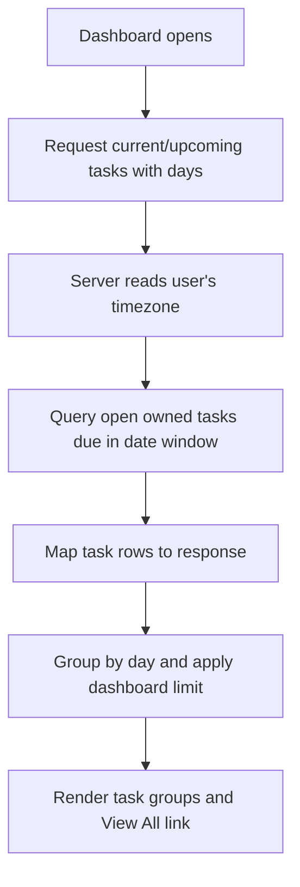

# 01. View Current and Upcoming Tasks

**Version:** 1.0.0  
**Created:** 2026-09-24  
**Last Updated:** 2026-11-25

## In simple terms

The dashboard shows open tasks due today and over the next few days. HabitFlow calculates “today” using the person's timezone, groups tasks by day, and shows only as many as the saved dashboard task limit allows.

## Flowchart



## Data flow walkthrough

Each numbered item describes one file. Comments explain timezone handling and list grouping.

### 1. `frontend/src/app/features/dashboard/current-upcoming-tasks/current-upcoming-tasks.ts`

```ts
protected load(): void {
  this.loadedAt.set(this.now());
  // Request the window, then group returned tasks in the user's timezone.
  this.dashboard.currentUpcoming(this.days()).subscribe({
    next: ({ tasks, total }) => {
      this.tasks.set(tasks);
      this.serverTotal.set(total);
      this.loadState.set('ready');
    },
    error: (error: unknown) => this.error.set(mapDashboardError(error).message),
  });
}
```

### 2. `frontend/src/app/features/dashboard/shared/services/dashboard.service.ts`

```ts
currentUpcoming(days = DEFAULT_UPCOMING_DAYS): Observable<DashboardTaskList> {
  // Clamp days to the API's supported range, then request the endpoint.
  const clamped = Math.min(Math.max(Math.trunc(days) || 1, 1), MAX_UPCOMING_DAYS);
  const params = new HttpParams().set('days', clamped);
  return this.http.get<DashboardTasksResponse>(`${this.baseUrl}/current-upcoming-tasks`, { params })
    .pipe(map(toTaskList));
}
```

### 3. `backend/src/features/dashboard/current-upcoming-tasks/current-upcoming-tasks.routes.ts`

```ts
router.get(
  '/current-upcoming-tasks',
  validateRequest(currentUpcomingQueryValidator, 'query', 'Invalid days value'),
  controller.list
);
```

### 4. `backend/src/features/dashboard/current-upcoming-tasks/current-upcoming-tasks.service.ts`

```ts
async list(userId: string, days: number) {
  // Compute the requested date window using the user's timezone.
  const timeZone = (await this.dependencies.findUserTimezone(userId)) ?? 'UTC';
  const window = getDateWindow(timeZone, days, this.now());
  const tasks = await this.dependencies.listTasksDueBetween(userId, window.startDate, window.endDate);
  return tasks.map(toDashboardTask);
}
```

### 5. `backend/src/features/dashboard/current-upcoming-tasks/db/queries/list-tasks-due-between.query.ts`

```ts
// Fetch only open, live tasks due in the requested date window for this owner.
return prisma.task.findMany({
  where: {
    userId,
    isDone: false,
    deletedAt: null,
    archivedAt: null,
    dueDate: { gte: toDatabaseDate(startDate), lte: toDatabaseDate(endDate) },
  },
  orderBy: [{ dueDate: 'asc' }, { createdAt: 'desc' }, { id: 'asc' }],
});
```

See [tests.md](tests.md) for timezone, date-window, grouping, and limit coverage.
