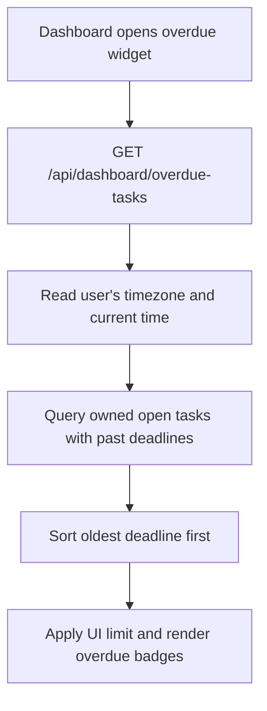

# 02. View Overdue Tasks

## In simple terms

The dashboard shows open tasks whose deadlines have passed. HabitFlow compares deadlines with the current time, sorts the oldest deadline first, and caps the visible list using the saved task limit.

## Flowchart



## Data flow walkthrough

Each numbered item describes one file. Comments explain which tasks qualify as overdue.

### 1. `frontend/src/app/features/dashboard/overdue-tasks/overdue-tasks.ts`

```ts
protected load(): void {
  this.loadedAt.set(this.now());
  // Load overdue tasks and retain the server's total for the count label.
  this.dashboard.overdue().subscribe({
    next: ({ tasks, total }) => {
      this.allTasks.set(tasks);
      this.total.set(total);
      this.loadState.set('ready');
    },
    error: (error: unknown) => this.error.set(mapDashboardError(error).message),
  });
}
```

### 2. `frontend/src/app/features/dashboard/shared/services/dashboard.service.ts`

```ts
// Request open overdue tasks from the dashboard API.
overdue(): Observable<DashboardTaskList> {
  return this.http.get<DashboardTasksResponse>(`${this.baseUrl}/overdue-tasks`).pipe(map(toTaskList));
}
```

### 3. `backend/src/features/dashboard/overdue-tasks/overdue-tasks.routes.ts`

```ts
router.get(
  '/overdue-tasks',
  validateRequest(overdueQueryValidator, 'query', 'Invalid query values'),
  controller.list
);
```

### 4. `backend/src/features/dashboard/overdue-tasks/overdue-tasks.service.ts`

```ts
async list(userId: string) {
  // The user's timezone determines the current local date/time boundary.
  const timeZone = (await this.dependencies.findUserTimezone(userId)) ?? 'UTC';
  const tasks = await this.dependencies.listOverdueTasks(userId, this.now());
  return tasks.map(toDashboardTask);
}
```

### 5. `backend/src/features/dashboard/overdue-tasks/db/queries/list-overdue-tasks.query.ts`

```ts
// Exclude done, deleted, archived, and archived-project tasks; sort oldest deadline first.
return prisma.task.findMany({
  where: {
    userId,
    isDone: false,
    deletedAt: null,
    archivedAt: null,
    deadline: { not: null, lt: before },
  },
  orderBy: [{ deadline: 'asc' }, { createdAt: 'desc' }, { id: 'asc' }],
});
```

See [tests.md](tests.md) for deadline, timezone, count, and filtering coverage.
