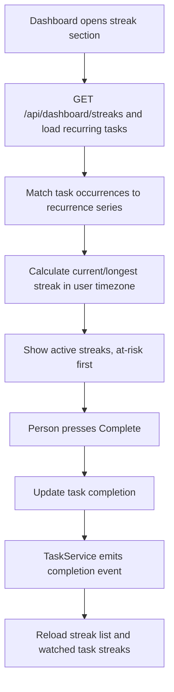

# 03. View and Complete Recurring Task Streaks

## In simple terms

The dashboard lists active recurring streaks, putting streaks at risk first. A person can mark the open occurrence done from this section. HabitFlow saves the completion and refreshes the streak list and badges throughout the app.

## Flowchart



## Data flow walkthrough

Each numbered item describes one file. Comments explain the combined dashboard summary and completion action.

### 1. `frontend/src/app/features/dashboard/streaks/streaks-section.ts`

```ts
// Load the summary and recurring tasks together so the UI can find the open occurrence.
forkJoin({ streaks: this.dashboard.streaks(), tasks: this.tasks.listAll({ recurring: true }) })
  .pipe(map(({ streaks, tasks }) => this.toRows(streaks, tasks)));

protected complete(row: StreakRow): void {
  // Completing here uses the same TaskService path as other completion controls.
  if (row.open) this.tasks.update(row.open.taskId, { completedAt: this.now().toISOString() });
}
```

### 2. `frontend/src/app/features/dashboard/shared/services/dashboard.service.ts`

```ts
streaks(limit = 20): Observable<DashboardStreak[]> {
  // Read dashboard streak summaries, capped to the supported API limit.
  const params = new HttpParams().set('limit', Math.min(Math.max(limit, 1), 100));
  return this.http.get<{ streaks: DashboardStreak[] }>(`${this.baseUrl}/streaks`, { params })
    .pipe(map(({ streaks }) => streaks));
}
```

### 3. `backend/src/features/dashboard/streaks/streaks.routes.ts`

```ts
router.get(
  '/streaks',
  validateRequest(validator, 'query', 'Invalid streak limit'),
  async (req, res, next) => {
    // Use the authenticated owner and requested limit for the shared streak service.
    const streaks = await service.listDashboardStreaks(
      req.auth!.userId,
      res.locals.validated.limit
    );
    res.status(200).json({ streaks });
  }
);
```

### 4. `backend/src/features/tasks/task-streaks/task-streaks.service.ts`

```ts
// Compute today's date in the owner's timezone and query completion events for each series.
const timezone = owner?.timezone ?? 'UTC';
const today = localDateString(timezone);
const longestStreak = longestConsecutiveDates(dates, recurrence);
// Return current/longest streak, last completion, next occurrence, and timezone.
return {
  taskId,
  currentStreak,
  longestStreak,
  lastCompletedOn,
  nextOccurrenceOn,
  timezone,
};
```

See [tests.md](tests.md) for dashboard summary, completion, and recurrence coverage.
