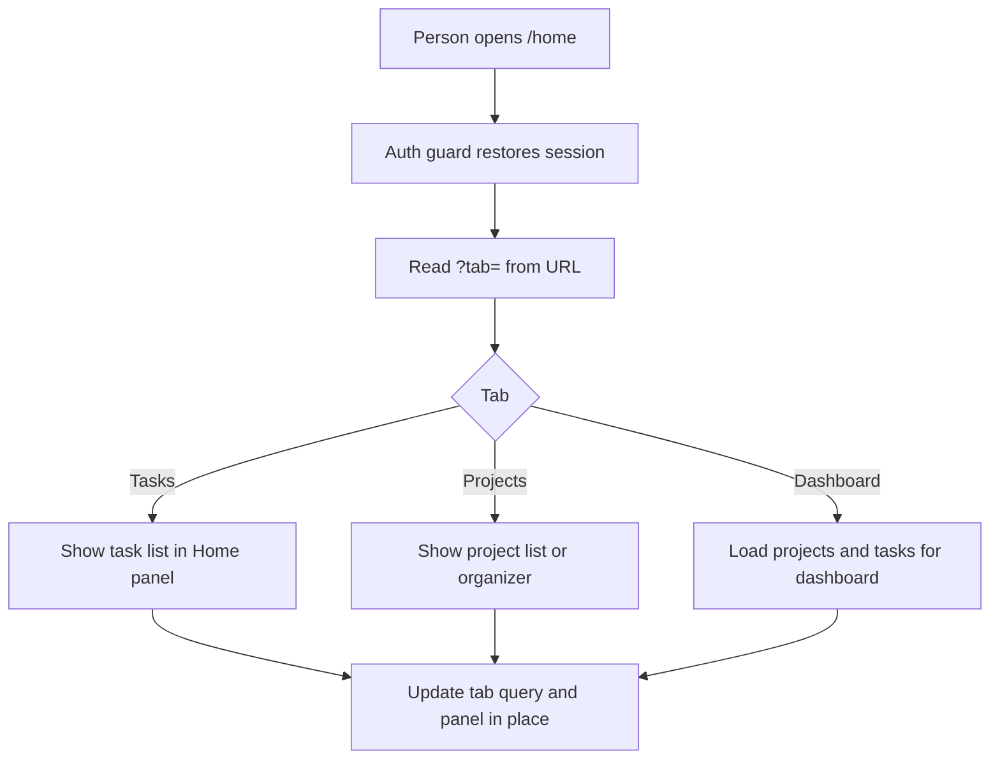

# 01. View Home and Switch Tabs

**Version:** 1.0.0  
**Created:** 2026-09-24  
**Last Updated:** 2026-11-25

## In simple terms

After signing in, Home opens on the dashboard tab. The person can switch to Tasks or Projects without leaving the Home page. The selected tab is written to the URL, so refresh and browser Back keep the same section. The dashboard tab loads project and task data for its widgets.

## Flowchart



## Data flow walkthrough

Each numbered item describes one file. Comments explain the protected route and tab-driven Home shell.

### 1. `frontend/src/app/app.routes.ts`

```ts
{
  path: 'home',
  // Only a restored signed-in session can enter Home.
  canActivate: [authGuard],
  loadComponent: () => import('./features/home/home').then((m) => m.Home),
}
```

### 2. `frontend/src/app/features/home/home.ts`

```ts
// Keep the selected tab and project organizer mode in sync with query parameters.
this.route.queryParamMap.pipe(takeUntilDestroyed()).subscribe((params) => {
  const tab = asTab(params.get('tab'));
  this.show(tab);
  if (tab === 'dashboard' && this.previousTab !== 'dashboard')
    this.loadDashboard();
  this.previousTab = tab;
  this.organizing.set(params.get('view') === 'organize');
});
```

### 3. `frontend/src/app/features/home/home.ts`

```ts
protected loadDashboard(): void {
  this.store.startLoading();
  // Load both sources for the Home dashboard panel.
  forkJoin({ projects: this.projects.refresh(), tasks: this.tasks.listAll() }).subscribe({
    next: ({ projects, tasks }) => this.store.setData(projects, tasks),
    error: (error: unknown) => this.store.fail(mapTaskError(error).message),
  });
}
```

### 4. `frontend/src/app/features/home/home.html`

```html
@switch (tab()) { @case ('tasks') { <app-tasks-page /> } @case ('projects') {
@if (organizing()) { <app-project-switcher /> } @else { <app-projects-page /> }
} @default { <app-status-columns /><app-all-tasks /> } }
```

The Tasks and Projects panels reuse their own feature components and APIs; Home owns their tab navigation and dashboard composition. See [tests.md](tests.md).
