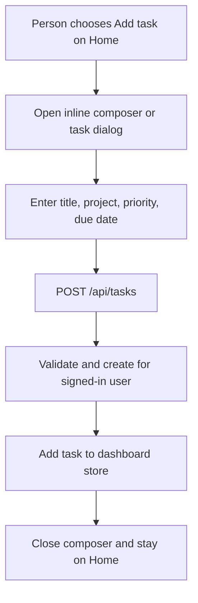

# 02. Create a Task from Home

## In simple terms

From Home, the person can create a task inline from All Tasks or open a task dialog from the task tab/calendar. The Home dashboard's inline composer starts with today's due date and the user's default priority, then adds the created task to the dashboard without leaving Home.

## Flowchart



## Data flow walkthrough

Each numbered item describes one file. Comments explain the Home-specific quick-create path.

### 1. `frontend/src/app/features/home/home.html`

```html
<!-- The calendar's Add task event opens the inline All Tasks composer. -->
<app-mini-calendar (addTask)="composing.set(true)" />
<!-- The dashboard owns the inline composer state. -->
<app-all-tasks [(composing)]="composing" />
```

### 2. `frontend/src/app/features/home/board/all-tasks.ts`

```ts
protected create(): void {
  if (this.form.invalid) return;
  const { title, projectId, priorityId, due } = this.form.getRawValue();
  // Send an open, non-recurring task with the Home form's due date and chosen/default priority.
  this.tasksApi.create({
    ...(projectId ? { projectId: Number(projectId) } : {}),
    priorityId,
    title: title.trim(),
    description: null,
    dueDate: due || null,
    deadline: null,
    recurrence: 'none',
    recurrenceDays: [],
    recurrenceEndDate: null,
  }).subscribe({
    next: (task) => {
      this.store.upsertTask(task);
      this.composing.set(false);
    },
  });
}
```

### 3. `frontend/src/app/features/tasks/task-crud/services/task.service.ts`

```ts
// Use the shared task creation endpoint and map the returned API task into app state.
create(request: CreateTaskRequest): Observable<Task> {
  return this.http.post<ApiTask>(this.baseUrl, toCreateTaskBody(request, this.legacyPriority))
    .pipe(map(toTask), tap((task) => this.store.upsert(task)));
}
```

### 4. `backend/src/features/tasks/task-crud/task-crud.service.ts`

```ts
// Resolve the requested project or this user's Inbox, then create the owned task.
async create(userId: string, input: CreateTaskInput) {
  const projectId = await this.resolveProjectId(userId, input.projectId);
  return toTaskModel(await this.dependencies.createTask(userId, { ...input, projectId }));
}
```

See [tests.md](tests.md) for Home composer and task creation coverage.
