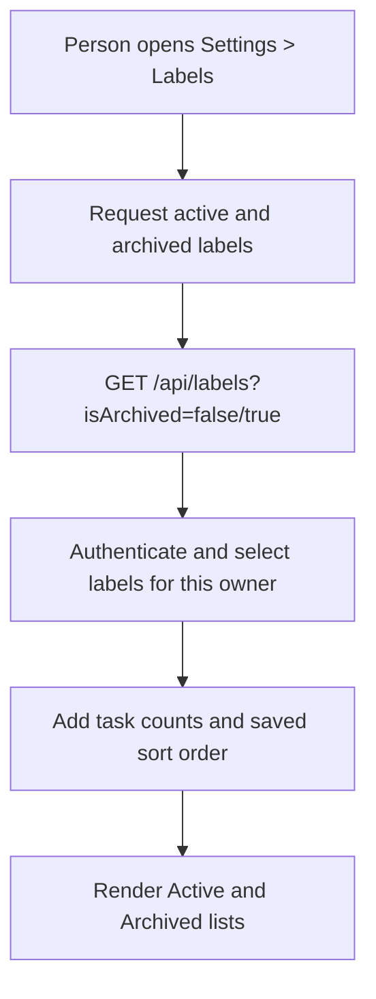

# 01. View Labels

## In simple terms

The Labels settings page loads the person's active labels and archived labels separately. Active labels are available in task filters and forms; archived labels remain visible for restoration, but cannot be newly assigned to tasks.

## Flowchart



## Data flow walkthrough

Each numbered item describes one file. Comments explain the two-list load and owner-scoped query.

### 1. `frontend/src/app/features/settings/labels/label-settings.ts`

```ts
protected load(): void {
  this.loading.set(true);
  // Load both sections together so the page shows active and archived labels consistently.
  forkJoin([this.api.list(false), this.api.list(true)]).subscribe({
    next: ([active, archived]) => {
      this.labels.set(active);
      this.archived.set(archived);
    },
    error: () => this.loadError.set("Couldn't load your labels."),
  });
}
```

### 2. `frontend/src/app/features/settings/services/labels.service.ts`

```ts
list(archived = false): Observable<LabelSetting[]> {
  // Ask the API for one section and preserve the user's stored label order.
  const params = new HttpParams().set('isArchived', String(archived));
  return this.http.get<ApiLabel[]>(this.baseUrl, { params }).pipe(
    map((labels) => labels.map(toLabelSetting).filter((label) => label.isArchived === archived)
      .sort((left, right) => left.sortOrder - right.sortOrder)),
  );
}
```

### 3. `backend/src/features/labels/label-crud/label-crud.routes.ts`

```ts
router.get(
  '/',
  requireAuth(sessionService),
  // Parse the archive filter before listing labels.
  validateRequest(listLabelsQueryValidator, 'query', 'Invalid label filters'),
  controller.list
);
```

### 4. `backend/src/features/labels/label-crud/label-crud.service.ts`

```ts
async list(userId: string, { isArchived = false }: Partial<ListLabelsQuery> = {}) {
  // The signed-in owner ID scopes the query; include task counts for settings UI.
  return (await this.dependencies.listLabels(userId, isArchived)).map(
    (label) => toLabelModel(label, label._count.taskLabels),
  );
}
```

### 5. `backend/src/features/labels/label-crud/db/queries/list-labels.query.ts`

```ts
return prisma.label.findMany({
  // Read only this owner's labels, selecting active or archived records.
  where: { userId, archivedAt: isArchived ? { not: null } : null },
  orderBy: [{ sortOrder: 'asc' }, { id: 'asc' }],
  include: {
    _count: {
      select: { taskLabels: { where: { task: { deletedAt: null } } } },
    },
  },
});
```

See [tests.md](tests.md) for label list and filtering coverage.
