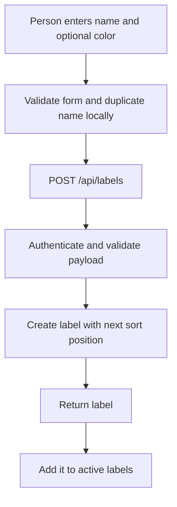

# 02. Create a Label

**Version:** 1.0.0  
**Created:** 2026-09-24  
**Last Updated:** 2026-11-25

## In simple terms

In Settings > Labels, the person enters a label name and optional color. HabitFlow rejects blank or duplicate names, creates the label for the signed-in user, and adds it to the active list.

## Flowchart



## Data flow walkthrough

Each numbered item describes one file. Comments explain the form-to-database path.

### 1. `frontend/src/app/features/settings/labels/label-settings.ts`

```ts
protected create(input: NameAndColor): void {
  this.creating.set(true);
  // Submit the editor's validated name/color and append the returned label.
  this.api.create(input).subscribe({
    next: (label) => {
      this.labels.update((labels) => [...labels, label]);
      this.createEditor()?.reset();
      this.announcement.set(`Label “${label.name}” created.`);
    },
    error: (error: unknown) => this.createError.set(saveError(error, input.name)),
  });
}
```

### 2. `frontend/src/app/features/settings/services/labels.service.ts`

```ts
create(input: NameAndColor): Observable<LabelSetting> {
  // Send the new label fields and map the API response for settings state.
  return this.http.post<ApiLabel>(this.baseUrl, input).pipe(map(toLabelSetting));
}
```

### 3. `backend/src/features/labels/label-crud/label-crud.routes.ts`

```ts
router.post(
  '/',
  requireAuth(sessionService),
  validateRequest(createLabelValidator, 'body', 'Invalid label details'),
  controller.create
);
```

### 4. `backend/src/features/labels/label-crud/label-crud.service.ts`

```ts
async create(userId: string, input: CreateLabelInput) {
  // Convert the database uniqueness error into the API's label-name conflict.
  try {
    return toLabelModel(await this.dependencies.createLabel(userId, input));
  } catch (error) {
    if (isLabelNameConflict(error)) throw new LabelNameTakenError();
    throw error;
  }
}
```

### 5. `backend/src/features/labels/label-crud/db/queries/create-label.query.ts`

```ts
return prisma.$transaction(async (transaction) => {
  // Add the new label after this owner's current last label.
  const lastLabel = await transaction.label.findFirst({
    where: { userId },
    orderBy: [{ sortOrder: 'desc' }, { id: 'desc' }],
    select: { sortOrder: true },
  });
  return transaction.label.create({
    data: {
      userId,
      name: input.name,
      color: input.color ?? null,
      sortOrder: (lastLabel?.sortOrder ?? -1) + 1,
    },
  });
});
```

See [tests.md](tests.md) for validation, duplicate-name, and persistence coverage.
