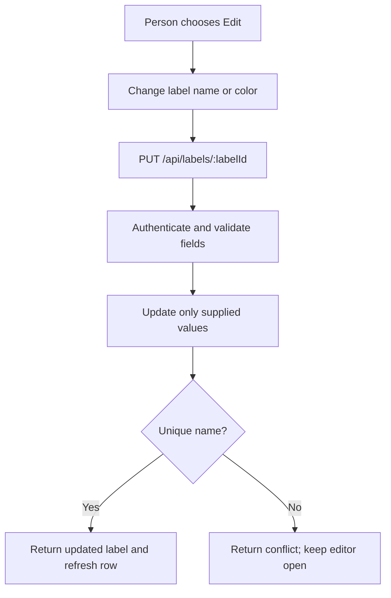

# 03. Edit a Label

**Version:** 1.0.0  
**Created:** 2026-09-24  
**Last Updated:** 2026-11-25

## In simple terms

The person edits a label's name or color in Settings. HabitFlow saves the changed values for that person's label. A duplicate name is rejected, and the editor keeps the input so the person can correct it.

## Flowchart



## Data flow walkthrough

Each numbered item describes one file. Comments explain the edit and conflict path.

### 1. `frontend/src/app/features/settings/labels/label-settings.ts`

```ts
protected saveEdit(label: LabelSetting, input: NameAndColor): void {
  this.saving.set(true);
  // Save the edited name/color and replace the matching row on success.
  this.api.update(label.id, input).subscribe({
    next: (updated) => {
      this.labels.update((labels) => labels.map((item) => item.id === updated.id ? updated : item));
      this.editingId.set(null);
    },
    error: (error: unknown) => this.editError.set(saveError(error, input.name)),
  });
}
```

### 2. `frontend/src/app/features/settings/services/labels.service.ts`

```ts
update(labelId: number, input: Partial<NameAndColor>): Observable<LabelSetting> {
  // PUT the label fields and map the response back into the settings model.
  return this.http.put<ApiLabel>(`${this.baseUrl}/${labelId}`, input).pipe(map(toLabelSetting));
}
```

### 3. `backend/src/features/labels/label-crud/label-crud.routes.ts`

```ts
router.put(
  '/:labelId',
  requireAuth(sessionService),
  validateLabelId,
  captureLabelId,
  validateRequest(updateLabelValidator, 'body', 'Invalid label update'),
  controller.update
);
```

### 4. `backend/src/features/labels/label-crud/label-crud.service.ts`

```ts
// Update only a label that belongs to the current user; map name conflicts to 409.
const label = await this.dependencies.updateOwnedLabel(labelId, userId, input);
if (!label) throw new LabelNotFoundError();
return toLabelModel(label);
```

### 5. `backend/src/features/labels/label-crud/db/queries/update-label.query.ts`

```ts
// Update only supplied fields for this user's label.
const updated = await prisma.label.updateMany({
  where: { id: labelId, userId },
  data: {
    ...(input.name !== undefined ? { name: input.name } : {}),
    ...(input.color !== undefined ? { color: input.color } : {}),
  },
});
if (updated.count === 0) return null;
return prisma.label.findFirst({ where: { id: labelId, userId } });
```

See [tests.md](tests.md) for update and uniqueness coverage.
