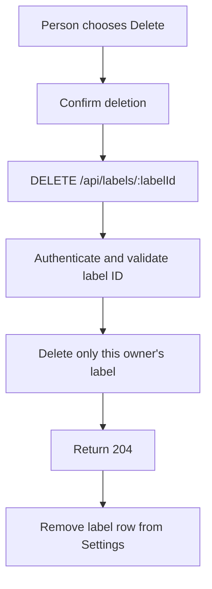

# 04. Delete a Label

## In simple terms

The person chooses Delete and confirms. HabitFlow removes the label for that user. Existing task-label links are removed by the database relation, but the tasks themselves remain.

## Flowchart



## Data flow walkthrough

Each numbered item describes one file. Comments explain confirmation and owner-scoped deletion.

### 1. `frontend/src/app/features/settings/labels/label-settings.ts`

```ts
protected confirmDelete(): void {
  const label = this.pendingDelete();
  if (!label || this.deleting()) return;
  this.deleting.set(true);
  // Delete after confirmation, then remove the row from the local list.
  this.api.delete(label.id).subscribe({
    next: () => this.labels.update((labels) => labels.filter((item) => item.id !== label.id)),
    error: (error: unknown) => this.deleteError.set(deleteError(error)),
  });
}
```

### 2. `frontend/src/app/features/settings/services/labels.service.ts`

```ts
delete(labelId: number): Observable<void> {
  // Request deletion of this label ID.
  return this.http.delete<void>(`${this.baseUrl}/${labelId}`);
}
```

### 3. `backend/src/features/labels/label-crud/label-crud.routes.ts`

```ts
router.delete(
  '/:labelId',
  requireAuth(sessionService),
  validateRequest(
    labelIdParamValidator,
    'params',
    'Label ID must be a positive integer'
  ),
  controller.delete
);
```

### 4. `backend/src/features/labels/label-crud/label-crud.controller.ts`

```ts
// Pass the authenticated owner and validated label ID to the service.
await service.delete(res.locals.validated as number, req.auth!.userId);
res.status(204).end();
```

### 5. `backend/src/features/labels/label-crud/label-crud.service.ts`

```ts
// Return 404 if this owner does not have the requested label.
if (!(await this.dependencies.deleteOwnedLabel(labelId, userId))) {
  throw new LabelNotFoundError();
}
```

### 6. `backend/src/features/labels/label-crud/db/queries/delete-label.query.ts`

```ts
// Delete only the label row belonging to this user.
const result = await prisma.label.deleteMany({
  where: { id: labelId, userId },
});
return result.count > 0;
```

See [tests.md](tests.md) for delete and task-link behavior coverage.
