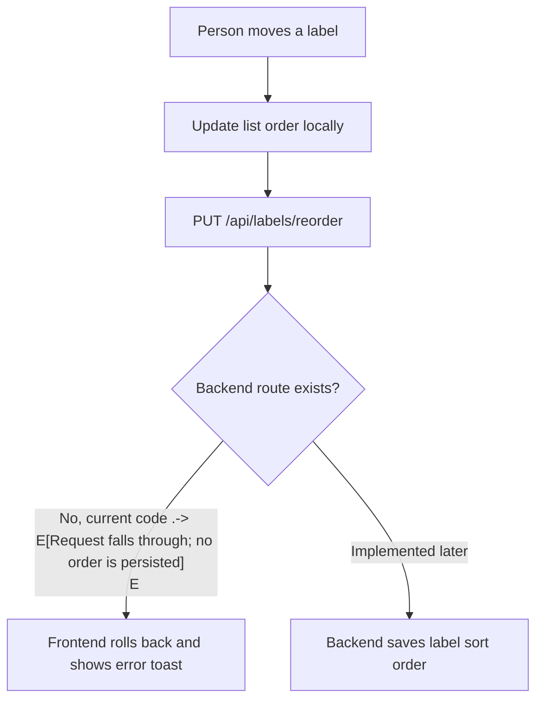

# 05. Reorder Labels

**Version:** 1.0.0  
**Created:** 2026-09-24  
**Last Updated:** 2026-11-25

## In simple terms

The Labels settings page lets a person drag labels or use move controls to change their order. The page immediately shows the new order, sends every active label ID to the API, and rolls back with a toast if saving fails.

## Flowchart



## Data flow walkthrough

Each numbered item describes one file. This action currently stops at the frontend/API boundary because the backend router has no reorder endpoint.

### 1. `frontend/src/app/features/settings/labels/label-settings.ts`

```ts
private reorder(from: number, to: number): boolean {
  const previous = this.labels();
  const next = moveItem(previous, from, to);
  if (!next) return false;
  // Show the requested order immediately and ask the service to persist it.
  this.labels.set(next.map((label, index) => ({ ...label, sortOrder: index })));
  this.api.reorder(next.map((label) => label.id)).subscribe({
    // Restore the old order and report failure if the request errors.
    error: () => {
      this.labels.set(previous);
      this.toast.error(LABEL_REORDER_FAILED_MESSAGE);
    },
  });
  return true;
}
```

### 2. `frontend/src/app/features/settings/services/labels.service.ts`

```ts
reorder(labelIds: readonly number[]): Observable<number[]> {
  // The frontend expects a route that accepts all active label IDs in order.
  return this.http.put<{ labelIds: number[] }>(`${this.baseUrl}/reorder`, { labelIds })
    .pipe(map((body) => body.labelIds));
}
```

### 3. `backend/src/features/labels/labels.routes.ts`

```ts
export function createLabelsRouter(sessionService: SessionService): Router {
  const router = Router();
  // The backend currently mounts only CRUD and archive routes; there is no reorder route.
  router.use(createLabelCrudRouter(sessionService));
  router.use(createLabelOrganizationRouter(sessionService));
  return router;
}
```

The frontend has an optimistic reorder path, but the current backend does not persist it. See [tests.md](tests.md) for the mocked frontend coverage and missing API test.
