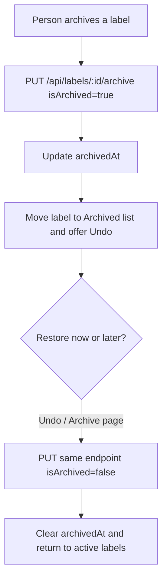

# 06. Archive or Restore a Label

**Version:** 1.0.0  
**Created:** 2026-09-24  
**Last Updated:** 2026-11-25

## In simple terms

The person archives a label instead of deleting it. It moves to the Archived section and cannot be newly attached to tasks. They can undo immediately or restore it later from the shared Archive page.

## Flowchart



## Data flow walkthrough

Each numbered item describes one file. Comments explain the optimistic lists and archived timestamp.

### 1. `frontend/src/app/features/settings/labels/label-settings.ts`

```ts
protected setArchived(label: LabelSetting, isArchived: boolean): void {
  // Move between active and archived lists immediately; undo/restore reverses the move.
  const from = isArchived ? this.labels : this.archived;
  const to = isArchived ? this.archived : this.labels;
  const moved = { ...label, isArchived, archivedAt: isArchived ? new Date().toISOString() : null };
  this.archiveUndo.archive({ kind: 'label', id: label.id, name: label.name }, { apply, rollback });
}
```

### 2. `frontend/src/app/features/settings/services/labels.service.ts`

```ts
setArchived(labelId: number, isArchived: boolean): Observable<LabelSetting> {
  // Send true to archive and false to restore.
  return this.http.put<ApiLabel>(`${this.baseUrl}/${labelId}/archive`, { isArchived })
    .pipe(map(toLabelSetting));
}
```

### 3. `frontend/src/app/features/archive/services/archive.service.ts`

```ts
// The shared Archive page calls the same kind-specific archive state endpoint for labels.
setArchived(kind: ArchiveKind, id: number, isArchived: boolean): Observable<void> {
  return this.http.put(`${this.api}/${PATH[kind]}/${id}/archive`, { isArchived })
    .pipe(tap(() => this.synced(kind, id, isArchived)), map(() => undefined));
}
```

### 4. `backend/src/features/labels/label-organization/label-organization.routes.ts`

```ts
router.put(
  '/:labelId/archive',
  requireAuth(sessionService),
  validateLabelId,
  captureLabelId,
  validateRequest(setLabelArchivedValidator, 'body', 'isArchived is required'),
  controller.archive
);
```

### 5. `backend/src/features/labels/label-organization/label-organization.service.ts`

```ts
// Persist the requested state and map the label/task count for the response.
const label = await this.dependencies.setLabelArchived(
  labelId,
  userId,
  isArchived
);
if (!label) throw new LabelNotFoundError();
return toLabelModel(label, label._count.taskLabels);
```

### 6. `backend/src/features/labels/label-organization/db/queries/set-label-archived.query.ts`

```ts
// Set or clear archivedAt for this owner's label, then return its task count.
const updated = await prisma.label.updateMany({
  where: { id: labelId, userId, archivedAt: isArchived ? null : { not: null } },
  data: { archivedAt: isArchived ? new Date() : null },
});
```

See [tests.md](tests.md) for archive, restore, and task-attachment behavior.
