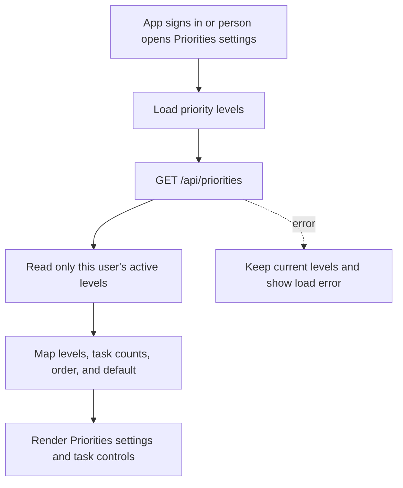

# 01. View Priorities

## In simple terms

The app loads the signed-in person's priority levels and shows them in saved order, with the current default marked. Until the server responds, the task form can use built-in High/Medium/Low levels; after loading, the server-managed levels are authoritative.

## Flowchart



## Data flow walkthrough

Each numbered item describes one file. Comments explain how priority levels are loaded and shared.

### 1. `frontend/src/app/features/settings/priorities/priority-settings.ts`

```ts
constructor() {
  // Refresh task counts and saved priority levels whenever the settings page opens.
  this.store.load();
}
```

### 2. `frontend/src/app/features/settings/state/priorities.store.ts`

```ts
load(): void {
  this.loading.set(true);
  // Replace built-in fallback levels with the signed-in user's server levels.
  this.api.list().subscribe({
    next: (levels) => {
      this.list.set(levels);
      this.source.set('server');
      this.loading.set(false);
    },
    error: () => {
      this.loading.set(false);
      this.error.set("Couldn't load your priority levels.");
    },
  });
}
```

### 3. `frontend/src/app/features/settings/services/priorities.service.ts`

```ts
list(): Observable<PriorityLevel[]> {
  // Request the user's levels and sort them by the order returned from the server.
  return this.http.get<ApiPriority[]>(this.baseUrl).pipe(
    map((levels) => levels.map(toPriorityLevel).sort((a, b) => a.sortOrder - b.sortOrder)),
  );
}
```

### 4. `backend/src/features/priorities/priority-crud/priority-crud.routes.ts`

```ts
// Only an authenticated user can list their priority levels.
router.get('/', auth, controller.list);
```

### 5. `backend/src/features/priorities/priority-crud/priority-crud.service.ts`

```ts
async list(userId: string): Promise<PriorityModel[]> {
  // Query by owner and map database rows to public priority models.
  return (await this.dependencies.listPriorities(userId)).map(toPriorityModel);
}
```

### 6. `backend/src/features/priorities/priority-crud/db/queries/list-priorities.query.ts`

```ts
// Read active priorities for the owner, including task counts for Settings.
return prisma.priorityLevel.findMany({
  where: { userId, deletedAt: null },
  orderBy: [{ sortOrder: 'asc' }, { id: 'asc' }],
  include: { _count: { select: { tasks: { where: { deletedAt: null } } } } },
});
```

See [tests.md](tests.md) for default levels, per-user isolation, and loading coverage.
