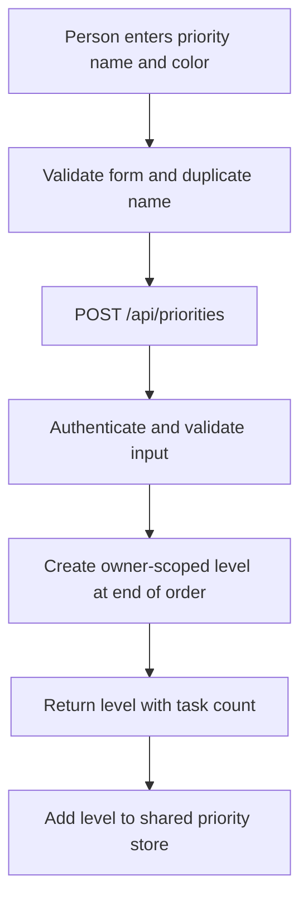

# 02. Create a Priority

## In simple terms

The person creates a named priority level and may choose a color. HabitFlow appends it to their ordered levels, marks it non-default, and makes it available in task forms and filters.

## Flowchart



## Data flow walkthrough

Each numbered item describes one file. Comments explain how the new level reaches shared state.

### 1. `frontend/src/app/features/settings/priorities/priority-settings.ts`

```ts
protected create(input: NameAndColor): void {
  this.creating.set(true);
  // Ask the shared store to create the level and announce success.
  this.store.create(input).subscribe({
    next: (level) => {
      this.createEditor()?.reset();
      this.announcement.set(`Priority “${level.name}” created.`);
    },
    error: (error: unknown) => this.createError.set(saveError(error, input.name)),
  });
}
```

### 2. `frontend/src/app/features/settings/state/priorities.store.ts`

```ts
create(input: NameAndColor): Observable<PriorityLevel> {
  // Add the server-created priority to levels used by forms and filters.
  return this.api.create(input).pipe(tap((level) => this.list.update((levels) => [...levels, level])));
}
```

### 3. `frontend/src/app/features/settings/services/priorities.service.ts`

```ts
create(input: NameAndColor): Observable<PriorityLevel> {
  // Send the new priority's name and color to the API.
  return this.http.post<ApiPriority>(this.baseUrl, input).pipe(map(toPriorityLevel));
}
```

### 4. `backend/src/features/priorities/priority-crud/priority-crud.routes.ts`

```ts
router.post(
  '/',
  auth,
  validateRequest(createPriorityValidator, 'body', 'Invalid priority details'),
  controller.create
);
```

### 5. `backend/src/features/priorities/priority-crud/priority-crud.service.ts`

```ts
async create(userId: string, input: CreatePriorityInput): Promise<PriorityModel> {
  // Convert the database unique-name constraint to a conflict response.
  try {
    return toPriorityModel(await this.dependencies.createPriority(userId, input));
  } catch (error) {
    if (isPriorityNameTaken(error)) throw new PriorityNameTakenError();
    throw error;
  }
}
```

### 6. `backend/src/features/priorities/priority-crud/db/queries/create-priority.query.ts`

```ts
// Assign the next position and create the new level as non-default.
const lastLevel = await prisma.priorityLevel.findFirst({
  where: { userId },
  orderBy: [{ sortOrder: 'desc' }, { id: 'desc' }],
  select: { sortOrder: true },
});
return prisma.priorityLevel.create({
  data: {
    userId,
    name: input.name.trim(),
    color: input.color?.trim() || null,
    sortOrder: (lastLevel?.sortOrder ?? 0) + 1,
    isDefault: false,
  },
});
```

See [tests.md](tests.md) for creation and duplicate-name coverage.
