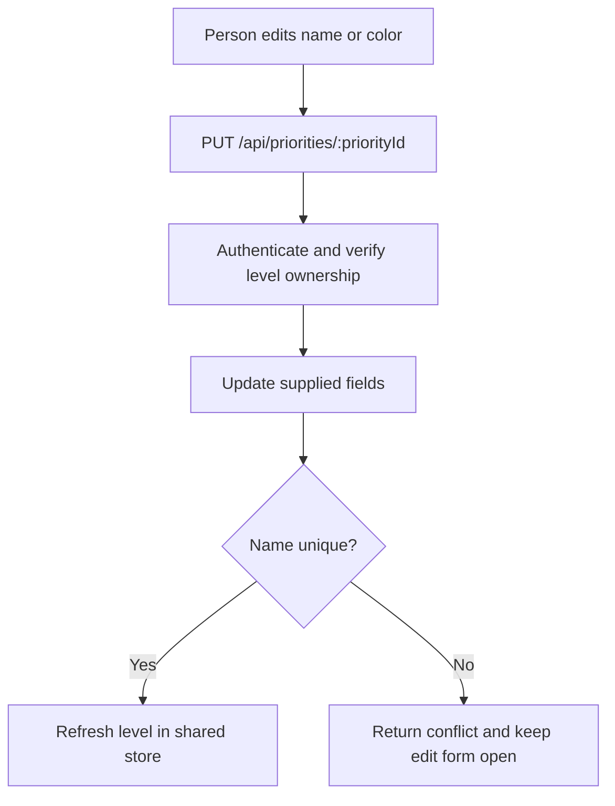

# 03. Edit a Priority

**Version:** 1.0.0  
**Created:** 2026-09-24  
**Last Updated:** 2026-11-25

## In simple terms

The person changes a priority's name or color in Settings. HabitFlow updates only the selected owner's level. Names must remain unique for that user; a duplicate produces a conflict while preserving the editing form.

## Flowchart



## Data flow walkthrough

Each numbered item describes one file. Comments explain the save and unique-name path.

### 1. `frontend/src/app/features/settings/priorities/priority-settings.ts`

```ts
protected saveEdit(level: PriorityLevel, input: NameAndColor): void {
  this.saving.set(true);
  // Save edited fields through the shared store and close on success.
  this.store.update(level.id, input).subscribe({
    next: () => this.editingId.set(null),
    error: (error: unknown) => this.editError.set(saveError(error, input.name)),
  });
}
```

### 2. `frontend/src/app/features/settings/state/priorities.store.ts`

```ts
update(id: number, input: Partial<NameAndColor>): Observable<PriorityLevel> {
  // Replace the matching priority level when the server returns the saved row.
  return this.api.update(id, input).pipe(tap((level) => this.replace(level)));
}
```

### 3. `frontend/src/app/features/settings/services/priorities.service.ts`

```ts
update(priorityId: number, input: Partial<NameAndColor>): Observable<PriorityLevel> {
  // PUT the editable name/color fields and map the returned priority model.
  return this.http.put<ApiPriority>(`${this.baseUrl}/${priorityId}`, input).pipe(map(toPriorityLevel));
}
```

### 4. `backend/src/features/priorities/priority-crud/priority-crud.routes.ts`

```ts
router.put(
  '/:priorityId',
  auth,
  validatePriorityId,
  validateRequest(updatePriorityValidator, 'body', 'Invalid priority update'),
  controller.update
);
```

### 5. `backend/src/features/priorities/priority-crud/priority-crud.service.ts`

```ts
// Update for this owner and map the database uniqueness error to a name conflict.
const priority = await this.dependencies.updatePriority(
  priorityId,
  userId,
  input
);
if (!priority) throw new PriorityNotFoundError();
return toPriorityModel(priority);
```

### 6. `backend/src/features/priorities/priority-crud/db/queries/update-priority.query.ts`

```ts
// Ensure the level belongs to the user before changing its editable fields.
const existing = await prisma.priorityLevel.findFirst({
  where: { id: priorityId, userId, deletedAt: null },
});
if (!existing) return null;
return prisma.priorityLevel.update({
  where: { id: priorityId },
  data: {
    ...(input.name !== undefined ? { name: input.name.trim() } : {}),
    ...(input.color !== undefined
      ? { color: input.color?.trim() || null }
      : {}),
  },
});
```

See [tests.md](tests.md) for update and uniqueness coverage.
