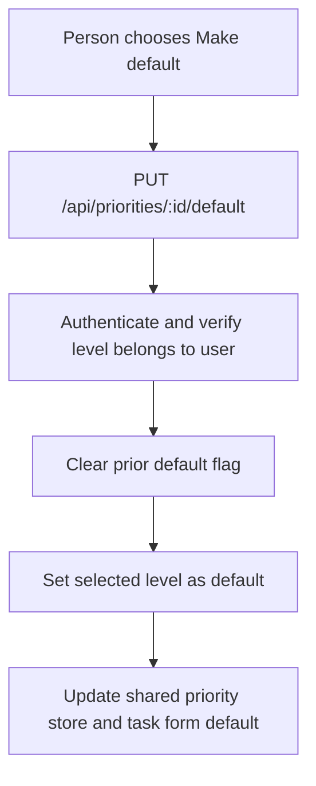

# 04. Set the Default Priority

**Version:** 1.0.0  
**Created:** 2026-09-24  
**Last Updated:** 2026-11-25

## In simple terms

The person selects which priority new tasks should use automatically. HabitFlow marks that level as default and clears the default flag from the person's other active levels. Existing tasks do not change.

## Flowchart



## Data flow walkthrough

Each numbered item describes one file. Comments explain how a single default is maintained.

### 1. `frontend/src/app/features/settings/priorities/priority-settings.ts`

```ts
protected setDefault(level: PriorityLevel): void {
  // Prevent another default request while this level is being saved.
  this.defaultingId.set(level.id);
  this.store.setDefault(level.id).subscribe({
    next: () => this.announcement.set(`${level.name} is now the default priority.`),
    error: () => this.toast.error(`Couldn't make “${level.name}” the default. Please try again.`),
  });
}
```

### 2. `frontend/src/app/features/settings/state/priorities.store.ts`

```ts
setDefault(id: number): Observable<unknown> {
  // On success, make the chosen level the only default in shared state.
  return this.api.setDefault(id).pipe(tap(() => this.list.update((levels) =>
    levels.map((level) => ({ ...level, isDefault: level.id === id })),
  )));
}
```

### 3. `frontend/src/app/features/settings/services/priorities.service.ts`

```ts
setDefault(priorityId: number): Observable<{ id: number; isDefault: true }> {
  // Ask the server to make this priority the default for its owner.
  return this.http.put(`${this.baseUrl}/${priorityId}/default`, null);
}
```

### 4. `backend/src/features/priorities/priority-crud/priority-crud.routes.ts`

```ts
router.put(
  '/:priorityId/default',
  auth,
  validatePriorityId,
  controller.setDefault
);
```

### 5. `backend/src/features/priorities/priority-crud/db/queries/set-default-priority.query.ts`

```ts
// Find this user's active level, clear all old default flags, then set the selected one.
const priority = await prisma.priorityLevel.findFirst({
  where: { id: priorityId, userId, deletedAt: null },
});
if (!priority) return null;
await prisma.priorityLevel.updateMany({
  where: { userId, deletedAt: null },
  data: { isDefault: false },
});
return prisma.priorityLevel.update({
  where: { id: priorityId },
  data: { isDefault: true },
});
```

See [tests.md](tests.md) for one-default-only and task-create default coverage.
