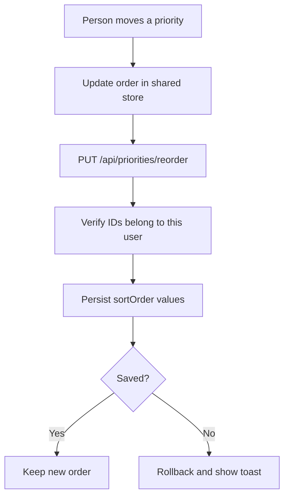

# 05. Reorder Priorities

## In simple terms

The person drags a priority or uses move controls in Settings. HabitFlow immediately displays the new order, sends every priority ID in that order, and restores the old order if the save fails.

## Flowchart



## Data flow walkthrough

Each numbered item describes one file. Comments explain the optimistic update and owner-scoped write.

### 1. `frontend/src/app/features/settings/priorities/priority-settings.ts`

```ts
private reorder(from: number, to: number): boolean {
  const next = moveItem(this.store.levels(), from, to);
  if (!next) return false;
  // The store updates immediately and restores its previous order on API failure.
  this.store.reorder(next.map((level) => level.id));
  this.announcement.set(`${next[to].name} moved to position ${to + 1} of ${next.length}.`);
  return true;
}
```

### 2. `frontend/src/app/features/settings/state/priorities.store.ts`

```ts
reorder(orderedIds: readonly number[]): void {
  const previous = this.list();
  // Apply the requested sort positions before waiting for the server.
  const position = new Map(orderedIds.map((id, index) => [id, index]));
  this.list.set(previous.map((level) => ({ ...level, sortOrder: position.get(level.id) ?? level.sortOrder })));
  this.api.reorder(orderedIds).subscribe({
    error: () => { this.list.set(previous); this.toast.error(REORDER_FAILED_MESSAGE); },
  });
}
```

### 3. `frontend/src/app/features/settings/services/priorities.service.ts`

```ts
// Send every priority ID in the requested order; use the returned IDs as confirmation.
reorder(priorityIds: readonly number[]): Observable<number[]> {
  return this.http.put<{ priorityIds: number[] }>(`${this.baseUrl}/reorder`, { priorityIds })
    .pipe(map((body) => body.priorityIds));
}
```

### 4. `backend/src/features/priorities/priority-crud/priority-crud.routes.ts`

```ts
router.put(
  '/reorder',
  auth,
  validateRequest(reorderPrioritiesValidator, 'body', 'Invalid priority order'),
  controller.reorder
);
```

### 5. `backend/src/features/priorities/priority-crud/db/queries/reorder-priorities.query.ts`

```ts
// Check every requested ID is unique and belongs to the current user.
const owned = await prisma.priorityLevel.findMany({
  where: { userId, deletedAt: null },
  select: { id: true },
});
const uniqueIds = [...new Set(priorityIds)];
const ownedIds = owned.map(({ id }) => id);
if (
  uniqueIds.length !== priorityIds.length ||
  uniqueIds.some((id) => !ownedIds.includes(id))
) {
  throw new Error('Invalid priority reorder request');
}
// Persist the complete ordering transactionally.
return prisma.$transaction(async (tx) => {
  const updates = uniqueIds.map((id, index) =>
    tx.priorityLevel.update({
      where: { id },
      data: { sortOrder: index + 1 },
      include: { _count: { select: { tasks: true } } },
    })
  );
  return Promise.all(updates);
});
```

See [tests.md](tests.md) for ordering, invalid IDs, and rollback coverage.
