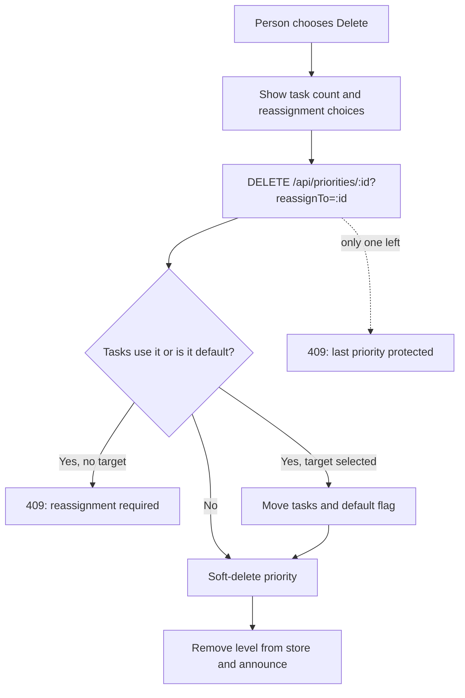

# 06. Delete a Priority and Reassign Tasks

## In simple terms

The person chooses Delete for a priority. If tasks use it, or it is the default, they must choose another priority to receive those tasks and/or the default flag. HabitFlow moves affected tasks, updates the default if needed, and soft-deletes the level in one transaction. The last remaining priority cannot be deleted.

## Flowchart



## Data flow walkthrough

Each numbered item describes one file. Comments explain task reassignment and transaction rules.

### 1. `frontend/src/app/features/settings/priorities/priority-settings.ts`

```ts
protected confirmDelete(reassignTo: number | null): void {
  const level = this.pendingDelete();
  if (!level || this.deleting()) return;
  // Submit the selected replacement when the level is used or is the default.
  this.store.remove(level.id, reassignTo).subscribe({
    next: () => {
      this.pendingDelete.set(null);
      this.announcement.set(`Priority “${level.name}” deleted.`);
    },
    error: (error: unknown) => this.deleteError.set(deleteError(error)),
  });
}
```

### 2. `frontend/src/app/features/settings/services/priorities.service.ts`

```ts
delete(priorityId: number, reassignTo: number | null): Observable<DeletePriorityResult> {
  // Send the replacement ID as a query parameter when one was selected.
  const params = reassignTo === null ? undefined : new HttpParams().set('reassignTo', reassignTo);
  return this.http.delete<DeletePriorityResult>(`${this.baseUrl}/${priorityId}`, { params });
}
```

### 3. `backend/src/features/priorities/priority-crud/priority-crud.routes.ts`

```ts
router.delete(
  '/:priorityId',
  auth,
  validatePriorityId,
  validateRequest(
    deletePriorityQueryValidator,
    'query',
    'Invalid delete priority request'
  ),
  controller.delete
);
```

### 4. `backend/src/features/priorities/priority-crud/priority-crud.service.ts`

```ts
// Delegate deletion and task reassignment to a database transaction.
const priority = await this.dependencies.deletePriorityAndReassign(
  priorityId,
  userId,
  query
);
if (!priority) throw new PriorityNotFoundError();
return toPriorityModel(priority);
```

### 5. `backend/src/features/priorities/priority-crud/db/queries/delete-priority-and-reassign.query.ts`

```ts
return prisma.$transaction(async (transaction) => {
  // Refuse to delete the last level and require a target if tasks/default use this level.
  const current = await transaction.priorityLevel.findFirst({
    where: { id: priorityId, userId, deletedAt: null },
    include: { _count: { select: { tasks: true } } },
  });
  if (!current) return null;
  const active = await transaction.priorityLevel.findMany({
    where: { userId, deletedAt: null },
  });
  if (active.length <= 1) throw new LastPriorityError();
  const mustReassign = current._count.tasks > 0 || current.isDefault;
  if (mustReassign && !query.reassignTo) throw new ReassignRequiredError();
  const target = active.find(
    (item) => item.id === query.reassignTo && item.id !== priorityId
  );
  if (mustReassign && !target) throw new ReassignRequiredError();
  // Move tasks/default if needed, then soft-delete the level in the same transaction.
  if (current._count.tasks > 0 && target) {
    await transaction.task.updateMany({
      where: { userId, priorityId },
      data: { priorityId: target.id },
    });
  }
  if (current.isDefault && target) {
    await transaction.priorityLevel.update({
      where: { id: priorityId },
      data: { isDefault: false },
    });
    await transaction.priorityLevel.update({
      where: { id: target.id },
      data: { isDefault: true },
    });
  }
  return transaction.priorityLevel.update({
    where: { id: priorityId },
    data: { deletedAt: new Date(), isDefault: false },
  });
});
```

The frontend store has a fallback for the response shape: it expects a reassignment summary, while the current controller returns the deleted level model. See [tests.md](tests.md) for coverage.
