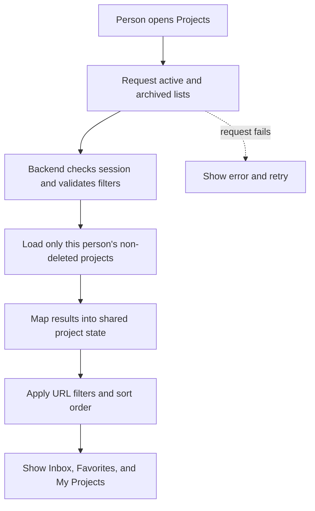

# 01. View, Filter, and Sort Projects

**Version:** 1.0.0  
**Created:** 2026-09-24  
**Last Updated:** 2026-11-25

## In simple terms

The Projects page loads the signed-in person's active projects and archived projects. It shows the Inbox first, then favorites and other projects. The person can filter by favorites, archive status, or color, and can sort the visible list. These filters and sort choices are kept in the URL so they survive reloads and can be shared.

## Flowchart



## Data flow walkthrough

Each numbered item describes one file. Comments in the excerpts explain how the list reaches the page.

### 1. `frontend/src/app/features/projects/project-crud/project-list/project-list.ts`

```ts
constructor() {
  // Load both active and archived projects when the page opens.
  this.load();
}

protected setQuery(changes: Partial<ProjectQuery>): void {
  // Keep the filters and sort in the URL so reloads preserve the view.
  void this.router.navigate([], {
    relativeTo: this.route,
    queryParams: projectQueryToParams({ ...this.query(), ...changes }),
    queryParamsHandling: 'merge',
    replaceUrl: true,
  });
}
```

### 2. `frontend/src/app/features/projects/project-crud/services/project.service.ts`

```ts
refresh(): Observable<Project[]> {
  this.store.startLoading();
  // Fetch active and archived project sets, then combine them for the store.
  return forkJoin([this.list(false), this.list(true)]).pipe(
    map(([active, archived]) => [...active, ...archived]),
    tap({
      next: (projects) => this.store.setProjects(projects),
      error: (error: unknown) => this.store.fail(mapProjectError(error).message),
    }),
  );
}
```

### 3. `frontend/src/app/features/projects/shared/state/projects.store.ts`

```ts
// Keep projects sorted in a stable display order, with Inbox first.
readonly projects = computed(() => [...this.list()].sort(byDisplayOrder));
// Let pages ask for active and archived groups without filtering the source list themselves.
readonly active = computed(() => this.projects().filter((p) => !p.isArchived));
readonly archived = computed(() => this.projects().filter((p) => p.isArchived));
```

### 4. `backend/src/features/projects/project-crud/project-crud.routes.ts`

```ts
router.get(
  '/',
  // Require a signed-in user and validate optional list filters.
  auth,
  validateRequest(
    listProjectsQueryValidator,
    'query',
    'Invalid project filters'
  ),
  controller.list
);
```

### 5. `backend/src/features/projects/project-crud/validators/list-projects-query.validator.ts`

```ts
export const listProjectsQueryValidator = z
  .object({
    // Convert URL booleans and allow supported color and sort choices only.
    isFavorite: queryBoolean.optional(),
    isArchived: queryBoolean.optional(),
    color: z
      .string()
      .regex(/^#[0-9a-fA-F]{6}$/)
      .transform((value) => value.toUpperCase())
      .optional(),
    orderBy: z.enum(['sortOrder', 'name', 'createdAt', 'updatedAt']).optional(),
    orderDirection: z.enum(['asc', 'desc']).optional(),
    limit: z
      .string()
      .regex(/^[1-9]\d*$/)
      .transform(Number)
      .optional(),
  })
  .strict();
```

### 6. `backend/src/features/projects/project-crud/project-crud.service.ts`

```ts
async list(userId: string, filters: ListProjectsFilters) {
  // The database query receives the verified user ID and validated filters.
  const result = await this.dependencies.findOwnedProjects(userId, filters);
  // Convert database records into public project response objects.
  if (Array.isArray(result)) return result.map(toProjectModel);
  return { projects: result.projects.map(toProjectModel), total: result.total };
}
```

### 7. `backend/src/features/projects/shared/db/queries/find-owned-projects.query.ts`

```ts
return {
  // Restrict results to the owner and hide soft-deleted projects.
  userId,
  deletedAt: null,
  isArchived: filters.isArchived ?? false,
  ...(filters.isFavorite !== undefined
    ? { isFavorite: filters.isFavorite }
    : {}),
  ...(filters.color !== undefined
    ? { color: { equals: filters.color, mode: 'insensitive' } }
    : {}),
};
```

The frontend applies its URL query to the loaded projects and renders the matching cards. See [tests.md](tests.md) for list/filter/sort coverage.
