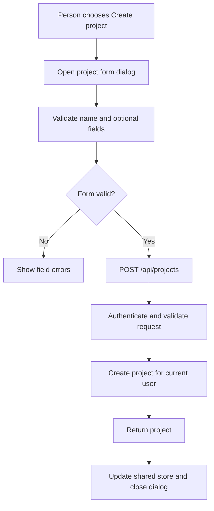

# 02. Create a Project

**Version:** 1.0.0  
**Created:** 2026-09-24  
**Last Updated:** 2026-11-25

## In simple terms

The person opens the New project dialog, enters a name, and may add a description and color. The form trims the name and turns empty optional fields into null values. HabitFlow creates the project for the signed-in account, adds the result to the shared project list, and closes the dialog.

## Flowchart



## Data flow walkthrough

Each numbered item describes one file. Comments explain the steps from the popup to the database.

### 1. `frontend/src/app/features/projects/project-crud/components/new-project-dialog/new-project-dialog.ts`

```ts
template: `
  <div class="dialog" role="dialog" aria-modal="true" cdkTrapFocus>
    <!-- Reuse ProjectForm in create mode; closing the form closes the popup. -->
    <app-project-form [dialog]="true" (closed)="store.creating.set(false)" />
  </div>
`,
```

### 2. `frontend/src/app/features/projects/project-crud/project-form/project-form.ts`

```ts
private values(): CreateProjectRequest {
  const { name, description, color } = this.form.getRawValue();
  // Trim the required name and normalize blank optional values to null.
  return { name: name.trim(), description: description.trim() || null, color: color || null };
}

private create(): void {
  this.submitting.set(true);
  this.projects.create(this.values()).subscribe({
    // Close the dialog only after the API confirms creation.
    next: () => this.closed.emit(),
    error: (error: unknown) => this.showError(error),
  });
}
```

### 3. `frontend/src/app/features/projects/project-crud/services/project.service.ts`

```ts
create(request: CreateProjectRequest): Observable<Project> {
  // Send only user-editable fields; the server controls Inbox/favorite/archive flags.
  const body = { name: request.name, description: request.description, color: request.color };
  return this.http.post<ApiProject>(this.baseUrl, body).pipe(
    map(toProject),
    // Make the new card available to every project view without reloading.
    tap((project) => this.store.upsert(project)),
  );
}
```

### 4. `backend/src/features/projects/project-crud/project-crud.routes.ts`

```ts
router.post(
  '/',
  // Only an authenticated user can create a project.
  auth,
  validateRequest(createProjectValidator, 'body', 'Invalid project details'),
  controller.create
);
```

### 5. `backend/src/features/projects/project-crud/validators/create-project.validator.ts`

```ts
export const createProjectValidator = z
  .object({
    // Require a non-empty name and enforce description/color formats.
    name: projectName,
    description: projectDescription.optional(),
    color: projectColor.optional(),
  })
  .strict(); // Reject client attempts to set system-owned project flags.
```

### 6. `backend/src/features/projects/project-crud/project-crud.controller.ts`

```ts
const project = await service.create(
  // Take ownership from the verified session, not from the request body.
  req.auth!.userId,
  res.locals.validated as CreateProjectInput
);
res.status(201).json(project);
```

### 7. `backend/src/features/projects/project-crud/project-crud.service.ts`

```ts
async create(userId: string, input: CreateProjectInput) {
  // Create the database record, then map it to the API's public project shape.
  return toProjectModel(await this.dependencies.createProject(userId, input));
}
```

### 8. `backend/src/features/projects/project-crud/db/queries/create-project.query.ts`

```ts
return prisma.project.create({
  // Associate the project with the authenticated owner and save editable values.
  data: {
    userId,
    name: input.name,
    description: input.description,
    color: input.color,
  },
});
```

See [tests.md](tests.md) for create, validation, and ownership coverage.
