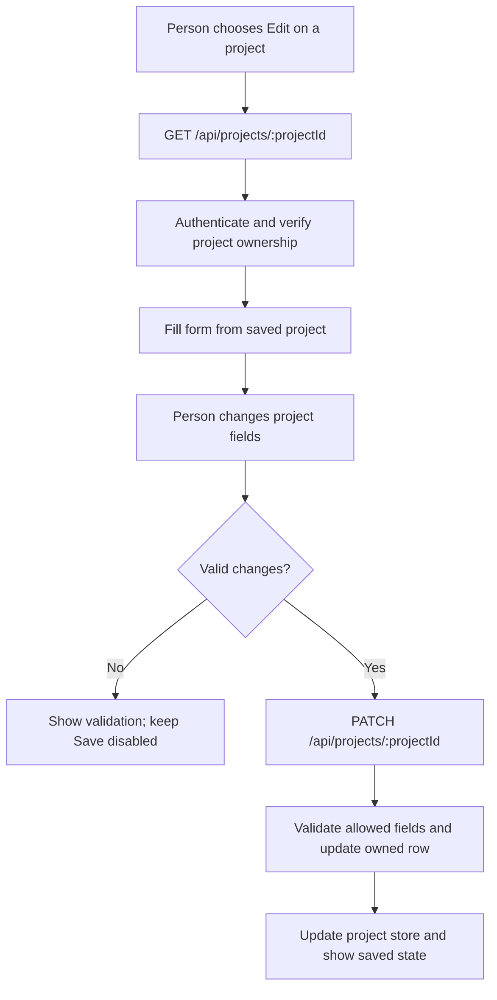

# 03. Edit a Project

**Version:** 1.0.0  
**Created:** 2026-09-24  
**Last Updated:** 2026-11-25

## In simple terms

The person chooses Edit on a project card. HabitFlow loads that project into a form. The person can change its name, description, or color; the form sends only fields that actually changed. The Inbox is read-only and cannot be edited.

## Flowchart



## Data flow walkthrough

Each numbered item describes one file. Comments explain loading, editing, and saving an owned project.

### 1. `frontend/src/app/features/projects/project-crud/components/project-card/project-card.ts`

```ts
// Open the edit form for this card's project ID.
<a class="action edit" [routerLink]="['/projects', project().projectId, 'edit']">
  Edit
</a>
```

### 2. `frontend/src/app/features/projects/project-crud/project-form/project-form.ts`

```ts
protected load(): void {
  // Read the existing project before showing its saved values in the form.
  this.projects.get(this.projectId).subscribe({
    next: (project) => {
      this.project.set(project);
      this.form.reset({
        name: project.name,
        description: project.description ?? '',
        color: project.color ?? '',
      });
      this.loadState.set('ready');
    },
  });
}
```

### 3. `frontend/src/app/features/projects/project-crud/project-form/project-form.ts`

```ts
private changes(): UpdateProjectRequest {
  const project = this.project();
  if (!project) return {};
  const values = this.values();
  // Build a patch containing only values that differ from the saved project.
  const changes: UpdateProjectRequest = {};
  if (values.name !== project.name) changes.name = values.name;
  if (values.description !== project.description) changes.description = values.description;
  if (values.color?.toLowerCase() !== project.color?.toLowerCase()) changes.color = values.color;
  return changes;
}
```

### 4. `frontend/src/app/features/projects/project-crud/services/project.service.ts`

```ts
get(projectId: number): Observable<Project> {
  // Load the owned project and put it into shared state.
  return this.http.get<ApiProject>(`${this.baseUrl}/${projectId}`).pipe(
    map(toProject),
    tap((project) => this.store.upsert(project)),
  );
}

update(projectId: number, changes: UpdateProjectRequest): Observable<Project> {
  // Send only changed fields, then replace the saved project in the store.
  return this.http.patch<ApiProject>(`${this.baseUrl}/${projectId}`, changes).pipe(
    map(toProject),
    tap((project) => this.store.upsert(project)),
  );
}
```

### 5. `backend/src/features/projects/project-crud/project-crud.routes.ts`

```ts
router.patch(
  '/:projectId',
  // Check login, valid ID, ownership, then allowed update fields.
  auth,
  validateProjectId,
  requireOwnedProject,
  validateRequest(updateProjectValidator, 'body', 'Invalid project update'),
  controller.update
);
```

### 6. `backend/src/features/projects/shared/middleware/owned-project.middleware.ts`

```ts
// Find the project using both its ID and the current user's ID.
const project = await findProject(projectId, req.auth!.userId);
if (!project) {
  res.status(404).json({ error: 'Project not found' });
  return;
}
// Pass the verified owned project to the update controller.
res.locals.ownedProject = project;
next();
```

### 7. `backend/src/features/projects/project-crud/validators/update-project.validator.ts`

```ts
// Allow only project-editable fields and require at least one changed field.
export const updateProjectValidator = z
  .object({
    name: z.string().trim().min(1).max(150).optional(),
    description: z.string().max(500).nullable().optional(),
    color: z
      .string()
      .regex(/^#[\da-fA-F]{6}$/)
      .nullable()
      .optional(),
  })
  .strict()
  .refine((data) => Object.keys(data).length > 0, {
    message: 'At least one project field must be provided',
  });
```

### 8. `backend/src/features/projects/project-crud/project-crud.service.ts`

```ts
async update(project: ProjectRecord, userId: string, input: UpdateProjectInput) {
  // The Inbox is system-owned and cannot be renamed or changed.
  if (project.isInbox) throw new InboxProjectMutationError();
  const updated = await this.dependencies.updateOwnedProject(project.id, userId, input);
  if (!updated) throw new ProjectNotFoundError();
  return toProjectModel(updated);
}
```

### 9. `backend/src/features/projects/project-crud/db/queries/update-owned-project.query.ts`

```ts
// Update only a non-deleted, non-Inbox project owned by this user.
const result = await prisma.project.updateMany({
  where: { id: projectId, userId, deletedAt: null, isInbox: false },
  data: { ...input, updatedAt: new Date() },
});
if (result.count === 0) return null;
// Return the updated record through the same owner-scoped lookup.
return findOwnedProject(projectId, userId);
```

See [tests.md](tests.md) for edit, ownership, and Inbox protection coverage.
