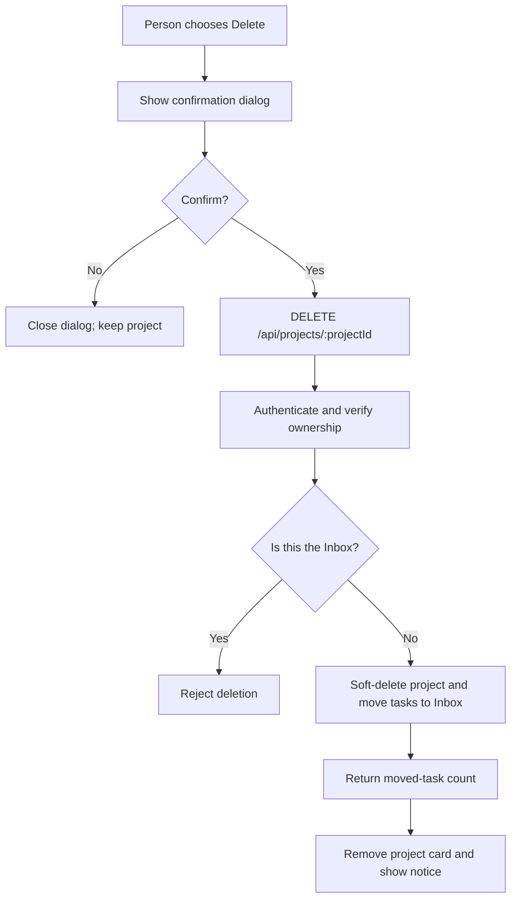

# 04. Delete a Project

**Version:** 1.0.0  
**Created:** 2026-09-24  
**Last Updated:** 2026-11-25

## In simple terms

The person chooses Delete and confirms in a dialog. HabitFlow soft-deletes the project rather than erasing it, moves its active tasks into the Inbox, and tells the person how many tasks moved. The Inbox itself cannot be deleted.

## Flowchart



## Data flow walkthrough

Each numbered item describes one file. Comments explain confirmation, soft deletion, and task handling.

### 1. `frontend/src/app/features/projects/project-crud/project-list/project-list.ts`

```ts
protected confirmDelete(): void {
  const project = this.pendingDelete();
  // Ignore duplicate confirms and keep the selected project for the dialog.
  if (!project || this.deleting()) return;
  this.deleting.set(true);
  this.projects.delete(project.projectId).subscribe({
    next: ({ movedTaskCount }) => {
      this.pendingDelete.set(null);
      // Tell the person when deleting moved tasks into Inbox.
      this.notice.set(deletedNotice(project.name, movedTaskCount));
    },
    error: (error: unknown) => this.deleteError.set(mapProjectError(error).message),
  });
}
```

### 2. `frontend/src/app/features/projects/project-crud/services/project.service.ts`

```ts
delete(projectId: number): Observable<DeleteProjectResponse> {
  return this.http.delete<Partial<DeleteProjectResponse> | null>(`${this.baseUrl}/${projectId}`).pipe(
    // Remove the deleted card from the shared state after a successful response.
    tap(() => this.store.remove(projectId)),
    // The 204 has no body, so this code defaults a missing body count to zero.
    map((response) => ({ movedTaskCount: response?.movedTaskCount ?? 0 })),
  );
}
```

The backend sends the actual moved-task count in the `X-Moved-Task-Count` response header, but this frontend request reads only the response body. Since the backend returns `204 No Content`, the current service defaults that count to zero; this is a frontend/backend response-contract mismatch.

### 3. `backend/src/features/projects/project-crud/project-crud.routes.ts`

```ts
router.delete(
  '/:projectId',
  // Require login, a valid ID, and a project owned by this account.
  auth,
  validateProjectId,
  requireOwnedProject,
  controller.delete
);
```

### 4. `backend/src/features/projects/project-crud/project-crud.controller.ts`

```ts
const movedTaskCount = await service.delete(
  res.locals.ownedProject as ProjectRecord,
  req.auth!.userId
);
// Return the count in a header; 204 has no response body.
res.setHeader('X-Moved-Task-Count', String(movedTaskCount));
res.status(204).end();
```

### 5. `backend/src/features/projects/project-crud/project-crud.service.ts`

```ts
// The Inbox is required and therefore cannot be deleted by the user.
if (project.isInbox) throw new InboxProjectMutationError();
const movedTaskCount = await this.dependencies.softDeleteOwnedProject(
  project.id,
  userId
);
if (movedTaskCount === null) throw new ProjectNotFoundError();
return movedTaskCount;
```

### 6. `backend/src/features/projects/project-crud/db/queries/soft-delete-owned-project.query.ts`

```ts
return prisma.$transaction(async (transaction) => {
  const updatedAt = new Date();
  // Mark the owned project deleted, but leave its data recoverable in the database.
  const result = await transaction.project.updateMany({
    where: { id: projectId, userId, deletedAt: null, isInbox: false },
    data: { deletedAt: updatedAt, updatedAt },
  });
  if (result.count === 0) return null;
  // Find this owner's Inbox before moving any tasks.
  const inbox = await transaction.project.findFirst({
    where: { userId, isInbox: true, deletedAt: null },
    select: { id: true },
  });
  if (!inbox) throw new Error('Inbox project not found for owner');
  // Move active tasks to this user's Inbox in the same transaction.
  const movedTasks = await transaction.task.updateMany({
    where: { projectId, userId, deletedAt: null },
    data: { projectId: inbox.id, updatedAt },
  });
  return movedTasks.count;
});
```

See [tests.md](tests.md) for confirmation, Inbox protection, soft-delete, and task-move coverage.
