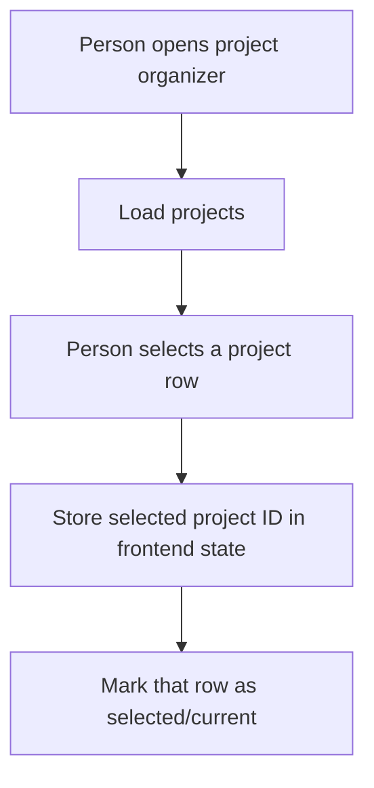

# 05. Select a Project

## In simple terms

In the project organizer, the person selects Inbox or another project. HabitFlow highlights that row and marks it as the current selection for this page session. This action is local UI state; it does not call the backend or change which project owns existing tasks.

## Flowchart



## Data flow walkthrough

Each numbered item describes one file. Project selection is intentionally local state rather than a database update.

### 1. `frontend/src/app/features/projects/project-organization/project-switcher/project-switcher.ts`

```ts
protected select(project: Project): void {
  // Record the selected project ID in the shared store.
  this.store.select(project.projectId);
  // Announce the change for assistive technology.
  this.announcement.set(`Switched to ${project.name}.`);
}
```

### 2. `frontend/src/app/features/projects/shared/state/projects.store.ts`

```ts
// Keep the selection as an in-memory project ID; no API request is made here.
readonly selectedProjectId = signal<number | null>(null);

select(projectId: number | null): void {
  this.selectedProjectId.set(projectId);
}
```

### 3. `frontend/src/app/features/projects/project-organization/project-switcher/project-switcher.html`

```html
<div
  class="row"
  [class.selected]="store.selectedProjectId() === project.projectId"
>
  <!-- Show which project is currently selected in this organizer view. -->
  <button
    type="button"
    class="select"
    [attr.aria-current]="store.selectedProjectId() === project.projectId ? 'true' : null"
    (click)="select(project)"
  >
    <span class="name">{{ project.name }}</span>
  </button>
</div>
```

Selecting a row updates only client-side selection state. Opening a project's task list is a separate navigation link from a project card. See [tests.md](tests.md) for selection behavior.
