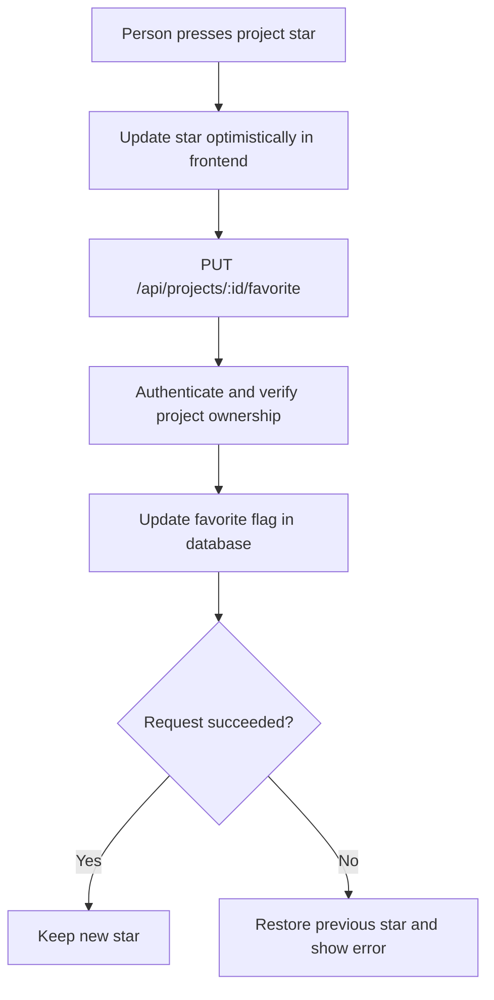

# 06. Favorite or Unfavorite a Project

**Version:** 1.0.0  
**Created:** 2026-09-24  
**Last Updated:** 2026-11-25

## In simple terms

The person presses the star next to a project. HabitFlow updates the star immediately, sends the change to the server, and keeps the new state if the request succeeds. If the request fails, it restores the old star and explains the problem. The Inbox cannot be favorited through the organizer controls.

## Flowchart



## Data flow walkthrough

Each numbered item describes one file. Comments explain the immediate UI response and server save.

### 1. `frontend/src/app/features/projects/project-organization/project-switcher/project-switcher.ts`

```ts
protected toggleFavorite(project: Project): void {
  const isFavorite = !project.isFavorite;
  // Send the requested state and announce the result to the person.
  this.run(project, this.organization.setFavorite(project, isFavorite),
    isFavorite ? `Added ${project.name} to favorites.` : `Removed ${project.name} from favorites.`);
}
```

### 2. `frontend/src/app/features/projects/project-organization/services/project-organization.service.ts`

```ts
setFavorite(project: Project, isFavorite: boolean): Observable<SetFavoriteResponse> {
  // Update the shared project immediately; optimistic() restores it if the request fails.
  return this.optimistic(project.projectId, 'isFavorite', isFavorite, () =>
    this.http.put<SetFavoriteResponse>(`${this.baseUrl}/${project.projectId}/favorite`, {
      isFavorite,
    }),
  );
}
```

### 3. `backend/src/features/projects/project-organization/project-organization.routes.ts`

```ts
router.put(
  '/:projectId/favorite',
  // Require login, a valid project ID, and ownership before updating its star.
  auth,
  validateProjectId,
  requireOwnedProject,
  validateRequest(setFavoriteValidator, 'body', 'isFavorite is required'),
  controller.favorite
);
```

### 4. `backend/src/features/projects/project-organization/project-organization.controller.ts`

```ts
const result = await service.setFavorite(
  res.locals.ownedProject as ProjectRecord,
  req.auth!.userId,
  (res.locals.validated as SetFavoriteInput).isFavorite
);
// Return the saved project ID and favorite state to the frontend.
res.status(200).json(result);
```

### 5. `backend/src/features/projects/project-organization/project-organization.service.ts`

```ts
const result = await this.dependencies.setProjectFavorite(
  project.id,
  userId,
  isFavorite
);
if (result.count !== 1) throw new ProjectNotFoundError();
// Keep the response small; the frontend already has the rest of the project.
return {
  projectId: project.id,
  isFavorite,
  message: isFavorite
    ? 'Project added to favorites'
    : 'Project removed from favorites',
};
```

### 6. `backend/src/features/projects/project-organization/db/queries/set-project-favorite.query.ts`

```ts
return prisma.project.updateMany({
  // Change only a live project owned by the signed-in user.
  where: { id: projectId, userId, deletedAt: null },
  data: { isFavorite, updatedAt: new Date() },
});
```

See [tests.md](tests.md) for favorite toggle, ownership, and rollback coverage.
