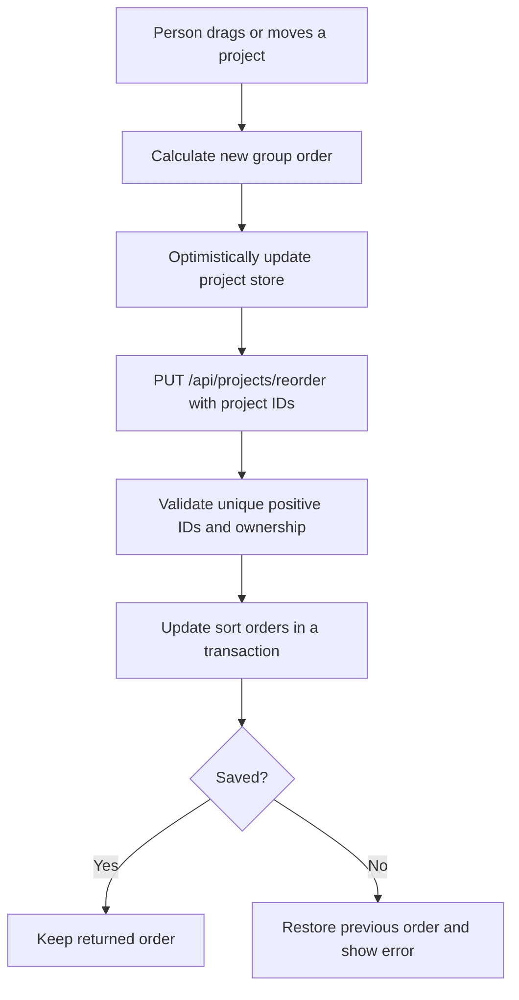

# 07. Reorder Projects

**Version:** 1.0.0  
**Created:** 2026-09-24  
**Last Updated:** 2026-11-25

## In simple terms

The person drags a project or uses its move buttons to change its place in Favorites or My Projects. HabitFlow calculates a complete project order, updates the list immediately, sends the new IDs to the backend, then saves new sort numbers. If the request fails, the previous order is restored.

## Flowchart



## Data flow walkthrough

Each numbered item describes one file. Comments explain how a gesture becomes persisted sort order.

### 1. `frontend/src/app/features/projects/project-organization/project-switcher/project-switcher.ts`

```ts
protected move(group: ReorderableGroup, from: number, to: number): void {
  const split = this.split();
  // Build a request only when an item really changes position.
  const payload = reorderPayload(split, group, from, to);
  if (!payload || this.reordering()) return;
  this.reordering.set(true);
  // Send the complete requested project order and show any API failure.
  this.organization.reorder(payload).subscribe({
    error: (error: unknown) => this.failed(error),
  });
}
```

### 2. `frontend/src/app/features/projects/project-organization/utils/reorder-projects.util.ts`

```ts
// Move an item within its group, then send all groups in their stable order.
const moved = { ...split, [group]: moveItem(split[group], from, to) };
const projectIds = [...moved.favorites, ...moved.active, ...moved.archived].map(
  (project) => project.projectId
);
return {
  request: { projectIds },
  sortOrders: projectIds.map((projectId, sortOrder) => ({
    projectId,
    sortOrder,
  })),
};
```

### 3. `frontend/src/app/features/projects/project-organization/services/project-organization.service.ts`

```ts
// Show the proposed order immediately but keep a copy for rollback.
const previous = this.store
  .projects()
  .map(({ projectId, sortOrder }) => ({ projectId, sortOrder }));
this.store.applySortOrders(sortOrders);
return this.http
  .put<ReorderProjectsResponse>(`${this.baseUrl}/reorder`, request)
  .pipe(
    tap(({ projects }) => this.store.applySortOrders(projects)),
    catchError((error: unknown) => {
      this.store.applySortOrders(previous);
      return throwError(() => error);
    })
  );
```

### 4. `backend/src/features/projects/project-organization/project-organization.routes.ts`

```ts
router.put(
  '/reorder',
  // This request has a list of IDs, so the service checks every ID belongs to this user.
  auth,
  validateRequest(reorderProjectsValidator, 'body', 'Invalid project order'),
  controller.reorder
);
```

### 5. `backend/src/features/projects/project-organization/validators/reorder-projects.validator.ts`

```ts
// Require a non-empty list of positive integer IDs with no duplicates.
export const reorderProjectsValidator = z
  .object({
    projectIds: z.array(z.number().int().positive()).min(1),
  })
  .strict()
  .refine((data) => new Set(data.projectIds).size === data.projectIds.length, {
    path: ['projectIds'],
    message: 'Project IDs must be unique',
  });
```

### 6. `backend/src/features/projects/project-organization/project-organization.controller.ts`

```ts
const { projectIds } = res.locals.validated as ReorderProjectsInput;
// Pass the validated list and owner ID to the organization service.
const projects = await service.reorder(projectIds, req.auth!.userId);
res
  .status(200)
  .json({ projects, message: 'Project order updated successfully' });
```

### 7. `backend/src/features/projects/project-organization/db/queries/update-project-sort-orders.query.ts`

```ts
return prisma.$transaction(async (transaction) => {
  // Load this user's live non-Inbox projects and reject IDs they do not own.
  const existing = await transaction.project.findMany({
    where: { userId, deletedAt: null, isInbox: false },
    select: { id: true },
  });
  const ownedProjectIds = new Set(existing.map((project) => project.id));
  const requestedIds = new Set(projectIds);
  if (projectIds.some((id) => !ownedProjectIds.has(id))) {
    throw new ProjectNotFoundError();
  }
  // Append any owned project omitted from the request after the requested IDs.
  const orderedIds = [
    ...projectIds,
    ...existing
      .map((project) => project.id)
      .filter((id) => !requestedIds.has(id)),
  ];
  // Recalculate all sort numbers and persist them inside the transaction.
  const sortOrders = reorderProjects(orderedIds);
  for (const { projectId, sortOrder } of sortOrders) {
    const result = await transaction.project.updateMany({
      where: { id: projectId, userId, deletedAt: null, isInbox: false },
      data: { sortOrder, updatedAt: new Date() },
    });
    if (result.count !== 1) throw new ProjectNotFoundError();
  }
  return sortOrders;
});
```

The single-project `sort-order` API route is not called by the current frontend; the user-facing reorder action uses the bulk endpoint above. See [tests.md](tests.md).
