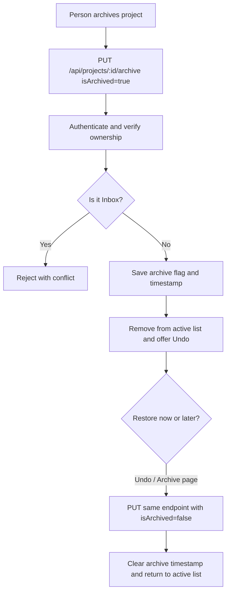

# 08. Archive or Restore a Project

## In simple terms

The person can archive a project they are finished with. The project disappears from active project lists, but it is not deleted. HabitFlow offers an Undo action immediately; later, the person can restore the project from the Archive page. The Inbox cannot be archived.

## Flowchart



## Data flow walkthrough

Each numbered item describes one file. Comments explain archiving in Projects and restoring through the Archive feature.

### 1. `frontend/src/app/features/projects/project-organization/project-switcher/project-switcher.ts`

```ts
protected setArchived(project: Project, isArchived: boolean): void {
  this.run(project, this.organization.setArchived(project, isArchived),
    isArchived ? `Archived ${project.name}.` : `Restored ${project.name}.`,
    () => {
      // After archiving, offer an immediate Undo that sends the reverse change.
      if (isArchived) this.archiveUndo.offerUndo(
        { kind: 'project', id: project.projectId, name: project.name },
        () => this.setArchived(this.store.byId(project.projectId) ?? project, false),
      );
    },
  );
}
```

### 2. `frontend/src/app/features/projects/project-organization/services/project-organization.service.ts`

```ts
setArchived(project: Project, isArchived: boolean): Observable<SetArchivedResponse> {
  // Update the flag immediately and roll it back if the API call fails.
  return this.optimistic(project.projectId, 'isArchived', isArchived, () =>
    this.http.put<SetArchivedResponse>(`${this.baseUrl}/${project.projectId}/archive`, {
      isArchived,
    }),
  );
}
```

### 3. `frontend/src/app/features/archive/services/archive.service.ts`

```ts
setArchived(kind: ArchiveKind, id: number, isArchived: boolean): Observable<void> {
  const project = kind === 'project' ? this.projects.byId(id) : undefined;
  // Restoring a project from Archive reuses the Projects organization API/service.
  const request = project
    ? this.projectOrganization.setArchived(project, isArchived)
    : this.http.put(`${this.api}/${PATH[kind]}/${id}/archive`, { isArchived });
  return request.pipe(tap(() => this.synced(kind, id, isArchived)), map(() => undefined));
}
```

### 4. `backend/src/features/projects/project-organization/project-organization.routes.ts`

```ts
router.put(
  '/:projectId/archive',
  // Check authentication, project ID, ownership, and requested boolean value.
  auth,
  validateProjectId,
  requireOwnedProject,
  validateRequest(setArchivedValidator, 'body', 'isArchived is required'),
  controller.archive
);
```

### 5. `backend/src/features/projects/project-organization/project-organization.service.ts`

```ts
async setArchived(project: ProjectRecord, userId: string, isArchived: boolean) {
  // The Inbox is essential and cannot be archived.
  if (project.isInbox && isArchived) throw new InboxCannotBeArchivedError();
  const updated = await this.dependencies.setProjectArchived(project.id, userId, isArchived);
  if (!updated) throw new ProjectNotFoundError();
  // Archiving sets archivedAt; restoring clears it in the database query.
  return { projectId: project.id, isArchived: updated.isArchived, archivedAt: updated.archivedAt };
}
```

### 6. `backend/src/features/projects/project-organization/db/queries/set-project-archived.query.ts`

```ts
// Update only an owned, live project in the expected prior state; never archive Inbox.
const updated = await prisma.project.updateMany({
  where: {
    id: projectId,
    userId,
    deletedAt: null,
    isArchived: !isArchived,
    ...(isArchived ? { isInbox: false } : {}),
  },
  data: { isArchived, archivedAt: isArchived ? updatedAt : null, updatedAt },
});
```

Restoring from the Archive page is documented in the Archive feature as well. See [tests.md](tests.md) for both archive and restore coverage.
