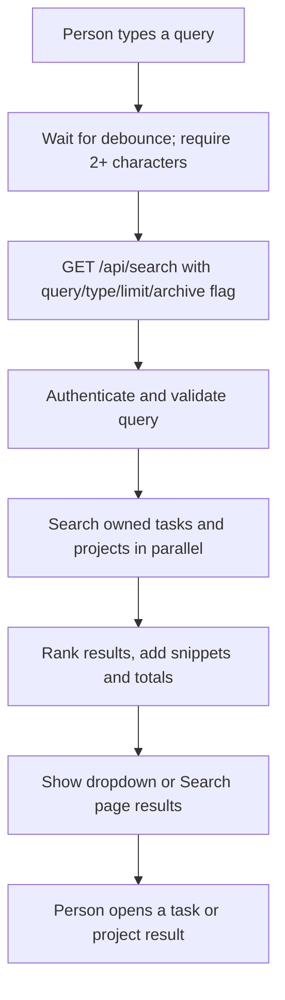

# 01. Search Tasks and Projects

**Version:** 1.0.0  
**Created:** 2026-09-24  
**Last Updated:** 2026-11-25

## In simple terms

The person searches from the top bar or Search page. HabitFlow waits until the query has at least two characters, then searches the person's tasks and projects. Results are ranked by exact/prefix/contains matches, grouped by type, and archived items are excluded unless the person opts in.

## Flowchart



## Data flow walkthrough

Each numbered item describes one file. Comments explain the search request, server query, and navigation.

### 1. `frontend/src/app/features/search/components/search-box/search-box.ts`

```ts
// Wait after typing and drop the answer to an older query when a newer one arrives.
this.requests.pipe(
  debounce((request) => timer(request.immediate ? 0 : SEARCH_DEBOUNCE_MS)),
  distinctUntilChanged(
    (a, b) => a.q === b.q && a.includeArchived === b.includeArchived
  ),
  switchMap((request) => {
    if (!isSearchable(request.q)) return EMPTY;
    return this.search.search(request.q, {
      includeArchived: request.includeArchived,
    });
  })
);
```

### 2. `frontend/src/app/features/search/services/search.service.ts`

```ts
search(query: string, options: SearchOptions = {}): Observable<SearchResults> {
  // Trim/cap the query and include type, result limit, and archived toggle.
  const q = query.trim().slice(0, MAX_QUERY_LENGTH);
  const params = new HttpParams()
    .set('q', q)
    .set('type', options.type ?? 'all')
    .set('limit', String(options.limit ?? DROPDOWN_LIMIT))
    .set('includeArchived', String(options.includeArchived ?? false));
  return this.http.get<ApiSearchResponse>(this.url, { params }).pipe(
    // Flatten each group for the UI while retaining server totals.
    map((body) => ({
      query: q,
      tasks: body.tasks.items,
      projects: body.projects.items,
      counts: { tasks: body.tasks.total, projects: body.projects.total },
    })),
  );
}
```

### 3. `backend/src/features/search/search.routes.ts`

```ts
router.get(
  '/',
  requireAuth(sessionService),
  // Reject too-short/long queries and unsupported filters before searching.
  validateRequest(searchQueryValidator, 'query', 'Invalid search query'),
  createSearchController(service)
);
```

### 4. `backend/src/features/search/search.service.ts`

```ts
// Run only the requested result groups; the default searches tasks and projects together.
const [tasks, projects] = await Promise.all([
  query.type === 'all' || query.type === 'tasks'
    ? this.dependencies.searchTasks(
        userId,
        query.q,
        query.limit,
        query.includeArchived
      )
    : Promise.resolve(emptyTasks),
  query.type === 'all' || query.type === 'projects'
    ? this.dependencies.searchProjects(
        userId,
        query.q,
        query.limit,
        query.includeArchived
      )
    : Promise.resolve(emptyProjects),
]);
return { tasks, projects };
```

### 5. `backend/src/features/search/db/queries/search-tasks.query.ts`

```ts
// Search only this user's live tasks; archived tasks/projects are opt-in.
where task.user_id = ${userId}::uuid
  and task.deleted_at is null
  and (task.title ilike ${containsPattern} or task.description ilike ${containsPattern})
  and (${includeArchived}::boolean or (task.archived_at is null and not project.is_archived))
// Exact matches rank ahead of prefixes, then other contains matches.
order by case when task.title ilike ${exactPattern} then ${SEARCH_RANK.exact} else ${SEARCH_RANK.contains} end
```

### 6. `frontend/src/app/features/search/components/search-page/search-page.ts`

```ts
// Keep query, result type, and archived toggle in the URL for reload/Back behavior.
protected select(type: SearchType): void {
  this.setParams({ type: type === 'all' ? null : type }, true);
}

protected open(result: SearchResult): void {
  // SearchService routes a task to its editor and a project to its task list.
  void this.search.open(result);
}
```

See [tests.md](tests.md) for search ranking, query, result, and navigation coverage.
