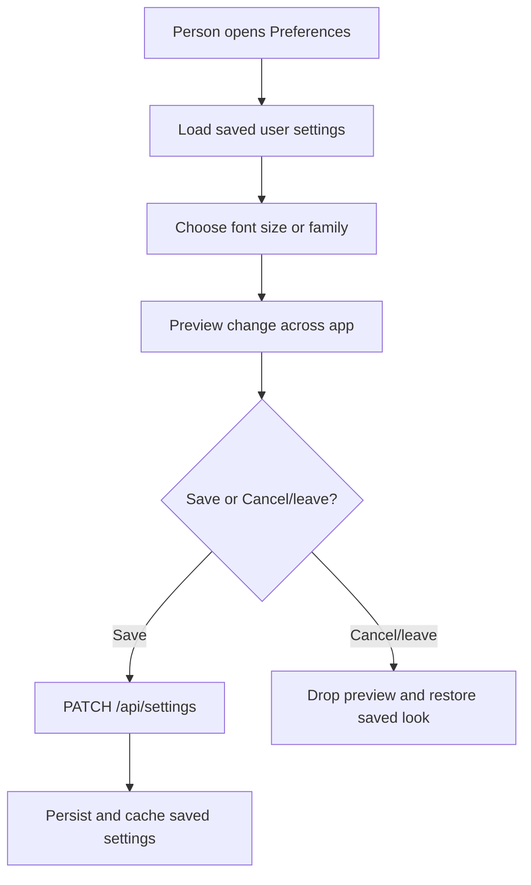

# 01. Set Appearance Preferences

**Version:** 1.0.0  
**Created:** 2026-09-24  
**Last Updated:** 2026-11-25

## In simple terms

In Preferences, the person changes the app's font size or font family. The choice previews across the app immediately, but it is not saved until Save is pressed. Cancel or leaving the page removes the preview and restores the saved appearance.

## Flowchart



## Data flow walkthrough

Each numbered item describes one file. Comments explain the preview versus persisted value.

### 1. `frontend/src/app/features/settings/preferences/preferences-settings.ts`

```ts
private apply(appearance: Appearance): void {
  // Show the choice now, without saving it yet.
  this.touched.set(true);
  this.fontSize.set(appearance.fontSize);
  this.fontFamily.set(appearance.fontFamily);
  this.store.previewAppearance(appearance);
}

protected cancel(): void {
  // Restore saved values and remove the app-wide preview.
  const { fontSize, fontFamily } = this.store.settings();
  this.fontSize.set(fontSize);
  this.fontFamily.set(fontFamily);
  this.store.cancelPreview();
}
```

### 2. `frontend/src/app/features/settings/state/settings.store.ts`

```ts
save(changes: SettingsChanges): Observable<UserSettings> {
  return this.injector.get(SettingsService).update(changes).pipe(
    tap((settings) => {
      // Cache the server response and replace the preview with saved appearance.
      this.set(settings);
      this.loaded.set(true);
      this.preview.set(null);
    }),
  );
}
```

### 3. `frontend/src/app/features/settings/services/settings.service.ts`

```ts
// Send only the changed preference fields to the settings API.
update(changes: SettingsChanges): Observable<UserSettings> {
  return this.http.patch<UserSettings>(this.url, changes);
}
```

### 4. `backend/src/features/settings/settings.routes.ts`

```ts
router.patch(
  '/',
  // Only an authenticated user can change their saved settings.
  auth,
  validateRequest(updateSettingsValidator, 'body', 'Invalid settings update'),
  controller.update
);
```

### 5. `backend/src/features/settings/validators/update-settings.validator.ts`

```ts
// Accept only the supported font choices and require at least one setting.
fontSize: z.enum(['small', 'medium', 'large', 'x-large']).optional(),
fontFamily: z.enum(['system', 'sans-serif', 'serif', 'monospace', 'atkinson-hyperlegible']).optional(),
```

### 6. `backend/src/features/settings/db/queries/update-settings.query.ts`

```ts
return prisma.userSetting.upsert({
  where: { userId },
  create: {
    userId,
    fontSize: input.fontSize ?? 'medium',
    fontFamily: input.fontFamily ?? 'system',
  },
  // Change only supplied settings; keep dashboard limits and other preferences as-is.
  update: {
    ...(input.fontSize !== undefined ? { fontSize: input.fontSize } : {}),
    ...(input.fontFamily !== undefined ? { fontFamily: input.fontFamily } : {}),
  },
});
```

See [tests.md](tests.md) for preview, save, cancel, validation, and error coverage.
