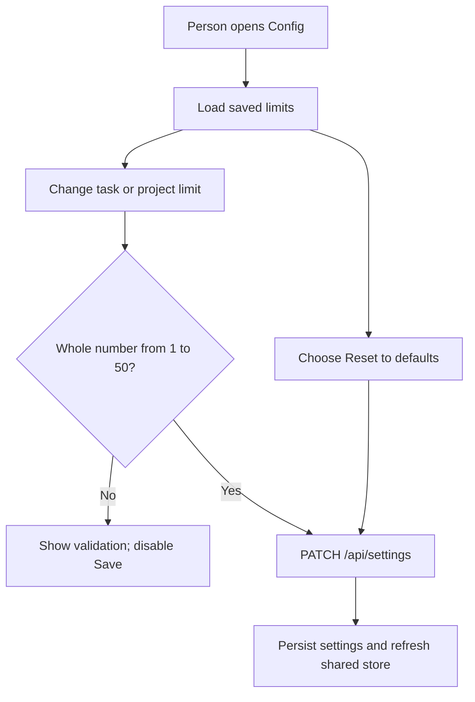

# 02. Configure Dashboard Limits

## In simple terms

The person chooses how many tasks each dashboard widget and how many projects the Home sidebar should show. Values must be whole numbers from 1 to 50. Save persists the limits; Reset to defaults saves the default values immediately.

## Flowchart



## Data flow walkthrough

Each numbered item describes one file. Comments explain validation, persistence, and which views consume the values.

### 1. `frontend/src/app/features/settings/config/config-settings.ts`

```ts
protected save(): void {
  this.form.markAllAsTouched();
  if (!this.canSave()) return;
  // Save both validated limits from the form.
  const { dashboardTaskLimit, dashboardProjectLimit } = this.form.getRawValue();
  this.persist({ dashboardTaskLimit: dashboardTaskLimit!, dashboardProjectLimit: dashboardProjectLimit! });
}

protected resetToDefaults(): void {
  // Reset is a saved change, not just a local form reset.
  this.persist(DEFAULT_SETTINGS, 'Limits reset to the defaults.');
}
```

### 2. `frontend/src/app/features/settings/state/settings.store.ts`

```ts
readonly taskLimit = computed(() => this.current().dashboardTaskLimit);
readonly projectLimit = computed(() => this.current().dashboardProjectLimit);

save(changes: SettingsChanges): Observable<UserSettings> {
  // Persist through SettingsService and update cached shared settings on success.
  return this.injector.get(SettingsService).update(changes).pipe(tap((settings) => this.set(settings)));
}
```

### 3. `backend/src/features/settings/settings.routes.ts`

```ts
router.patch(
  '/',
  auth,
  // Reject unsupported fields and out-of-range values before persistence.
  validateRequest(updateSettingsValidator, 'body', 'Invalid settings update'),
  controller.update
);
```

### 4. `backend/src/features/settings/validators/update-settings.validator.ts`

```ts
// Dashboard limits are integers from 1 through 50; no extra fields are accepted.
dashboardTaskLimit: z.coerce.number().int().min(1).max(50).optional(),
dashboardProjectLimit: z.coerce.number().int().min(1).max(50).optional(),
```

### 5. `backend/src/features/settings/db/queries/update-settings.query.ts`

```ts
return prisma.userSetting.upsert({
  where: { userId },
  // Create defaults on first update; otherwise update only the submitted limit fields.
  create: {
    userId,
    dashboardTaskLimit: input.dashboardTaskLimit ?? 5,
    dashboardProjectLimit: input.dashboardProjectLimit ?? 5,
  },
  update: {
    ...(input.dashboardTaskLimit !== undefined
      ? { dashboardTaskLimit: input.dashboardTaskLimit }
      : {}),
    ...(input.dashboardProjectLimit !== undefined
      ? { dashboardProjectLimit: input.dashboardProjectLimit }
      : {}),
  },
});
```

The Dashboard widgets and Home project sidebar read the same SettingsStore limits. See [tests.md](tests.md).
