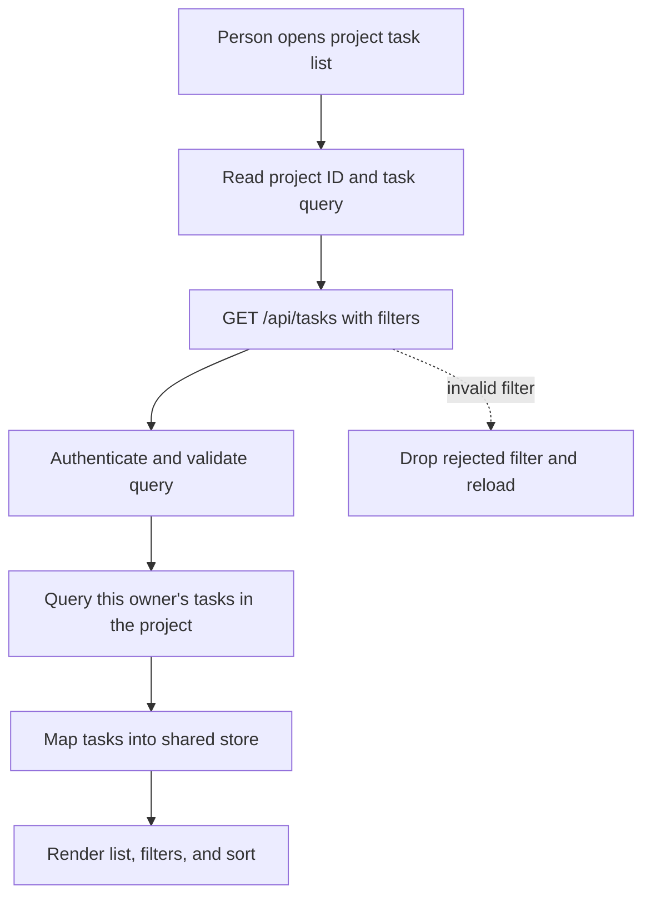

# 01. View, Filter, and Sort Tasks

## In simple terms

The person opens a project's task list. HabitFlow loads that project's tasks, then applies status, label, priority, date, repeat, and sort choices. The query stays in the page state, while the API limits returned tasks to the signed-in owner and selected project.

## Flowchart



## Data flow walkthrough

Each numbered item describes one file. Comments explain the path from URL/filter controls to the database query.

### 1. `frontend/src/app/features/tasks/task-crud/task-list/task-list.ts`

```ts
// When project or query state changes, build the API filter and reload the list.
this.query.changes$.pipe(takeUntilDestroyed()).subscribe(() => {
  if (!this.projectMissing()) this.load();
});

protected setSort({ value, direction }: SortChange): void {
  // Store the chosen sort in the query state so the UI and list stay aligned.
  this.changeQuery({ orderBy: taskSortField(value), orderDirection: direction });
}
```

### 2. `frontend/src/app/features/tasks/task-crud/services/task.service.ts`

```ts
list(filter: TaskListFilter = {}): Observable<Task[]> {
  let params = new HttpParams();
  if (filter.projectId !== undefined) params = params.set('projectId', filter.projectId);
  params = params.set('status', filter.status ?? 'all').set('pageSize', MAX_PAGE_SIZE);
  // Add priority, labels, dates, recurrence, and order as API query parameters.
  params = appendTaskFilters(params, filter);
  if (filter.orderBy) params = params.set('orderBy', filter.orderBy);
  if (filter.orderDirection) params = params.set('orderDirection', filter.orderDirection);
  return this.http.get<ApiTask[]>(this.baseUrl, { params }).pipe(map((tasks) => tasks.map(toTask)));
}
```

### 3. `backend/src/features/tasks/task-crud/task-crud.routes.ts`

```ts
router.get(
  '/',
  // This parent router already requires an authenticated session.
  validateRequest(listTasksQueryValidator, 'query', 'Invalid task filters'),
  controller.list
);
```

### 4. `backend/src/features/tasks/task-crud/validators/list-tasks-query.validator.ts`

```ts
// Parse supported list filters and reject unknown query fields.
export const listTasksQueryValidator = z
  .object({
    projectId: z.coerce.number().int().positive().optional(),
    status: z.enum(['all', 'active', 'completed']).default('all'),
    page: z.coerce.number().int().positive().default(1),
    pageSize: z.coerce.number().int().positive().max(100).default(20),
    // Reuse the supported filter/order rules and their cross-field checks.
    ...taskFilterValidator.shape,
    ...taskOrderValidator.shape,
  })
  .strict()
  .superRefine(validateTaskFilterCombinations);
```

### 5. `backend/src/features/tasks/task-crud/task-crud.service.ts`

```ts
async list(userId: string, filters: ListTasksFilters) {
  // The verified user ID scopes the query; returned records are mapped to API models.
  const tasks = await this.dependencies.findOwnedTasks(userId, filters);
  return tasks.map(toTaskModel);
}
```

### 6. `backend/src/features/tasks/task-crud/db/queries/list-tasks.query.ts`

```ts
return {
  // Never return another user's tasks or soft-deleted tasks.
  userId,
  deletedAt: null,
  ...(filters.projectId !== undefined ? { projectId: filters.projectId } : {}),
  ...(filters.status === 'active' ? { isDone: false } : {}),
  ...(filters.status === 'completed' ? { isDone: true } : {}),
  archivedAt: filters.isArchived ? { not: null } : null,
  AND: and, // The `and` list contains date, label, priority, repeat, and overdue filters.
};
```

See [tests.md](tests.md) for list, filters, sort, and ownership coverage.
