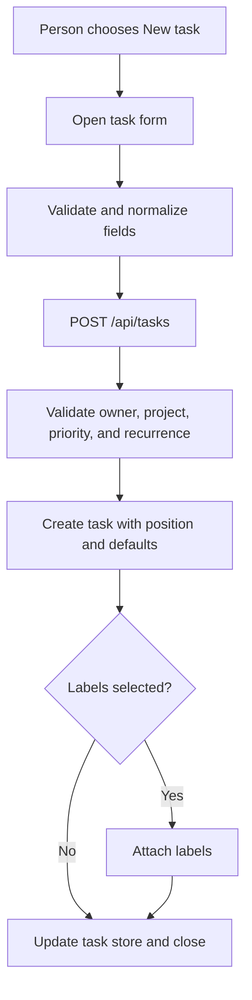

# 02. Create a Task

**Version:** 1.0.0  
**Created:** 2026-09-24  
**Last Updated:** 2026-11-25

## In simple terms

The person opens the New task dialog from a project list, enters a title, and may choose details such as priority, labels, dates, recurrence, or another project. HabitFlow creates the task for that person, defaults it to the Inbox when no project is selected, then attaches selected labels.

## Flowchart



## Data flow walkthrough

Each numbered item describes one file. Comments explain task creation and optional label attachment.

### 1. `frontend/src/app/features/tasks/task-crud/task-form/task-form.ts`

```ts
private create(): void {
  const request = this.values();
  const labelIds = this.form.controls.labelIds.value;
  this.submitting.set(true);
  // Create the task first, then attach any selected labels to its new ID.
  this.tasks.create(request).pipe(
    switchMap((task) => labelIds.length
      ? this.labelsApi.syncTaskLabels(task.taskId, [], labelIds).pipe(map((labels) => ({ ...task, labels })))
      : of(task)),
    finalize(() => this.submitting.set(false)),
  ).subscribe({ next: (task) => this.created.emit(task) });
}
```

### 2. `frontend/src/app/features/tasks/task-crud/services/task.service.ts`

```ts
create(request: CreateTaskRequest): Observable<Task> {
  // Map frontend fields and submit them to the task API.
  return this.http.post<ApiTask>(this.baseUrl, toCreateTaskBody(request, this.legacyPriority)).pipe(
    map(toTask),
    tap((task) => this.store.upsert(task)),
  );
}
```

### 3. `backend/src/features/tasks/task-crud/task-crud.routes.ts`

```ts
router.post(
  '/',
  // The parent task router authenticates all task endpoints before this route.
  validateRequest(createTaskValidator, 'body', 'Invalid task details'),
  controller.create
);
```

### 4. `backend/src/features/tasks/task-crud/task-crud.controller.ts`

```ts
const task = await service.create(
  // Use the signed-in account as owner; don't trust a client-supplied owner ID.
  req.auth!.userId,
  res.locals.validated as CreateTaskInput
);
res.status(201).json(task);
```

### 5. `backend/src/features/tasks/task-crud/task-crud.service.ts`

```ts
async create(userId: string, input: CreateTaskInput) {
  // Resolve a requested project or use this user's Inbox by default.
  const projectId = await this.resolveProjectId(userId, input.projectId);
  return toTaskModel(await this.dependencies.createTask(userId, { ...input, projectId }));
}
```

### 6. `backend/src/features/tasks/task-crud/db/queries/create-task.query.ts`

```ts
// Resolve a user-owned priority before starting the insert transaction.
const priorityLevel = await resolveUserPriorityLevel(userId, input);
if (!priorityLevel) {
  if (input.priority !== undefined || input.priorityId !== undefined) {
    throw new InvalidTaskPriorityError();
  }
  throw new Error('Default priority is not configured for this user');
}

return prisma.$transaction(async (transaction) => {
  // Allocate the next position and create the task with its resolved priority/date fields.
  const position = await getNextTaskPosition(
    transaction,
    userId,
    input.projectId ?? null
  );
  return transaction.task.create({
    data: {
      userId,
      title: input.title,
      projectId: input.projectId ?? null,
      position,
      priorityId: priorityLevel.id,
      isDone: input.isDone ?? false,
      boardStatus: input.isDone ? 'done' : 'todo',
      ...toRecurrenceData({
        recurrence: input.recurrence ?? 'none',
        recurrenceDays: input.recurrenceDays,
      }),
    },
    include: { priorityLevel: true, taskLabels: { include: { label: true } } },
  });
});
```

See [tests.md](tests.md) for create, validation, defaults, and ownership coverage.
