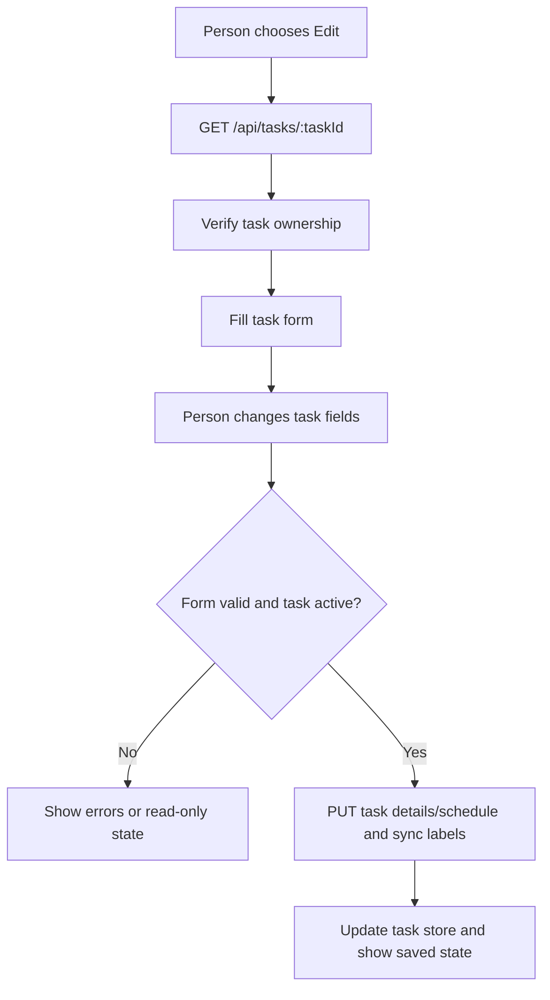

# 03. Edit a Task

## In simple terms

The person opens Edit from a task row. HabitFlow loads the task, compares the form with the saved task, and sends only changed details. Details, schedule, and label changes are saved through their respective endpoints. Archived tasks are read-only until restored.

## Flowchart



## Data flow walkthrough

Each numbered item describes one file. Comments explain the shared edit form and update requests.

### 1. `frontend/src/app/features/tasks/task-crud/components/task-item/task-item.ts`

```ts
// Route to this task's edit form using its project and task IDs.
<a class="action edit" [routerLink]="['/projects', task().projectId, 'tasks', task().taskId, 'edit']">
  Edit
</a>
```

### 2. `frontend/src/app/features/tasks/task-crud/task-form/task-form.ts`

```ts
private changes(): TaskChanges {
  const task = this.task();
  const changes: TaskChanges = { details: {}, schedule: {} };
  if (!task) return changes;
  const values = this.values();
  // Put title, description, priority, and project changes in the detail patch.
  if (values.title !== task.title) changes.details.title = values.title;
  if (values.description !== task.description) changes.details.description = values.description;
  if (values.priorityId !== task.priorityId) changes.details.priorityId = values.priorityId;
  if (values.projectId !== task.projectId) changes.details.projectId = values.projectId;
  return changes;
}
```

### 3. `frontend/src/app/features/tasks/task-crud/task-form/task-form.ts`

```ts
private update(): void {
  const task = this.task();
  if (!task || !this.canSave()) return;
  const labelIds = this.form.controls.labelIds.value;
  const syncLabels = this.labelsChanged()
    ? this.labelsApi.syncTaskLabels(
        task.taskId,
        task.labels.map((label) => label.labelId),
        labelIds,
      )
    : of(task.labels);

  // Save changed details/schedule, then sync labels if their selection changed.
  this.tasks.save(task.taskId, this.changes()).pipe(
    switchMap(() =>
      syncLabels.pipe(tap((labels) => this.tasksStore.patch(task.taskId, { labels }))),
    ),
  ).subscribe({ next: () => this.saved.set('Changes saved.') });
}
```

### 4. `frontend/src/app/features/tasks/task-crud/services/task.service.ts`

```ts
update(taskId: number, changes: UpdateTaskRequest): Observable<UpdateTaskResponse> {
  // Send only changed task details and update the local store on success.
  return this.http
    .put<UpdateTaskResponse>(
      `${this.baseUrl}/${taskId}`,
      toUpdateTaskBody(changes, this.legacyPriority),
    )
    .pipe(
      tap(() => {
        this.store.patch(taskId, changes);
        if (changes.completedAt !== undefined) {
          this.completed.next({ taskId, completedAt: changes.completedAt });
        }
      }),
    );
}
```

### 5. `backend/src/features/tasks/task-crud/task-crud.routes.ts`

```ts
router.put(
  '/:taskId',
  // Validate ID, load an owned task, then validate the editable fields.
  validateTaskId,
  requireOwnedTask,
  validateRequest(updateTaskValidator, 'body', 'Invalid task update'),
  controller.update
);
```

### 6. `backend/src/features/tasks/task-crud/task-crud.service.ts`

```ts
async update(task: TaskRecord, userId: string, input: UpdateTaskInput) {
  // Archived tasks cannot be edited until restored.
  if (task.archivedAt !== null) throw new TaskArchivedError();
  const updated = await this.dependencies.updateOwnedTask(task.id, userId, input);
  if (!updated) throw new TaskNotFoundError();
  return toTaskModel(updated);
}
```

### 7. `backend/src/features/tasks/task-crud/db/queries/update-task.query.ts`

```ts
// Update only supplied fields in a transaction; the query also handles completion state and position.
const result = await transaction.task.updateMany({
  where: { id: taskId, userId, deletedAt: null, archivedAt: null },
  data: {
    ...(input.title !== undefined ? { title: input.title } : {}),
    ...(input.description !== undefined
      ? { description: input.description }
      : {}),
  },
});
```

See [tests.md](tests.md) for edit-field validation, persistence, and archived-task protection.
