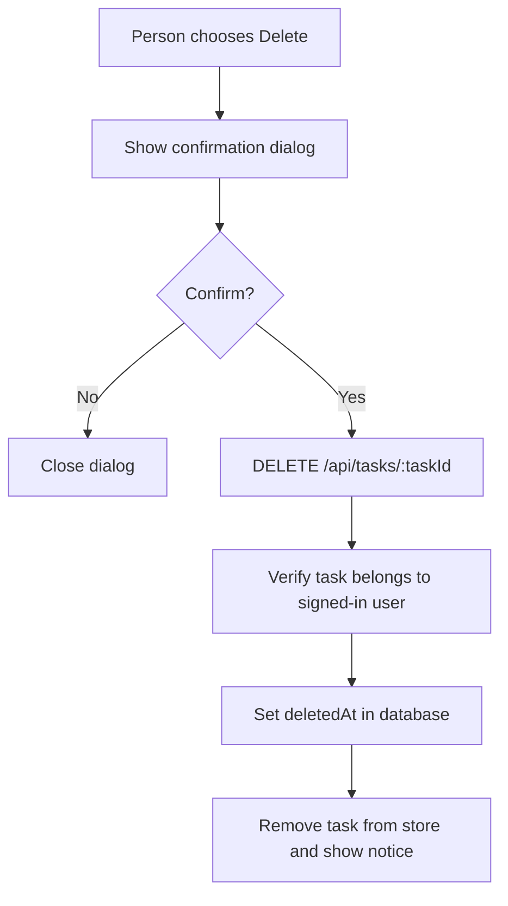

# 04. Delete a Task

## In simple terms

The person chooses Delete on a task and confirms. HabitFlow removes the task from active lists by recording a soft-delete timestamp. If the task is already gone, the page closes the dialog and reloads the list.

## Flowchart



## Data flow walkthrough

Each numbered item describes one file. Comments explain the confirm, request, and soft-delete path.

### 1. `frontend/src/app/features/tasks/task-crud/task-list/task-list.ts`

```ts
protected confirmDelete(): void {
  const task = this.pendingDelete();
  if (!task || this.deleting()) return;
  this.deleting.set(true);
  // Send the delete only after confirmation and show success/error feedback.
  this.tasks.delete(task.taskId).subscribe({
    next: () => {
      this.pendingDelete.set(null);
      this.notice.set(`“${task.title}” was deleted.`);
    },
  });
}
```

### 2. `frontend/src/app/features/tasks/task-crud/services/task.service.ts`

```ts
delete(taskId: number): Observable<DeleteTaskResponse> {
  // Send DELETE and remove the task from shared state when it succeeds.
  return this.http.delete<DeleteTaskResponse>(`${this.baseUrl}/${taskId}`)
    .pipe(tap(() => this.store.remove(taskId)));
}
```

### 3. `backend/src/features/tasks/task-crud/task-crud.routes.ts`

```ts
router.delete(
  '/:taskId',
  // Validate the ID and load only a task owned by this user.
  validateTaskId,
  requireOwnedTask,
  controller.delete
);
```

### 4. `backend/src/features/tasks/task-crud/task-crud.controller.ts`

```ts
await service.delete(res.locals.ownedTask as TaskRecord, req.auth!.userId);
// Return the API success message after the database operation completes.
res.status(200).json({ message: 'Task deleted successfully' });
```

### 5. `backend/src/features/tasks/task-crud/task-crud.service.ts`

```ts
async delete(task: TaskRecord, userId: string): Promise<void> {
  // Delegate deletion using both task ID and owner ID.
  const deleted = await this.dependencies.deleteOwnedTask(task.id, userId);
  if (!deleted) throw new TaskNotFoundError();
}
```

### 6. `backend/src/features/tasks/task-crud/db/queries/soft-delete-task.query.ts`

```ts
const result = await prisma.task.updateMany({
  // Keep the row for history but exclude it from normal task queries.
  where: { id: taskId, userId, deletedAt: null },
  data: { deletedAt: new Date() },
});
return result.count > 0;
```

See [tests.md](tests.md) for confirmation and soft-delete coverage.
