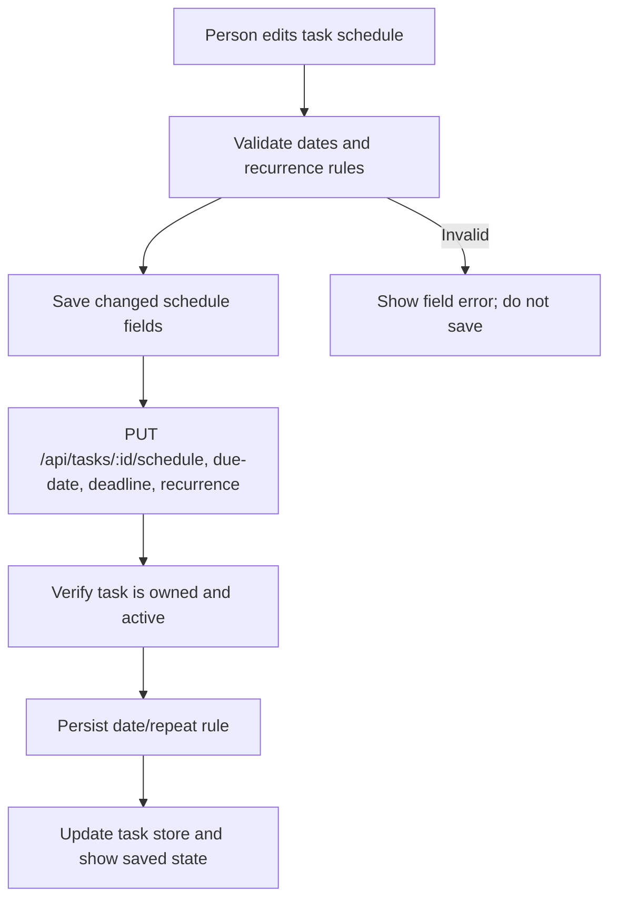

# 05. Schedule and Repeat a Task

**Version:** 1.0.0  
**Created:** 2026-09-24  
**Last Updated:** 2026-11-25

## In simple terms

The task form lets a person set a scheduled day, due date, deadline, and repeat rule. Dates are normalized using the signed-in person's timezone. A deadline cannot be earlier than the due date, and recurrence requires a due date. Empty date fields clear the saved value.

## Flowchart



## Data flow walkthrough

Each numbered item describes one file. Comments explain form normalization and the scheduling API.

### 1. `frontend/src/app/features/tasks/task-crud/task-form/task-form.ts`

```ts
// Normalize date inputs before they are sent to the API.
return {
  scheduledDate: scheduledDate || null,
  dueDate: dueDate || null,
  deadline: deadline ? deadlineToInstant(deadline, this.timeZone()) : null,
  recurrence,
  // Weekly days and end date are sent only when the chosen repeat rule uses them.
  recurrenceDays: recurrence === 'weekly' ? recurrenceDays : [],
  recurrenceEndDate:
    recurrence !== 'none' && recurrenceEnds === 'date'
      ? recurrenceEndDate || null
      : null,
};
```

### 2. `frontend/src/app/features/tasks/task-crud/services/task.service.ts`

```ts
save(taskId: number, { details, schedule }: TaskChanges): Observable<void> {
  const requests: Observable<unknown>[] = [];
  if (Object.keys(details).length) requests.push(this.update(taskId, details));
  // Delegate schedule fields to the scheduling service after detail changes.
  if (Object.keys(schedule).length) requests.push(this.scheduling.save(taskId, schedule));
  if (!requests.length) return of(undefined);
  return concat(...requests).pipe(last(), map(() => undefined));
}
```

### 3. `frontend/src/app/features/tasks/task-scheduling/services/task-scheduling.service.ts`

```ts
// Save changed schedule fields in sequence; a failed request stops later saves.
const {
  scheduledDate,
  dueDate,
  deadline,
  recurrence,
  recurrenceDays,
  recurrenceEndDate,
} = changes;
if (scheduledDate !== undefined)
  requests.push(this.setScheduledDate(taskId, scheduledDate));
if (dueDate !== undefined) requests.push(this.setDueDate(taskId, dueDate));
if (deadline !== undefined) requests.push(this.setDeadline(taskId, deadline));
if (recurrence !== undefined) {
  requests.push(
    this.setRecurrence(taskId, recurrence, {
      ...(recurrenceDays === undefined ? {} : { recurrenceDays }),
      ...(recurrenceEndDate === undefined ? {} : { recurrenceEndDate }),
    })
  );
}
```

### 4. `backend/src/features/tasks/task-scheduling/task-scheduling.routes.ts`

```ts
router.put(
  '/:taskId/due-date',
  requireAuth(sessionService),
  validateTaskId,
  requireOwnedTask,
  validateRequest(taskDueDateValidator, 'body', 'Invalid due date'),
  controller.setDueDate
);
router.put(
  '/:taskId/recurrence',
  requireAuth(sessionService),
  validateTaskId,
  requireOwnedTask,
  validateRequest(recurrenceRuleValidator, 'body', 'Invalid recurrence rule'),
  controller.setRecurrence
);
```

### 5. `backend/src/features/tasks/task-scheduling/task-scheduling.service.ts`

```ts
setDeadline(task: TaskRecord, userId: string, deadline: string | null) {
  // Reject changes on archived tasks and deadlines earlier than the due date.
  this.assertTaskActive(task);
  if (deadline && task.dueDate && new Date(deadline).getTime() < task.dueDate.getTime()) {
    throw new InvalidTaskDeadlineError();
  }
  // Persist the deadline for this owned task and return the updated task.
  return this.dependencies.updateTaskSchedule(task.id, userId, { deadline });
}
```

### 6. `backend/src/features/tasks/task-scheduling/db/queries/update-task-schedule.query.ts`

```ts
// Update only a live, non-archived task and convert empty dates to database nulls.
const result = await prisma.task.updateMany({
  where: { id: taskId, userId, deletedAt: null, archivedAt: null },
  data: {
    ...(input.dueDate !== undefined
      ? {
          dueDate: input.dueDate
            ? new Date(`${input.dueDate}T00:00:00.000Z`)
            : null,
        }
      : {}),
    // Convert recurring rule fields through the shared recurrence-data mapper.
    ...toRecurrenceData(input),
  },
});
```

See [tests.md](tests.md) for date, deadline, recurrence, and time-zone coverage.
