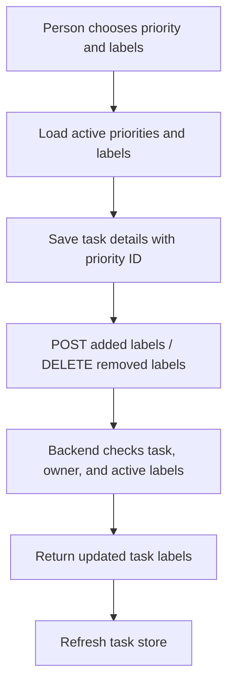

# 06. Set a Task Priority and Labels

## In simple terms

While creating or editing a task, the person picks a priority and any labels that describe it. HabitFlow validates the priority belongs to the person and that labels are active and owned by them. Label changes are synchronized as additions/removals after task details save.

## Flowchart



## Data flow walkthrough

Each numbered item describes one file. Comments explain the task-to-priority and task-to-label connections.

### 1. `frontend/src/app/features/tasks/task-crud/task-form/task-form.ts`

```ts
// Fill priority and label controls from the task or the user's default priority.
priorityId: [this.prioritiesStore.defaultLevel().id],
labelIds: [[] as number[]],
```

### 2. `frontend/src/app/features/tasks/task-crud/services/task.service.ts`

```ts
// Convert a priority ID to the supported API representation and save task details.
update(taskId: number, changes: UpdateTaskRequest): Observable<UpdateTaskResponse> {
  return this.http.put(`${this.baseUrl}/${taskId}`, toUpdateTaskBody(changes, this.legacyPriority))
    .pipe(tap(() => this.store.patch(taskId, changes)));
}
```

### 3. `frontend/src/app/features/tasks/task-organization/services/label.service.ts`

```ts
// Add newly selected labels, remove unselected labels, then reload the attached label list.
syncTaskLabels(taskId: number, currentLabelIds: number[], desiredLabelIds: number[]) {
  const current = new Set(currentLabelIds);
  const desired = new Set(desiredLabelIds);
  const requests: Observable<unknown>[] = [];
  // Detach labels that were removed from the form.
  for (const labelId of current) {
    if (!desired.has(labelId)) {
      requests.push(this.http.delete(`${this.tasksUrl}/${taskId}/labels/${labelId}`));
    }
  }
  // Attach newly selected labels in one request.
  const additions = [...desired].filter((labelId) => !current.has(labelId));
  if (additions.length) {
    requests.push(this.http.post(`${this.tasksUrl}/${taskId}/labels`, { labelIds: additions }));
  }
  // Fetch the final task-label list after all writes complete.
  const fetchLabels = () => this.http.get<ApiLabel[]>(`${this.tasksUrl}/${taskId}/labels`)
    .pipe(map((labels) => labels.map(toTaskLabel)));
  if (!requests.length) return fetchLabels();
  return concat(...requests).pipe(ignoreElements(), endWith(null), switchMap(fetchLabels));
}
```

### 4. `backend/src/features/tasks/task-organization/task-organization.routes.ts`

```ts
router.put(
  '/:taskId/priority',
  ...base,
  // Verify a valid user priority before updating the owned task.
  validateRequest(taskPriorityValidator, 'body', 'Invalid task priority'),
  controller.setPriority
);
router.post(
  '/:taskId/labels',
  ...base,
  validateRequest(taskLabelsValidator, 'body', 'Invalid task labels'),
  controller.attachLabels
);
```

### 5. `backend/src/features/tasks/task-organization/task-organization.service.ts`

```ts
// Confirm labels are owned and not archived before linking them to this task.
const labelIds = [...new Set(requestedLabelIds)];
const ownedLabels = await this.dependencies.findOwnedLabels(labelIds, userId);
if (ownedLabels.length !== labelIds.length) throw new LabelNotFoundError();
if (ownedLabels.some((label) => label.archivedAt !== null))
  throw new LabelArchivedError();
return (
  await this.dependencies.attachTaskLabels(task.id, labelIds, userId)
).map(toLabelModel);
```

### 6. `backend/src/features/tasks/task-organization/db/queries/attach-task-labels.query.ts`

```ts
// Add links without duplicating an existing task-label pair, then return owned labels.
await prisma.taskLabel.createMany({
  data: labelIds.map((labelId) => ({ taskId, labelId })),
  skipDuplicates: true,
});
return listTaskLabels(taskId, userId);
```

See [tests.md](tests.md) for priority validation and task-label assignment coverage.
