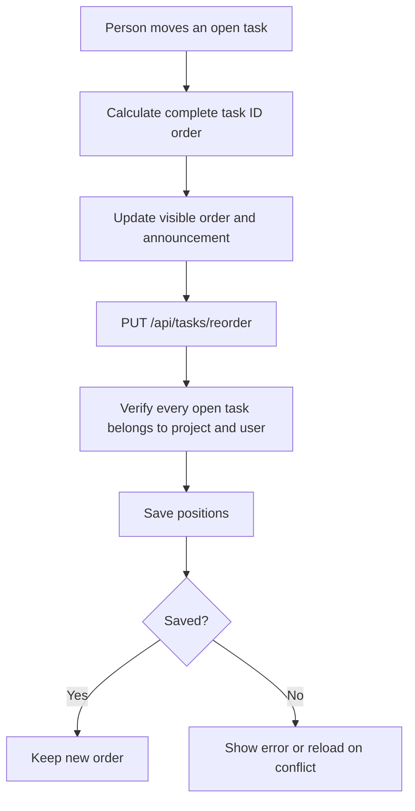

# 07. Reorder Open Tasks

## In simple terms

The person drags a task or uses the up/down controls to change its place in the open-task list. HabitFlow sends the complete open-task order for that project. If another change made the order stale, the server rejects it and the page reloads the current list.

## Flowchart



## Data flow walkthrough

Each numbered item describes one file. Comments explain the full-order request and conflict behavior.

### 1. `frontend/src/app/features/tasks/task-crud/task-list/task-list.ts`

```ts
protected moveTask(from: number, to: number): void {
  const open = this.store.open();
  // Build the full ordered ID list for open tasks in the current project.
  const taskIds = reorderTaskIds(open, from, to);
  if (!taskIds || !this.canReorder() || this.reordering()) return;
  this.reordering.set(true);
  this.tasks.reorder(this.projectId(), taskIds).subscribe({
    // A 409 means the list changed elsewhere; reload the server's current order.
    error: (error: unknown) => {
      if (error instanceof HttpErrorResponse && error.status === 409) {
        this.actionError.set('The list changed elsewhere; it has been reloaded.');
        this.load();
      } else {
        this.actionError.set(`Your new order wasn't saved. ${mapTaskError(error).message}`);
      }
    },
  });
}
```

### 2. `frontend/src/app/features/tasks/task-organization/utils/reorder-tasks.util.ts`

```ts
// Move one task and return every open task ID in the new order.
export function reorderTaskIds(
  tasks: readonly Task[],
  from: number,
  to: number
): number[] | null {
  if (!tasks.length || from === to) return null;
  const moved = moveItem(tasks, from, to);
  return moved.map((task) => task.taskId);
}
```

### 3. `frontend/src/app/features/tasks/task-crud/services/task.service.ts`

```ts
reorder(projectId: number, taskIds: number[]): Observable<void> {
  // Keep the old positions so a failed network request can be rolled back.
  const previous = taskIds.map((taskId) => [taskId, this.store.byId(taskId)?.sortOrder] as const);
  // Optimistically assign positions before saving the full order.
  taskIds.forEach((taskId, sortOrder) => this.store.patch(taskId, { sortOrder }));
  return this.http.put(`${this.baseUrl}/reorder`, { projectId, taskIds }).pipe(
    map(() => undefined),
    catchError((error: unknown) => {
      // Restore saved positions if the server rejects the reorder.
      for (const [taskId, sortOrder] of previous) {
        if (sortOrder !== undefined) this.store.patch(taskId, { sortOrder });
      }
      return throwError(() => error);
    }),
  );
}
```

### 4. `backend/src/features/tasks/task-organization/task-organization.routes.ts`

```ts
router.put(
  '/reorder',
  requireAuth(sessionService),
  // Validate project ID and all task IDs before the organization controller runs.
  validateRequest(reorderTasksValidator, 'body', 'Invalid task order'),
  controller.reorder
);
```

### 5. `backend/src/features/tasks/task-organization/task-organization.service.ts`

```ts
// Delegate the complete requested order with the authenticated owner ID.
reorder(projectId: number, taskIds: number[], userId: string) {
  return this.dependencies.updateTaskPositions(projectId, taskIds, userId);
}
```

### 6. `backend/src/features/tasks/task-organization/db/queries/update-task-positions.query.ts`

```ts
// Save the requested positions transactionally after checking project/task ownership.
return prisma.$transaction(async (transaction) => {
  // Load this owner's active tasks in the project and check that all are included.
  const currentTasks = await transaction.task.findMany({
    where: {
      projectId,
      userId,
      deletedAt: null,
      archivedAt: null,
      isDone: false,
    },
    orderBy: [{ position: 'asc' }, { createdAt: 'asc' }, { id: 'asc' }],
    select: { id: true },
  });
  const activeTaskIds = new Set(currentTasks.map(({ id }) => id));
  if (taskIds.some((taskId) => !activeTaskIds.has(taskId)))
    throw new TaskNotFoundError();
  if (taskIds.length !== currentTasks.length)
    throw new TaskReorderConflictError();
  // Recalculate positions and save them in the transaction.
  const updates = reorderTasks(taskIds);
  for (const { taskId, position } of updates) {
    await transaction.task.updateMany({
      where: {
        id: taskId,
        projectId,
        userId,
        deletedAt: null,
        archivedAt: null,
        isDone: false,
      },
      data: { position },
    });
  }
  return updates;
});
```

See [tests.md](tests.md) for stale-order, ownership, keyboard, and drag/drop coverage.
