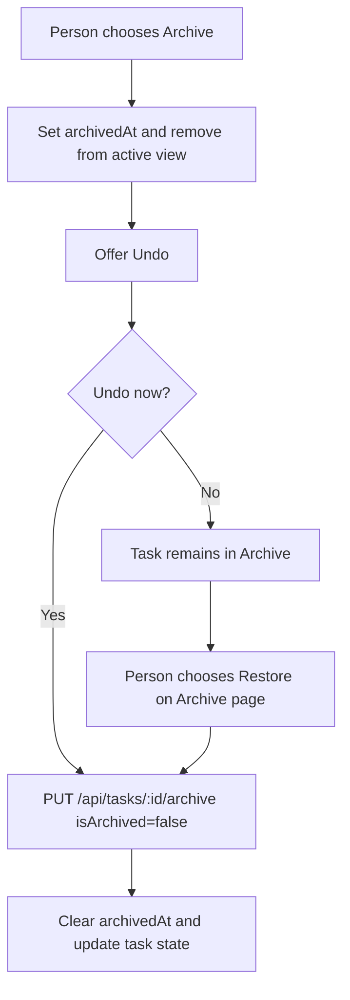

# 08. Archive or Restore a Task

## In simple terms

Archiving hides a task from active lists without deleting it. The person can undo right away or restore it later from the Archive page. Archived tasks are read-only until restored.

## Flowchart



## Data flow walkthrough

Each numbered item describes one file. Comments explain the shared archive/restore state change.

### 1. `frontend/src/app/features/tasks/task-crud/components/task-item/task-item.ts`

```ts
// Reuse the shared Archive action so tasks can be archived and undone consistently.
<app-archive-action kind="task" [itemId]="task().taskId" [name]="task().title" [hooks]="archiveHooks" />
```

### 2. `frontend/src/app/features/archive/services/archive.service.ts`

```ts
// Archive or restore an item using its type and ID; sync shared state after success.
setArchived(kind: ArchiveKind, id: number, isArchived: boolean): Observable<void> {
  return this.http.put(`${this.api}/${PATH[kind]}/${id}/archive`, { isArchived }).pipe(
    tap(() => this.synced(kind, id, isArchived)),
    map(() => undefined),
  );
}
```

### 3. `backend/src/features/tasks/task-organization/task-organization.routes.ts`

```ts
router.put(
  '/:taskId/archive',
  ...base, // Authenticate and load the owned task.
  validateRequest(setTaskArchivedValidator, 'body', 'isArchived is required'),
  controller.archive
);
```

### 4. `backend/src/features/tasks/task-organization/task-organization.service.ts`

```ts
// Persist the requested archive state for this owned task.
const updated = await this.dependencies.setTaskArchived(
  task.id,
  userId,
  isArchived
);
if (!updated) throw new TaskNotFoundError();
return {
  taskId: updated.id,
  isArchived: updated.archivedAt !== null,
  archivedAt: updated.archivedAt,
};
```

### 5. `backend/src/features/tasks/task-organization/db/queries/set-task-archived.query.ts`

```ts
// Set or clear archivedAt only when the row is in the opposite current state.
const updated = await prisma.task.updateMany({
  where: {
    id: taskId,
    userId,
    deletedAt: null,
    archivedAt: isArchived ? null : { not: null },
  },
  data: { archivedAt: isArchived ? new Date() : null },
});
```

Restoring from Archive uses the same task organization state change. See [tests.md](tests.md).
