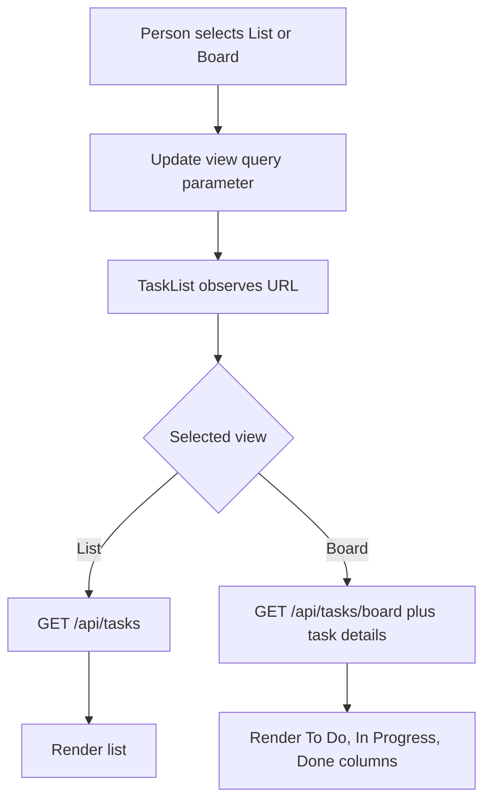

# 09. Switch Between List and Board Views

## In simple terms

The person switches between the regular task list and a three-column board. The chosen view is stored in the URL, so reload and browser Back preserve it. Both views use the same project and task filters.

## Flowchart



## Data flow walkthrough

Each numbered item describes one file. Comments explain that the URL controls which view loads.

### 1. `frontend/src/app/features/tasks/task-views/view-switcher/view-switcher.ts`

```ts
// Preserve the other query parameters while selecting a view.
protected readonly params = computed(() => ({
  list: { [this.param()]: null },
  board: { [this.param()]: 'board' },
}));
```

### 2. `frontend/src/app/features/tasks/task-crud/task-list/task-list.ts`

```ts
// Read the view from the URL and load the matching task representation.
map((params): TaskView => (params.get('view') === 'board' ? 'board' : 'list'));

protected load(): void {
  if (this.view() === 'board') {
    this.boardFilter.set(toBoardFilter(toTaskListFilter(this.query.query(), this.today())));
  } else {
    this.reloads.next();
  }
}
```

### 3. `frontend/src/app/features/tasks/task-views/board-view/services/task-board.service.ts`

```ts
load(projectId: number, filter: BoardFilter = {}): Observable<BoardState> {
  // The board endpoint supplies columns; the list endpoint supplies full card details.
  const details = this.tasks.listAll({ ...filter, projectId }).pipe(catchError(() => of<Task[]>([])));
  return forkJoin([this.get(projectId, filter), details]).pipe(
    map(([board, tasks]) => toBoardState(board, tasks)),
  );
}
```

### 4. `backend/src/features/tasks/task-board/task-board.routes.ts`

```ts
router.get(
  '/board',
  requireAuth(sessionService),
  validateRequest(boardQueryValidator, 'query', 'Invalid board filters'),
  controller.list
);
```

See [tests.md](tests.md) for route, view-switcher, and board-load coverage.
