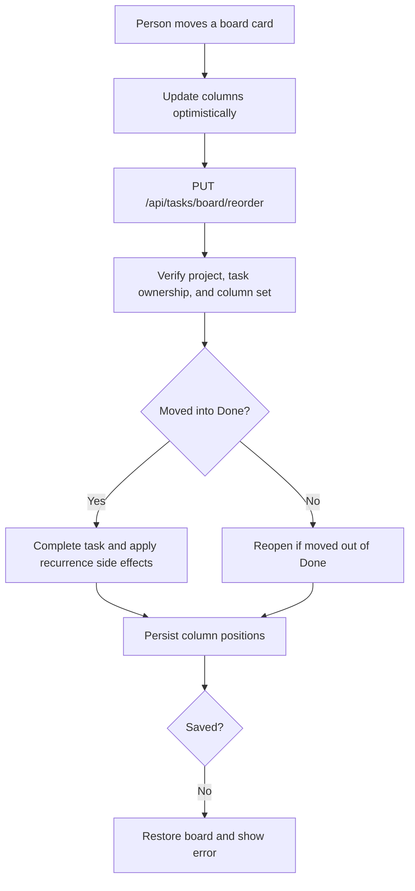

# 10. Move a Task on the Board

## In simple terms

The board shows To Do, In Progress, and Done. The person drags a card or uses its Move menu. HabitFlow updates the board immediately, then saves the entire target column order. Moving into Done completes the task; moving it out of Done reopens it and updates completion/streak behavior.

## Flowchart



## Data flow walkthrough

Each numbered item describes one file. Comments explain how card movement changes task status and order.

### 1. `frontend/src/app/features/tasks/task-views/board-view/board-view.ts`

```ts
protected move({ taskId, to, index }: BoardMove): void {
  const before = this.board();
  if (!before || this.saving()) return;
  // Move the card locally so the interface responds immediately.
  const after = moveCard(before, taskId, to, index);
  this.board.set(after);
  // Save the full target column order; failures restore or reload the board.
  this.columnOrder(this.projectId(), to, after, taskId)
    .pipe(switchMap((taskIds) => this.api.reorder(this.projectId(), to, taskIds)))
    .subscribe({ next: () => this.moved(card, from.column, to), error: (error) => this.moveFailed(error, card, before, after) });
}
```

### 2. `frontend/src/app/features/tasks/task-views/board-view/services/task-board.service.ts`

```ts
reorder(projectId: number, column: BoardColumnKey, taskIds: number[]) {
  // Translate the visual column name into the API board status.
  const body: BoardReorderBody = { projectId, boardStatus: toApiStatus(column), tasks: taskIds };
  return this.http.put<BoardReorderBody>(`${this.baseUrl}/reorder`, body);
}
```

### 3. `backend/src/features/tasks/task-board/task-board.routes.ts`

```ts
router.put(
  '/board/reorder',
  requireAuth(sessionService),
  validateRequest(
    boardReorderValidator,
    'body',
    'Invalid board reorder request'
  ),
  controller.reorder
);
```

### 4. `backend/src/features/tasks/task-board/task-board.service.ts`

```ts
async move(userId: string, input: BoardReorderInput) {
  // Only an active project owned by this user can have its board changed.
  await this.requireActiveProject(input.projectId, userId);
  return this.dependencies.moveBoardTask(userId, input);
}
```

### 5. `backend/src/features/tasks/task-board/db/queries/move-board-task.query.ts`

```ts
// Within a serializable transaction, verify cards are owned and belong to this project.
const requestedTasks = await transaction.task.findMany({
  where: { id: { in: input.tasks }, userId },
  select: {
    id: true,
    projectId: true,
    boardStatus: true,
    isDone: true,
    position: true,
  },
});
// Moving to/from Done updates isDone (and completion side effects) before positions persist.
if (movedTask && movedTask.isDone !== (input.boardStatus === 'done')) {
  await updateTask(
    movedTask.id,
    userId,
    { isDone: input.boardStatus === 'done' },
    transaction
  );
}
```

See [tests.md](tests.md) for board movement, completion, recurrence, and conflict coverage.
