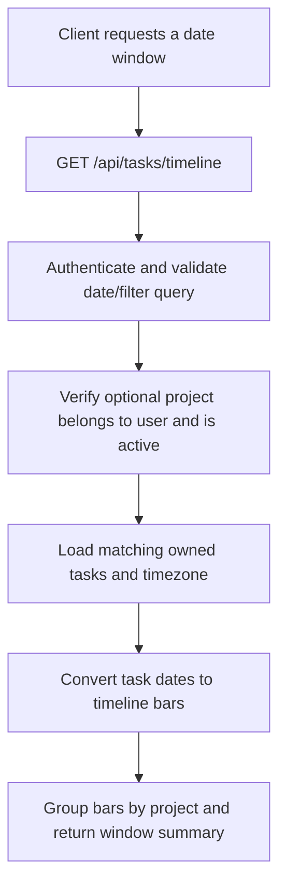

# 11. View the Task Timeline

## In simple terms

The authenticated timeline endpoint returns tasks as project-grouped bars between requested dates. It can include completed tasks or filter to a project/task state. The repository currently has no dedicated frontend timeline component, so the timeline is documented as an API capability rather than a visible Angular screen.

## Flowchart



## Data flow walkthrough

Each numbered item describes one file. Comments explain timeline validation, ownership, and result grouping.

### 1. `backend/src/features/tasks/task-timeline/task-timeline.routes.ts`

```ts
router.get(
  '/timeline',
  requireAuth(sessionService),
  validateRequest(
    timelineQueryValidator,
    'query',
    'Invalid timeline parameters'
  ),
  async (req, res, next) => {
    // If a project filter is supplied, ensure it is owned and active.
    const { projectId } = res.locals.validated;
    if (projectId !== undefined) {
      const project = await findOwnedProject(projectId, req.auth!.userId);
      if (!project || project.isArchived) {
        res
          .status(404)
          .json({ error: 'Project not found', code: 'project-not-found' });
        return;
      }
    }
    next();
  },
  controller.list
);
```

### 2. `backend/src/features/tasks/task-timeline/validators/timeline-query.validator.ts`

```ts
// Require calendar dates, a bounded window, and supported task filters.
export const timelineQueryValidator = z
  .object({
    from: calendarDate,
    to: calendarDate,
    projectId: z.coerce.number().int().positive().optional(),
    includeCompleted: z
      .enum(['true', 'false'])
      .transform((value) => value === 'true')
      .default(false),
    status: z.enum(['all', 'active', 'completed']).default('all'),
    ...taskFilterValidator.shape,
  })
  .strict()
  .superRefine((query, context) => {
    validateTaskFilterCombinations(query, context);
    // The range is limited so a request cannot ask for an unbounded timeline.
    if (
      (Date.parse(`${query.to}T00:00:00.000Z`) -
        Date.parse(`${query.from}T00:00:00.000Z`)) /
        86_400_000 +
        1 >
      92
    ) {
      context.addIssue({
        code: 'custom',
        path: ['to'],
        message: 'Date range must not exceed 92 calendar days',
      });
    }
  });
```

### 3. `backend/src/features/tasks/task-timeline/task-timeline.controller.ts`

```ts
// The signed-in owner ID is passed to the timeline service with parsed query values.
const result = await service.list(
  req.auth!.userId,
  res.locals.validated as TimelineQuery
);
res.status(200).json(result);
```

### 4. `backend/src/features/tasks/task-timeline/task-timeline.service.ts`

```ts
// Convert task records to bars and keep only those crossing the requested window.
const bars = tasks.flatMap((task) => {
  const bar = toTimelineTaskModel(task, timeZone, today);
  return bar && bar.start <= query.to && bar.end >= query.from ? [bar] : [];
});
// Group visible bars by project and include the undated-task count.
return {
  from: query.from,
  to: query.to,
  projects: [...groups.values()],
  undatedCount,
};
```

### 5. `backend/src/features/tasks/task-timeline/db/queries/list-timeline-tasks.query.ts`

```ts
// Read the owner's timezone so date-only fields become local calendar dates.
const user = await prisma.user.findUnique({
  where: { id: userId },
  select: { timezone: true },
});
const timeZone = user?.timezone ?? 'UTC';
const today = getDateWindow(timeZone, 0).startDate;
// Apply owner, archive, date-window, and query filters before loading timeline fields.
const tasks = await prisma.task.findMany({
  where: buildTimelineTasksWhere(query, userId, today),
  orderBy: [
    { scheduledDate: { sort: 'asc', nulls: 'last' } },
    { dueDate: 'asc' },
    { id: 'asc' },
  ],
  select: {
    id: true,
    title: true,
    projectId: true,
    scheduledDate: true,
    dueDate: true,
    deadline: true,
  },
});
return { tasks, timeZone, today };
```

See [tests.md](tests.md) for API, date-window, and query coverage.
